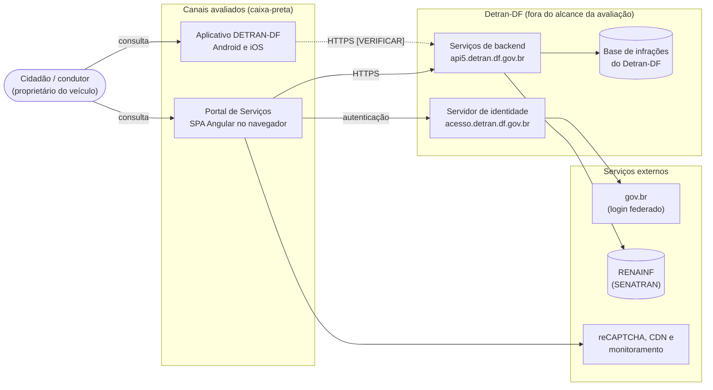
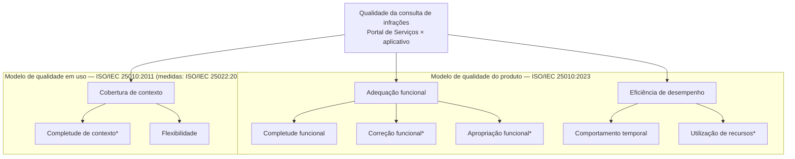

# Fase 1 — Descrição do Produto e Modelo de Qualidade

**Projeto Final FGA0315 Qualidade de Software 1 (UnB/FGA, 2026/2)**  
*Avaliação da consulta de infrações do Detran-DF: Portal de Serviços × aplicativo*  
*Responsável: Hugo Freitas Silva*  
*Data do levantamento: 18/10/2026*

---

## 1. Levantamento dos canais

### 1.1 Método do levantamento

O levantamento usou apenas informações acessíveis a qualquer cidadão, sem credenciais e sem acesso à infraestrutura do Detran-DF:

1. **Acesso público ao Portal de Serviços** em navegador desktop (Google Chrome, Linux), em 18/10/2026, com captura das telas públicas (ver Seção 1.6).
2. **Páginas oficiais do aplicativo** na Google Play e na App Store, e consulta à interface pública de busca da App Store (iTunes Lookup), em 18/10/2026.
3. **Inspeção do código cliente público do portal**, isto é, os arquivos que o próprio navegador baixa ao abrir a página e que qualquer usuário pode ver nas ferramentas de desenvolvedor. Essa inspeção não dá acesso ao código do servidor e serviu só para identificar rótulos de tela, rotas e serviços externos.

Itens que dependem de login com um veículo real ou de um aparelho com o aplicativo instalado estão marcados com **[VERIFICAR]** e serão confirmados na sessão de levantamento com a massa de dados (ver `dados/massa-de-dados.md`).

### 1.2 Identificação dos canais

| Item | Portal de Serviços | Aplicativo |
|---|---|---|
| Nome oficial | "Detran Digital", apresentado como "Portal de Serviços do Departamento de Trânsito do Distrito Federal (Detran/DF)" | "DETRAN-DF" nas duas lojas; a descrição na Google Play o chama de "DETRAN DIGITAL" |
| Endereço / identificador | <https://portal.detran.df.gov.br> | Android: `br.com.mesotec.detrandf` · iOS: `id1526746296` |
| Publicador | Detran-DF | App Store: "Departamento de Trânsito do Distrito Federal". Google Play: [VERIFICAR nome do desenvolvedor exibido] |
| Versão avaliada | Não há número de versão público; o pacote principal carregado em 18/10/2026 é `main-es2017.638a2c0c922c0af94e51.js` | 2.6.9 no iOS (publicada em 13/10/2026) e na Google Play (atualizada em 09/10/2026) [VERIFICAR versão instalada no aparelho de teste] |
| Primeira publicação | — | App Store: 17/08/2020 · Google Play: 14/08/2020 |
| Plataformas | Navegador em desktop e em celular | Android e iOS |
| Requisito mínimo | Não declarado [VERIFICAR navegadores suportados] | iOS 15.1 ou superior · Android: [VERIFICAR na página da Google Play, seção "Sobre este app"] |
| Tamanho do pacote | — | 41,5 MB no iOS |
| Instalações | — | Mais de 1 milhão na Google Play |
| Autenticação | CPF/CNPJ e senha, com reCAPTCHA, ou botão "Entrar com gov.br" | [VERIFICAR: conta própria do Detran-DF, gov.br ou ambas] |
| A consulta exige login? | Sim. As telas de infrações do veículo ficam na área logada e listam só os veículos vinculados ao CPF do usuário ("Veículos atuais de minha propriedade"). Há também a opção "Consultar veículo de outra UF". Não foi encontrada consulta de infrações por placa + RENAVAM sem login [VERIFICAR] | [VERIFICAR] |

### 1.3 Passos da consulta

Sequência provável no portal, deduzida das telas públicas e das rotas do código cliente. Deve ser refeita com um veículo real, contando cada tela e cada ação.

| # | Portal de Serviços | Aplicativo |
|---|---|---|
| 1 | Abrir <https://portal.detran.df.gov.br> | Abrir o aplicativo [VERIFICAR] |
| 2 | "Fazer login" e autenticar (CPF/CNPJ + senha + reCAPTCHA, ou gov.br) | Autenticar [VERIFICAR] |
| 3 | Menu "Infração" | [VERIFICAR] |
| 4 | Opção de histórico de infrações por veículo [VERIFICAR nome exato no menu] | [VERIFICAR] |
| 5 | Selecionar o veículo na lista "Veículos atuais de minha propriedade" | [VERIFICAR] |
| 6 | Ver a lista de infrações e escolher uma ("Selecione a multa desejada") | [VERIFICAR] |
| 7 | Ver a tela "Detalhes da infração" | [VERIFICAR] |

### 1.4 Campos exibidos por infração

A tela de detalhes do portal prevê os rótulos abaixo (extraídos do código cliente). Um rótulo previsto não garante que o dado apareça preenchido; a presença efetiva será conferida com veículo real. A coluna do aplicativo será preenchida no mesmo levantamento.

| Grupo | Rótulos previstos no portal | Aplicativo |
|---|---|---|
| Veículo | Placa · UF · Marca/Modelo | [VERIFICAR] |
| Identificação da infração | Infração · Descrição da Infração · Regulamento · Natureza · Auto Infração · Código Renainf · Órgão Autuador · Responsável pela Infração | [VERIFICAR] |
| Ocorrência | Data Infração · Hora Infração · Local da Infração · Velocidade Permitida · Velocidade Aferida | [VERIFICAR] |
| Prazos | Data da Notif. de Autuação · Data da Notif. de Penalidade · Data da Defesa Prévia · Identificação do Condutor Infrator · Data de Vencimento | [VERIFICAR] |
| Valores | Valor da Multa · Valor Correção · Valor Desconto · Valor Devido | [VERIFICAR] |
| Situação | Pontuação Infração/Status · Situação Pagamento · Situação Multa | [VERIFICAR] |

O campo "Código Renainf" traz a dica "Origem: RENAINF", o que indica que parte dos dados vem do Registro Nacional de Infrações de Trânsito, e não só da base do Detran-DF.

### 1.5 Lista de referência de campos (insumo para a questão Q1.1)

Para julgar a completude funcional sem depender de um dos canais como padrão, propõe-se uma lista de referência externa. Ela parte do conteúdo obrigatório do auto de infração (art. 280 do Código de Trânsito Brasileiro, Lei nº 9.503/1997) e acrescenta as informações de que o cidadão precisa para decidir o que fazer com a multa (pagar, recorrer, indicar condutor). Os textos legais foram conferidos no Planalto em 18/10/2026.

| ID | Campo de referência | Fundamento | Rótulo correspondente no portal |
|---|---|---|---|
| R01 | Tipificação da infração (código e descrição) | CTB, art. 280, I | Infração · Descrição da Infração |
| R02 | Enquadramento legal | Complementa o art. 280, I | Regulamento |
| R03 | Local da infração | CTB, art. 280, II | Local da Infração |
| R04 | Data da infração | CTB, art. 280, II | Data Infração |
| R05 | Hora da infração | CTB, art. 280, II | Hora Infração |
| R06 | Placa do veículo | CTB, art. 280, III | Placa |
| R07 | Marca/modelo do veículo | CTB, art. 280, III | Marca/Modelo |
| R08 | Órgão autuador | CTB, art. 280, V | Órgão Autuador |
| R09 | Número do auto de infração | Identifica a autuação em pagamento, defesa e recurso | Auto Infração |
| R10 | Natureza (gravidade) | CTB, art. 258 | Natureza |
| R11 | Pontuação | CTB, art. 259 | Pontuação Infração/Status |
| R12 | Valor da multa | CTB, art. 258 | Valor da Multa · Valor Devido |
| R13 | Data de vencimento | Necessária para pagar no prazo | Data de Vencimento |
| R14 | Prazo de defesa prévia ou de indicação do condutor | Necessário para exercer a defesa | Data da Defesa Prévia · Identificação do Condutor Infrator |
| R15 | Situação da infração | Indica se ainda há algo a fazer | Situação Pagamento · Situação Multa |

Ficam fora da lista os incisos IV (prontuário do condutor) e VI (assinatura do infrator) do art. 280, porque são dados pessoais que não fazem parte da consulta pelo proprietário. Velocidade permitida e aferida só se aplicam a infrações de velocidade e entram como campos condicionais, não na contagem geral. A definição da métrica e dos níveis cabe ao Philipe.

### 1.6 Evidências

| Arquivo | Conteúdo | Dados pessoais |
|---|---|---|
| `evidencias/fase1/portal-pagina-inicial-2026-10-18.png` | Página inicial pública do Portal de Serviços, com o nome oficial e o menu "Infração" | Nenhum (imagem ilustrativa do próprio portal) |
| `evidencias/fase1/portal-login-2026-10-18.png` | Tela de login: CPF/CNPJ, senha, reCAPTCHA e "Entrar com gov.br" | Nenhum (campos vazios) |

Prints pendentes, a fazer com veículo real e com tarja em placa, RENAVAM, CPF, nome, endereço e número do auto antes de entrar no repositório: lista de veículos, lista de infrações e detalhes de uma infração, nos dois canais. As regras de anonimização estão em `evidencias/fase1/README.md`.

---

## 2. Tipo de produto e descrição estruturada

### 2.1 Classificação

A consulta de infrações é um **serviço digital governamental ao cidadão**, oferecido por um sistema de informação do Detran-DF com dois clientes:

- **Portal de Serviços:** aplicação web de página única (SPA) feita em Angular 12 com Angular Material, executada no navegador;
- **aplicativo:** cliente móvel distribuído nas lojas oficiais para Android e iOS. Não foi possível confirmar se é nativo ou híbrido [VERIFICAR: no Android, procurar `libflutter.so`, `index.android.bundle` ou uma WebView dominante no pacote instalado].

Os dois clientes não guardam as infrações: consultam serviços de backend do Detran-DF, que por sua vez reúnem dados próprios e de bases nacionais, como o RENAINF.

### 2.2 Descrição lado a lado

| Aspecto | Portal de Serviços | Aplicativo |
|---|---|---|
| Módulos usados na consulta | Autenticação; módulo "Infração" (histórico por veículo, detalhes, débitos e emissão de boleto/PIX) | [VERIFICAR] |
| Interface com o usuário | Navegador, layout responsivo para desktop e celular | Telas do aplicativo |
| Interface com o backend | API HTTPS em `api5.detran.df.gov.br` (ex.: serviço `portal/infracoes`) | [VERIFICAR: mesma API ou API própria] |
| Identidade | Servidor OpenID Connect do Detran-DF (`acesso.detran.df.gov.br`) e gov.br (`sso.acesso.gov.br`) | [VERIFICAR] |
| Dependências externas no carregamento | Google reCAPTCHA; Google Fonts; jQuery servido por `code.jquery.com`; agente de monitoramento Dynatrace | [VERIFICAR] |
| Origem dos dados | Base do Detran-DF e RENAINF (dica "Origem: RENAINF") | Presume-se a mesma [VERIFICAR] |
| Plataformas | Qualquer navegador moderno, em desktop ou celular | Android [VERIFICAR versão mínima] e iOS 15.1 ou superior |
| Restrições | Login obrigatório; reCAPTCHA no login com CPF; conexão permanente | Login [VERIFICAR]; instalação e atualização pela loja; conexão permanente [VERIFICAR comportamento sem rede] |

### 2.3 Diagrama de contexto

*Figura — Diagrama de contexto da consulta de infrações. Linha tracejada: ligação ainda não confirmada. Fonte: elaborado pela equipe a partir do levantamento de 18/10/2026.*

### 2.4 Implicações para a avaliação

Como a avaliação é caixa-preta, só se mede o que chega ao avaliador pelo canal. O diagrama separa o que está ao alcance (os dois clientes e o que trafega entre eles e a rede) do que não está (servidores e bases).

| Dá para medir | Como | Não dá para medir | Por quê |
|---|---|---|---|
| Campos exibidos e sua consistência entre canais | Comparar as telas dos dois canais para o mesmo veículo, no mesmo dia | Correção absoluta dos dados | Não há acesso à base oficial. A referência possível é o outro canal e a notificação recebida pelo proprietário |
| Passos até a lista de infrações | Contar telas e ações em roteiro fixo | Causa de um passo a mais | Exigiria conhecer o projeto interno |
| Tempo percebido até a lista aparecer | Gravação de tela e cronometragem; no portal, também DevTools | Tempo de processamento no servidor e na base | Só se vê o tempo de ponta a ponta |
| Dados transferidos | Portal: aba Rede do DevTools. Aplicativo: contador de dados por aplicativo do Android ou `adb shell dumpsys netstats` | Memória do servidor e capacidade | Exigiria teste de carga, não autorizado |
| Conclusão da consulta em cada contexto (dispositivo, sistema, navegador, rede) | Roteiro repetido em cada contexto, com rede limitada por perfil do DevTools ou do Android | Disponibilidade ao longo do tempo | Exigiria monitoramento contínuo por semanas |

Três consequências práticas para as Fases 2 e 3:

1. **Login obrigatório.** A consulta só lista veículos do CPF logado, então quem faz login é o proprietário que consentiu, no aparelho de teste. A equipe não guarda senhas (ver `dados/consentimento.md`).
2. **reCAPTCHA no login.** O tempo de login depende do avaliador; a medição de tempo deve começar depois da autenticação, a partir da escolha do menu de infrações.
3. **Ferramentas diferentes por canal.** O perfilador do Android Studio não funciona com aplicativos de loja (não depuráveis). Por isso a utilização de recursos fica restrita a dados transferidos, que têm medição equivalente nos dois canais; memória fica fora da comparação.

---

## 3. Modelo de qualidade adaptado

### 3.1 Ponto de partida

O modelo combina duas fontes da família SQuaRE:

- **modelo de qualidade do produto da ISO/IEC 25010:2023**, de onde vêm adequação funcional e eficiência de desempenho;
- **modelo de qualidade em uso da ISO/IEC 25010:2011**, de onde vem a cobertura de contexto, com medidas na ISO/IEC 25022:2016.

A segunda fonte é uma edição anterior por um motivo explícito: a ISO/IEC 25019:2023, que substituiu o modelo de qualidade em uso de 2011, removeu a cobertura de contexto. O prefácio da norma diz: "context coverage which was shown as quality characteristics in the quality-in-use model of the previous version is removed" (ISO/IEC 25019:2023, Foreword). As medidas de completude de contexto continuam na ISO/IEC 25022:2016, ainda vigente, e a própria ISO/IEC 25019:2023 prevê comparar a qualidade entre contextos de uso para encontrar lacunas (Introduction). Por isso a equipe mantém a característica, com a origem declarada.

Partes interessadas usadas nas justificativas (a tabela completa é a do Heitor, na seção de propósito e stakeholders [VERIFICAR nomes finais]):

- **Cidadão/condutor:** precisa ver todas as infrações, com dados corretos, em qualquer aparelho e rede;
- **Equipe técnica de TI e gestão de serviços digitais do Detran-DF:** precisa saber em que canal e em que condição o serviço fica lento ou pesado;
- **Requisitante (área de governança digital do Detran-DF):** precisa de paridade entre os canais para decidir onde investir.

### 3.2 Seleção das subcaracterísticas

| Característica (origem) | Subcaracterística | Decisão | Justificativa |
|---|---|---|---|
| Adequação funcional (25010:2023) | Completude funcional | Incluída | O cidadão precisa de todas as informações da autuação para pagar, recorrer ou indicar condutor. Medida contra a lista de referência da Seção 1.5, externa aos dois canais |
| | Correção funcional | Incluída, adaptada | Divergência entre canais leva a pagamento errado ou perda de prazo. Sem acesso à base oficial, é medida como consistência entre os canais e com a notificação recebida pelo proprietário |
| | Adequação (apropriação) funcional | Incluída, adaptada | A norma exemplifica com "the necessary and sufficient steps to complete a task, excluding any unnecessary steps" (25010:2023, 3.1.3). Mede-se a contagem objetiva de passos, sem opinião sobre facilidade |
| Eficiência de desempenho (25010:2023) | Comportamento temporal | Incluída | A equipe técnica precisa comparar tempos entre canais; o cidadão em rede móvel sente o atraso |
| | Utilização de recursos | Incluída, restrita | Só dados transferidos, que pesam no plano de dados do cidadão e têm medição equivalente nos dois canais. Memória fica fora porque não há ferramenta equivalente para o portal e para um aplicativo de loja |
| | Capacidade | Excluída | Exige teste de carga sobre a infraestrutura do Detran-DF, não autorizado e fora do alcance caixa-preta |
| Cobertura de contexto (25010:2011, qualidade em uso) | Completude de contexto | Incluída, adaptada | É o que diferencia os canais: computador × celular, Wi-Fi × 4G. A norma de 2011 define com "effectiveness, efficiency, freedom from risk and satisfaction"; a equipe usa só eficácia (consulta concluída) e tempo, porque satisfação é usabilidade, proibida neste trabalho |
| | Flexibilidade | Incluída | Contextos além dos especificados, como rede degradada e versões antigas de sistema. Não confundir com a característica "flexibilidade" do modelo de produto de 2023, que trata de adaptabilidade e instalação |
| Capacidade de interação (25010:2023) | Todas | Excluída | Corresponde à antiga usabilidade, proibida pela professora |
| Compatibilidade (25010:2023) | Coexistência, interoperabilidade | Excluída | A troca de dados com o gov.br e o RENAINF acontece no servidor, fora do que se observa |
| Confiabilidade (25010:2023) | Todas | Excluída | Disponibilidade exige monitoramento contínuo por semanas. Falhas pontuais aparecem como consulta não concluída na cobertura de contexto |
| Segurança (25010:2023) | Todas | Excluída | Testar proteção de dados exigiria autorização formal do Detran-DF; o cuidado com dados pessoais fica no procedimento da equipe (LGPD) |
| Manutenibilidade e flexibilidade (25010:2023) | Todas | Excluídas | Dependem de código-fonte ou de processo de implantação, inacessíveis |
| Segurança operacional (25010:2023) | Todas | Excluída | A consulta não controla equipamentos nem expõe pessoas a dano físico |
| Qualidade em uso (25010:2011) | Eficácia, eficiência, satisfação, ausência de risco | Excluídas como características | Satisfação é opinião de usuário. Eficácia e tempo entram só como parte da completude de contexto |

### 3.3 Adaptações em relação ao modelo de referência

1. **Origem mista.** Duas características vêm do modelo de produto de 2023 e uma do modelo de qualidade em uso de 2011, porque a comparação entre canais depende do contexto em que cada um é usado.
2. **Completude de contexto sem satisfação.** A definição de 2011 inclui satisfação; aqui ela é medida só pela conclusão da consulta e pelo tempo.
3. **Correção como consistência.** Sem a base oficial, a correção é julgada pela concordância entre os canais e com a notificação em papel ou eletrônica que o proprietário recebeu.
4. **Apropriação funcional como contagem de passos.** Segue o exemplo da própria norma e evita qualquer juízo sobre facilidade de uso.
5. **Utilização de recursos só pela rede.** É o único recurso com medição equivalente nos dois canais.

### 3.4 Diagrama do modelo

*Figura — Modelo de qualidade adaptado. Asterisco: subcaracterística adaptada (ver Seção 3.3). Características excluídas estão na tabela da Seção 3.2. Fonte: elaborado pela equipe com base na ISO/IEC 25010:2023 e na ISO/IEC 25010:2011.*

---

*Repositório do projeto:* [GitHub - 2026-2_T02_KATHERINE_JOHNSON](https://github.com/FCTE-Qualidade-de-Software-1/2026-2_T02_KATHERINE_JOHNSON)  
*Versão 0.1 — 18/10/2026 — rascunho para revisão.*
