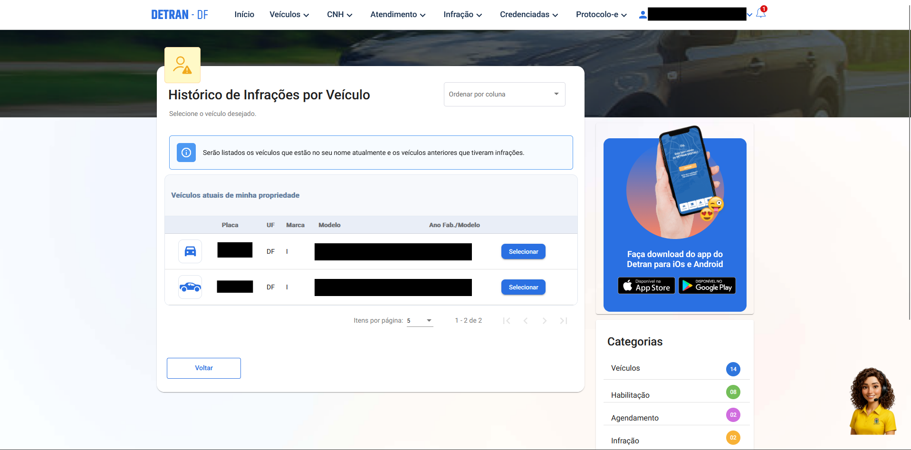
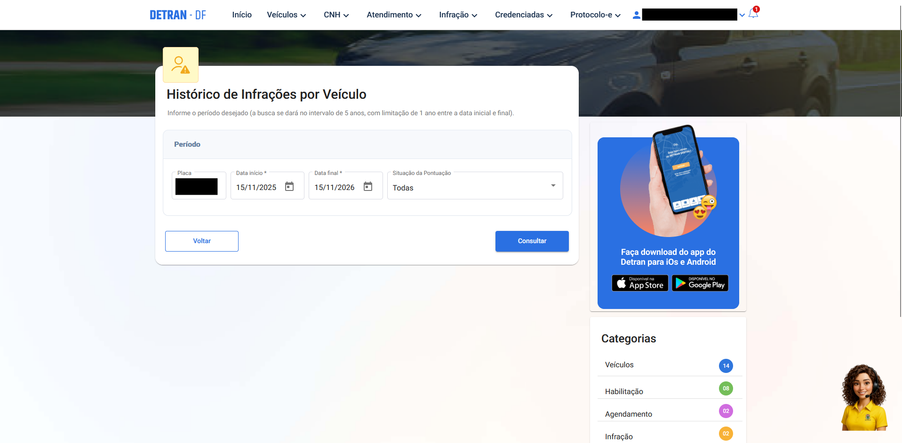

# Fase 3 — Projeto da avaliação

A Fase 3 planeja como as métricas da [Fase 2](fase2.md) serão obtidas na Fase 4, de forma que
outro avaliador consiga repetir as medições: método e instruções para o avaliador, recursos,
ambiente e massa de dados, e cronograma das sessões de coleta.

| Tema | Responsável | Página |
|---|---|---|
| Método, parâmetros, procedimentos por métrica e rastreabilidade com a Fase 2 | Pedro Druck | [Método e instruções para o avaliador](fase3-metodo.md) |
| Recursos, ambiente e massa de dados | Hugo, Philipe | [Recursos e ambiente](fase3-ambiente.md); [massa e instrumentos](fase3-dados.md) |
| Cronograma das sessões de coleta | Hugo, Philipe | [Cronograma e bloqueios](fase3-cronograma.md) |

O passo a passo da fase está em [Metodologia](metodologia.md).

## Cobertura dos critérios da issue #46

| Critério | Artefato verificável | Situação |
|---|---|---|
| F3-C1: método e instruções | [P1–P7](fase3-metodo.md), parâmetros e registro de sessão | Documentado para revisão |
| F3-C2: recursos e ambiente | [Inventário e piloto](fase3-ambiente.md) | Parcial: inventário efetivo de CT01, CT02, CT03 e CT05 registrado em `ambientes.csv` (S03 e S05) e do iPhone D04 (CT06, com P6 executado e versão do iOS a conferir no aparelho); D02 pendente (CT04 não avaliado); S06/S08 com D05 (Samsung) e D06 (computador), aparelhos registrados nas sessões e ainda fora do inventário planejado |
| F3-C2: massa e consentimento | [Massa e instrumentos](fase3-dados.md) | Termos aplicados, conforme confirmação de Hugo em 22/11/2026; vias assinadas privadas; códigos V1, V2, V4 e V5 conciliados com a tabela privada por Hugo (PR #84); V4 usado em S06/S08 e V5 no CT06 (iPhone) |
| F3-C3: cronograma | [Sessões e responsáveis](fase3-cronograma.md) | Datas propostas; horários com titulares e sincronização do Project pendentes |
| F3-C8: coerência com a Fase 2 | [Tabela de rastreabilidade](fase3-metodo.md#rastreabilidade-f2-f3) | Quatorze métricas ligadas a procedimentos, instrumentos e registros |
| Artigo e GitPage | Seção `fase3-plano.tex` e páginas desta fase | Disponíveis no repositório |
| Levantamento autenticado e atualização da Fase 1 | S01 e roteiro do levantamento | Parcial: seis capturas autenticadas do portal; caminho do aplicativo Android 2.7.0 levantado até o detalhe na S05 (seção 2 abaixo); piloto liberado em 22/11 (seção Piloto S01); atualização da Fase 1 com os filtros observados pendente. Ver [evidências de S00/S01](fase4-coleta.md#s00-s01) |
| iOS | CT06 e bloqueio B03 | iPhone D04, de um integrante; inventário registrado e P6 executado em 22/11 (3 de 3), pendente de conferência independente; M2.2.1 não medida no iOS (D008) |
| Revisão do plano documental | Pedro Henrique | PR #57 aprovado; piloto S01 executado e registrado em 22/11 (seção seguinte) |

Os critérios empíricos só podem ser marcados como concluídos após as sessões e a conferência
das evidências. A integração documental não encerra automaticamente a issue.

## Piloto S01 (22/11/2026)

O piloto foi executado em 22/11 com o V2 nos dois canais: portal no Google Chrome 158 do D01
(Ubuntu 26.04 LTS) e aplicativo 2.7.0 no Motorola edge 60 neo (D03). Resultado das 11 verificações
do modelo de sessão: 8 aprovadas (consentimento e login, veículo e infração nos dois canais,
inventário, gravação com indicação de clique/toque, rótulos e caminho, capturas, iOS), 1 parcial
(contador de volume, sem equivalência entre os instrumentos dos dois canais) e 2 bloqueadas (rede
controlada, B04). Revisão independente pendente. Liberação registrada por Hugo e Philipe em 22/11: P1, P2, P4 e P6
liberados; P3 e P5 parciais; P7 bloqueado no piloto e executado depois na S08, com a rede degradada aplicada só ao portal (desvio D021)
([registro](https://github.com/FCTE-Qualidade-de-Software-1/2026-2_T02_KATHERINE_JOHNSON/blob/main/evidencias/fase4/S01-registro-2026-11-22.md); desvio D011).

## Levantamento autenticado

### 1. Passos da consulta
A sequência a seguir é referência para os procedimentos [P1](fase3-metodo.md#p1) e [P3](fase3-metodo.md#p3). Sequência de telas e ações para consulta de infrações com usuário autenticado (Tabela 1). As capturas são do Portal de Serviços, com dados pessoais tarjados.

| # | Portal de Serviços | Telas |
|---|---|---|
| 1 | Abrir <https://portal.detran.df.gov.br> | { width="420" loading=lazy } |
| 2 | "Fazer login" e autenticar (CPF/CNPJ + senha + reCAPTCHA, ou gov.br) | { width="420" loading=lazy } |
| 3 | Na área de serviços, abrir o grupo de consultas de infração | { width="420" loading=lazy } |
| 4 | Escolher "Histórico de infrações por veículo" | { width="420" loading=lazy } |
| 5 | Selecionar o veículo na lista "Veículos atuais de minha propriedade" | { width="420" loading=lazy } |
| 6 | Selecionar o período de emissão da infração e clicar em "Consultar" |{ width="420" loading=lazy } |
| 7 | Ver resultado da consulta e selecionar, caso exista, uma infração para ver detalhes | { width="420" loading=lazy } |
*Tabela 1 — Passos da consulta no Portal de Serviços, com capturas anonimizadas. Fonte: levantamento autenticado da equipe; capturas em `evidencias/fase1/` e `docs/img/passoApassoConsulta/`.*

> Tela de exceção para tentativas de consultas de infrações emitidas há mais de 5 anos. { width="420" loading=lazy }

### 2. Passos da consulta no aplicativo Android

Caminho observado em 22/11/2026 no aplicativo 2.7.0 (246), num Motorola edge 60 neo, durante a sessão
de contingência S05 ([registro](https://github.com/FCTE-Qualidade-de-Software-1/2026-2_T02_KATHERINE_JOHNSON/blob/main/evidencias/fase4/S05-registro-2026-11-22.md)).

| # | Aplicativo Detran-DF Digital (Android 2.7.0) |
|---|---|
| 1 | Abrir o aplicativo e entrar ("Entrar" ou "Entrar com gov.br"); a tela inicial autenticada mostra atalhos e a lista de serviços |
| 2 | Tocar no cartão "Infrações". No D03 o cartão ficou sob a barra de abas inferior e foi preciso rolar a tela antes de tocar |
| 3 | Escolher "Histórico de infrações por veículo" |
| 4 | Tocar no veículo em "Veículos atuais de minha propriedade" |
| 5 | Conferir o período (padrão: últimos 12 meses), escolher a "Situação da Multa" (o botão "Consultar" só fica ativo depois dessa escolha; "Todas" cobre todas as situações) e tocar em "Consultar" |
| 6 | Rolar até "Resultado da pesquisa": a tela repete antes CPF, placa, período, situação e pontuação. Tocar na infração |
| 7 | Ver "Confira o detalhamento da infração", folha aberta sobre o resultado, com dados do veículo, informações gerais, dados da infração e penalidade; fecha pelo cabeçalho |

*Tabela 2 — Passos da consulta no aplicativo Android 2.7.0. Fonte: registro da S05.*

Na versão 2.6.3 (Galaxy S24+, S03) a tela do histórico não tinha filtro de período e, nas três
tentativas, mostrou "Ocorreu um erro ao buscar os veículos, por favor, tente novamente mais tarde."
A [captura do detalhe](https://github.com/FCTE-Qualidade-de-Software-1/2026-2_T02_KATHERINE_JOHNSON/blob/main/evidencias/fase4/capturas/S05/S05-B01-aplicativo-P6-V2-1-2026-11-22.png)
publicada está tarjada; capturas das demais telas do aplicativo ainda não foram revisadas para publicação.
