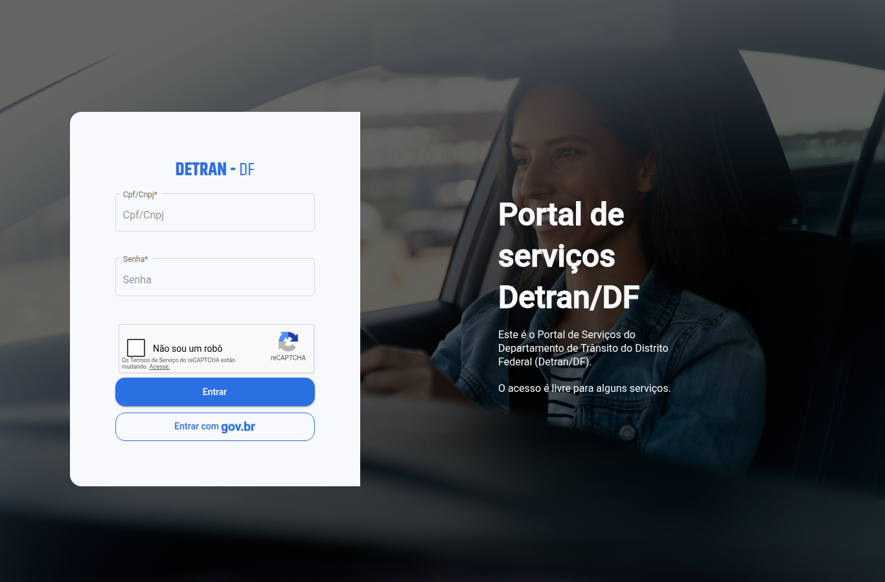
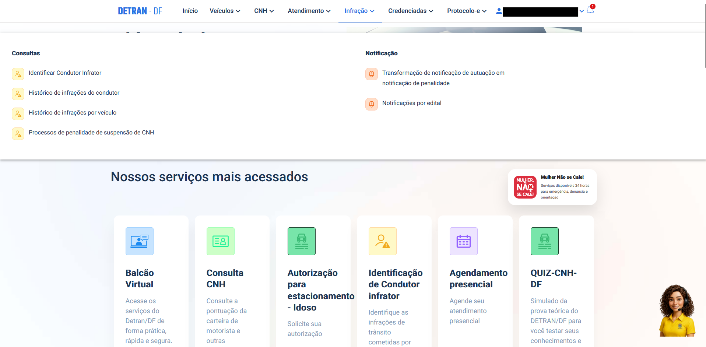
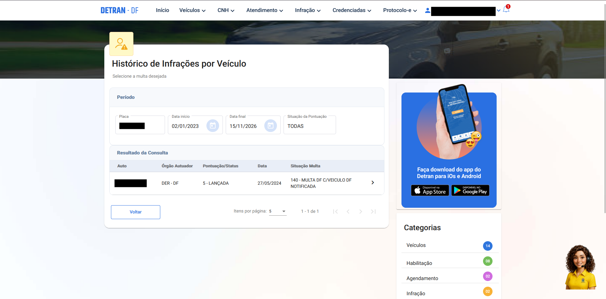
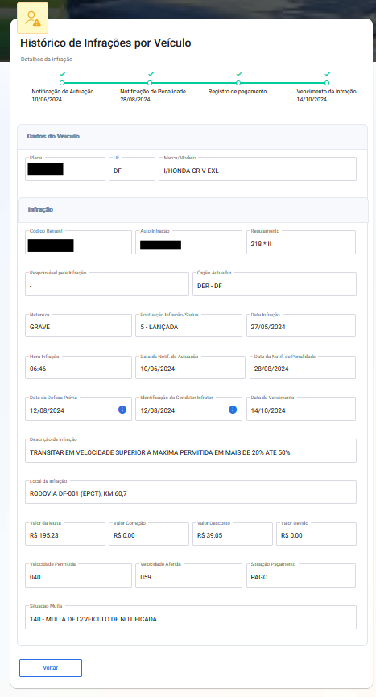
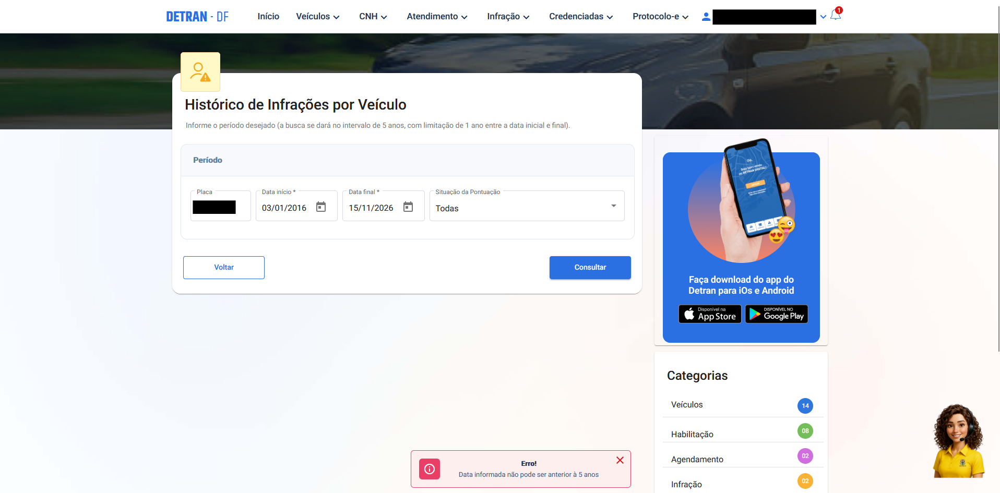

# Fase 3 — Projeto da avaliação

A Fase 3 planeja como as métricas da [Fase 2](fase2.md) serão obtidas na Fase 4, de forma que
outro avaliador consiga repetir as medições: método e instruções para o avaliador, recursos,
ambiente e massa de dados, e cronograma das sessões de coleta.

| Tema | Responsável | Página |
|---|---|---|
| Método, parâmetros, procedimentos por métrica e rastreabilidade com a Fase 2 | Pedro Druck | [Método e instruções para o avaliador](fase3-metodo.md) |
| Recursos, ambiente e massa de dados | Hugo, Philipe | [Recursos e ambiente](fase3-ambiente.md); [massa e instrumentos](fase3-dados.md) |
| Cronograma das sessões de coleta | Hugo, Philipe | [Cronograma e bloqueios](fase3-cronograma.md) |

O passo a passo da fase está em [Metodologia](metodologia.md).

## Cobertura dos critérios da issue #46

| Critério | Artefato verificável | Situação |
|---|---|---|
| F3-C1: método e instruções | [P1–P7](fase3-metodo.md), parâmetros e registro de sessão | Documentado para revisão |
| F3-C2: recursos e ambiente | [Inventário e piloto](fase3-ambiente.md) | Planejado; modelos e versões reais pendentes |
| F3-C2: massa e consentimento | [Massa e instrumentos](fase3-dados.md) | Seleção justificada e termo preparado; recrutamento e assinaturas pendentes |
| F3-C3: cronograma | [Sessões e responsáveis](fase3-cronograma.md) | Datas propostas; horários com titulares e sincronização do Project pendentes |
| F3-C8: coerência com a Fase 2 | [Tabela de rastreabilidade](fase3-metodo.md#4-rastreabilidade-entre-as-fases-2-e-3) | Quatorze métricas ligadas a procedimentos, instrumentos e registros |
| Artigo e GitPage | Seção `fase3-plano.tex` e páginas desta fase | Disponíveis nesta branch para revisão |
| Levantamento autenticado e atualização da Fase 1 | S01 e roteiro do levantamento | Pendente de veículo real; nenhuma captura autenticada produzida |
| iOS | CT06 e bloqueio B03 | iPhone de Heitor; modelo e versões a registrar; contexto não avaliado até haver evidências |
| Revisão | Pedro Henrique, até 15/11/2026 | Aprovação pendente |

Os critérios empíricos só podem ser marcados como concluídos após as sessões e a conferência
das evidências. A integração documental não encerra automaticamente a issue.

## Levantamento autenticado

### 1. Passos da consulta
Sequência de telas e ações para consulta de infrações com usuário autenticado.

| # | Portal de Serviços | Telas |
|---|---|---|
| 1 | Abrir <https://portal.detran.df.gov.br> | { width="420" loading=lazy } |
| 2 | "Fazer login" e autenticar (CPF/CNPJ + senha + reCAPTCHA, ou gov.br) | { width="420" loading=lazy } |
| 3 | Na área de serviços, abrir o grupo de consultas de infração | { width="420" loading=lazy } |
| 4 | Escolher "Histórico de infrações por veículo" | { width="420" loading=lazy } |
| 5 | Selecionar o veículo na lista "Veículos atuais de minha propriedade" | { width="420" loading=lazy } |
| 6 | Selecionar o período de emissão da infração e clicar em "Consultar" |{ width="420" loading=lazy } |
| 7 | Ver resultado da consulta e selecionar, caso exista, uma infração para ver detalhes | { width="420" loading=lazy } |

> Tela de exceção para tentativas de consultas de infrações emitidas a mais de 5 anos atrás. { width="420" loading=lazy }

