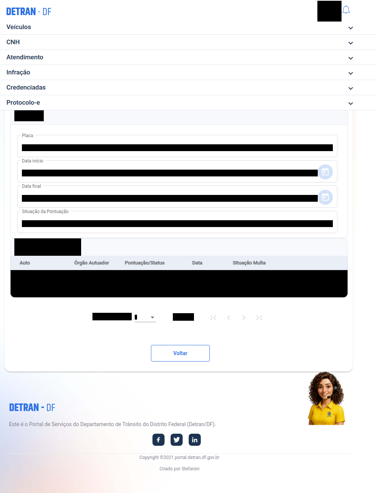
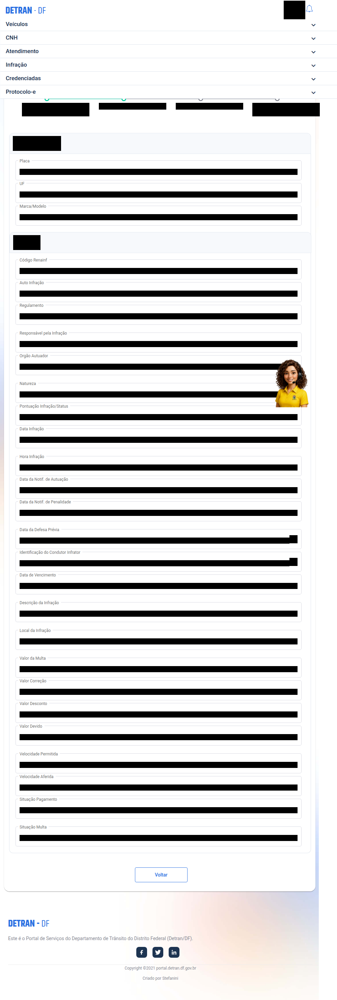

<!-- Gerado por dados/scripts/gerar_medicoes.py; não editar à mão. -->
# Fase 4 — Medições por métrica

Esta página mostra **cada medição real** por trás das quatorze métricas. Para cada métrica há o
caminho desde a Fase 1, o resultado oficial com o nível da Fase 2 e a lista das observações
brutas. Cada observação tem link para a **linha exata** do CSV no GitHub e, quando existe, para
a captura anonimizada e a segunda leitura independente. Os valores não são digitados: a página
é gerada por [`gerar_medicoes.py`](https://github.com/FCTE-Qualidade-de-Software-1/2026-2_T02_KATHERINE_JOHNSON/blob/main/dados/scripts/gerar_medicoes.py) a partir
de `dados/brutos/` e de [`resultados-metricas.csv`](https://github.com/FCTE-Qualidade-de-Software-1/2026-2_T02_KATHERINE_JOHNSON/blob/main/dados/consolidados/resultados-metricas.csv).

**Como conferir um resultado em três cliques**

1. No [painel](#painel), clique na métrica.
2. Na seção dela, a coluna **Verificar** abre as linhas do CSV que geraram o valor e a segunda leitura.
3. Em **observações**, cada linha do CSV aparece com captura, revisor e motivo de exclusão, quando houver.

Para refazer o cálculo: `python3 dados/scripts/calcular.py`. Ele lê os mesmos CSV, gera os 42
resultados calculados e registra o SHA-256 de cada entrada em
[`manifesto-calculo.json`](https://github.com/FCTE-Qualidade-de-Software-1/2026-2_T02_KATHERINE_JOHNSON/blob/main/dados/consolidados/manifesto-calculo.json).

## Painel de resultados {#painel}

A Tabela 1 traz o nível de cada métrica por canal. Cada nome leva à seção com as medições.
Quando um canal tem mais de um caso (contextos ou redes), cada caso aparece em uma linha da célula.

| Métrica | Portal | Aplicativo | Par de canais |
|---|---|---|---|
| [**M1.1.1**, Campos da lista de referência exibidos](#m1-1-1) | Inaceitável | Inaceitável |  |
| [**M1.1.2**, Campos detalhados acessíveis](#m1-1-2) | Excelente | Alvo |  |
| [**M1.2.1**, Campos comuns consistentes](#m1-2-1) |  |  | Alvo |
| [**M1.2.2**, Infrações sem divergência](#m1-2-2) |  |  | Inaceitável |
| [**M1.3.1**, Passos até a lista de infrações](#m1-3-1) | Excelente | Alvo |  |
| [**M1.3.2**, Transições de tela](#m1-3-2) | Excelente | Alvo |  |
| [**M2.1.1**, Tempo até a lista completa](#m2-1-1) | Excelente | Excelente |  |
| [**M2.1.2**, Tempo até os detalhes](#m2-1-2) | Excelente | Excelente |  |
| [**M2.2.1**, Volume de dados transferidos](#m2-2-1) | Excelente | Excelente |  |
| [**M3.1.1**, Conclusão por plataforma](#m3-1-1) | Excelente <small>CT01 + CT03</small> Excelente <small>CT01 + CT02</small> | Inaceitável <small>CT05 · 2.6.3</small> Excelente <small>CT06 · 2.7.1</small> Excelente <small>CT05 · 2.7.0</small> |  |
| [**M3.1.2**, Conclusão por navegador (só portal)](#m3-1-2) | Excelente <small>CT01 + CT03</small> Excelente <small>CT01 + CT02</small> | Não se aplica |  |
| [**M3.2.1**, Conclusão por condição de rede](#m3-2-1) | Excelente <small>Wi-Fi</small> Excelente <small>4G</small> Alvo <small>degradada</small> | Excelente <small>Wi-Fi</small> Excelente <small>4G</small> Inconclusivo <small>degradada</small> |  |
| [**M3.2.2**, Falhas ou expiração de sessão](#m3-2-2) | Excelente <small>Wi-Fi</small> Excelente <small>4G</small> Alvo <small>degradada</small> | Excelente <small>Wi-Fi</small> Excelente <small>4G</small> Inconclusivo <small>degradada</small> |  |
| [**M3.2.3**, Tempo de conclusão por rede](#m3-2-3) | Excelente <small>Wi-Fi</small> Excelente <small>4G</small> Excelente <small>degradada</small> | Excelente <small>Wi-Fi</small> Excelente <small>4G</small> Inconclusivo <small>degradada</small> |  |

*Tabela 1 — Nível de cada métrica por canal. Fonte: [`resultados-metricas.csv`](https://github.com/FCTE-Qualidade-de-Software-1/2026-2_T02_KATHERINE_JOHNSON/blob/main/dados/consolidados/resultados-metricas.csv); níveis da [Fase 2](fase2-metricas.md#niveis).*

A Tabela 2 aplica a regra da [Fase 2](fase2-metricas.md#niveis): a questão é atendida quando todas
as métricas aplicáveis atingem ao menos o nível Mínimo aceitável; o objetivo, quando todas as
questões são atendidas. As justificativas estão na [análise](fase4-analise.md#respostas-questoes).

| Questão ou objetivo | Portal | Aplicativo |
|---|---|---|
| [Q1.1, Completude funcional](fase4-analise.md#resp-q1-1) | Não atendida | Não atendida |
| [Q1.2, Correção e consistência funcional](fase4-analise.md#resp-q1-2) | Não atendida <small>(par)</small> | Não atendida <small>(par)</small> |
| [Q1.3, Adequação das operações](fase4-analise.md#resp-q1-3) | Atendida | Atendida |
| **[G1, Adequação funcional](fase4-analise.md#julg-g1)** | **Não atendido** | **Não atendido** |
| [Q2.1, Comportamento temporal](fase4-analise.md#resp-q2-1) | Atendida | Atendida |
| [Q2.2, Utilização de recursos de rede](fase4-analise.md#resp-q2-2) | Atendida | Atendida |
| **[G2, Eficiência de desempenho](fase4-analise.md#julg-g2)** | **Atendido** | **Atendido** |
| [Q3.1, Completude de contexto tecnológico](fase4-analise.md#resp-q3-1) | Atendida | Não atendida |
| [Q3.2, Flexibilidade em rede degradada](fase4-analise.md#resp-q3-2) | Atendida | Inconclusiva |
| **[G3, Cobertura de contexto](fase4-analise.md#julg-g3)** | **Atendido** | **Não atendido** |

*Tabela 2 — Respostas às questões e julgamento dos objetivos por canal. Fonte: [`respostas-gqm.csv`](https://github.com/FCTE-Qualidade-de-Software-1/2026-2_T02_KATHERINE_JOHNSON/blob/main/dados/consolidados/respostas-gqm.csv).*

<ul class="kj-legenda" aria-label="Níveis de pontuação">
<li>Excelente</li><li>Alvo</li><li>Mínimo aceitável</li>
<li>Inaceitável</li><li>Inconclusivo sem medição, nunca zero</li>
<li>Não se aplica</li>
</ul>

## G1 — Adequação funcional {#g1}

Questões [Q1.1](fase2-gqm.md#q1-1), [Q1.2](fase2-gqm.md#q1-2), [Q1.3](fase2-gqm.md#q1-3) da [Fase 2](fase2-gqm.md#g1); julgamento na [análise](fase4-analise.md#julg-g1).

### M1.1.1 — Campos da lista de referência exibidos {#m1-1-1}

- Fase 1 [Adequação funcional](fase1-priorizacao.md#resultado-priorizacao) · [decisões D1 e D2](fase1-proposito.md#decisoes)
- Fase 2 [G1](fase2-gqm.md#g1) → [Q1.1](fase2-gqm.md#q1-1) e [H1.1](fase2-gqm.md#h1-1) → [ficha e níveis de M1.1.1](fase2-metricas.md#m1-1-1)
- Fase 3 [procedimento P1](fase3-metodo.md#p1) · [CT01](fase3-ambiente.md#ct01), [CT05](fase3-ambiente.md#ct05) · [campos-por-infracao.csv](https://github.com/FCTE-Qualidade-de-Software-1/2026-2_T02_KATHERINE_JOHNSON/blob/main/dados/brutos/campos-por-infracao.csv)
- Fase 4 [resposta à Q1.1](fase4-analise.md#resp-q1-1) → [julgamento de G1](fase4-analise.md#julg-g1) · [linha na rastreabilidade](rastreabilidade.md#rt-m1-1-1)

| Canal | Caso e sessão | n válido (excluídos) | Valor julgado | Nível | Verificar |
|---|---|---|---|---|---|
| Portal | V2, CT01, Wi-Fi; S02 | 15 (0) | 5/15 (33,33%) | Inaceitável | [linhas 2–16](https://github.com/FCTE-Qualidade-de-Software-1/2026-2_T02_KATHERINE_JOHNSON/blob/main/dados/brutos/campos-por-infracao.csv?plain=1#L2-L16) de campos-por-infracao.csv; [segunda leitura de P1](https://github.com/FCTE-Qualidade-de-Software-1/2026-2_T02_KATHERINE_JOHNSON/blob/main/evidencias/fase4/S02-segunda-leitura-2026-11-23.md#2-p1--presença-dos-campos) |
| Aplicativo | V2, CT05 (aplicativo 2.7.0), Wi-Fi; S02 | 15 (0) | 5/15 (33,33%) | Inaceitável | [linhas 34–48](https://github.com/FCTE-Qualidade-de-Software-1/2026-2_T02_KATHERINE_JOHNSON/blob/main/dados/brutos/campos-por-infracao.csv?plain=1#L34-L48) de campos-por-infracao.csv; [segunda leitura de P1](https://github.com/FCTE-Qualidade-de-Software-1/2026-2_T02_KATHERINE_JOHNSON/blob/main/evidencias/fase4/S02-segunda-leitura-2026-11-23.md#2-p1--presença-dos-campos) |

*Resultado oficial de M1.1.1. Fonte: `resultados-metricas.csv`, gerado por `calcular.py`.*

<a class="kj-miniatura" href="https://github.com/FCTE-Qualidade-de-Software-1/2026-2_T02_KATHERINE_JOHNSON/blob/main/evidencias/fase4/capturas/S02/S02-portal-lista-infracoes-V2.png">Portal: lista (S02)</a><a class="kj-miniatura" href="https://github.com/FCTE-Qualidade-de-Software-1/2026-2_T02_KATHERINE_JOHNSON/blob/main/evidencias/fase4/capturas/S02/S02-android-lista-infracoes-V2.png">Aplicativo: lista (S02)</a>

Campo a campo, com a linha de cada registro

| Campo de referência (Fase 1) | Portal | Aplicativo |
|---|---|---|
| R01, Tipificação da infração | **ausente** ([linha 2](https://github.com/FCTE-Qualidade-de-Software-1/2026-2_T02_KATHERINE_JOHNSON/blob/main/dados/brutos/campos-por-infracao.csv?plain=1#L2)) | **ausente** ([linha 34](https://github.com/FCTE-Qualidade-de-Software-1/2026-2_T02_KATHERINE_JOHNSON/blob/main/dados/brutos/campos-por-infracao.csv?plain=1#L34)) |
| R02, Enquadramento legal | **ausente** ([linha 3](https://github.com/FCTE-Qualidade-de-Software-1/2026-2_T02_KATHERINE_JOHNSON/blob/main/dados/brutos/campos-por-infracao.csv?plain=1#L3)) | **ausente** ([linha 35](https://github.com/FCTE-Qualidade-de-Software-1/2026-2_T02_KATHERINE_JOHNSON/blob/main/dados/brutos/campos-por-infracao.csv?plain=1#L35)) |
| R03, Local | **ausente** ([linha 4](https://github.com/FCTE-Qualidade-de-Software-1/2026-2_T02_KATHERINE_JOHNSON/blob/main/dados/brutos/campos-por-infracao.csv?plain=1#L4)) | **ausente** ([linha 36](https://github.com/FCTE-Qualidade-de-Software-1/2026-2_T02_KATHERINE_JOHNSON/blob/main/dados/brutos/campos-por-infracao.csv?plain=1#L36)) |
| R04, Data | presente ([linha 5](https://github.com/FCTE-Qualidade-de-Software-1/2026-2_T02_KATHERINE_JOHNSON/blob/main/dados/brutos/campos-por-infracao.csv?plain=1#L5)) | presente ([linha 37](https://github.com/FCTE-Qualidade-de-Software-1/2026-2_T02_KATHERINE_JOHNSON/blob/main/dados/brutos/campos-por-infracao.csv?plain=1#L37)) |
| R05, Hora | **ausente** ([linha 6](https://github.com/FCTE-Qualidade-de-Software-1/2026-2_T02_KATHERINE_JOHNSON/blob/main/dados/brutos/campos-por-infracao.csv?plain=1#L6)) | **ausente** ([linha 38](https://github.com/FCTE-Qualidade-de-Software-1/2026-2_T02_KATHERINE_JOHNSON/blob/main/dados/brutos/campos-por-infracao.csv?plain=1#L38)) |
| R06, Placa | **ausente** ([linha 7](https://github.com/FCTE-Qualidade-de-Software-1/2026-2_T02_KATHERINE_JOHNSON/blob/main/dados/brutos/campos-por-infracao.csv?plain=1#L7)) | **ausente** ([linha 39](https://github.com/FCTE-Qualidade-de-Software-1/2026-2_T02_KATHERINE_JOHNSON/blob/main/dados/brutos/campos-por-infracao.csv?plain=1#L39)) |
| R07, Marca/modelo | **ausente** ([linha 8](https://github.com/FCTE-Qualidade-de-Software-1/2026-2_T02_KATHERINE_JOHNSON/blob/main/dados/brutos/campos-por-infracao.csv?plain=1#L8)) | **ausente** ([linha 40](https://github.com/FCTE-Qualidade-de-Software-1/2026-2_T02_KATHERINE_JOHNSON/blob/main/dados/brutos/campos-por-infracao.csv?plain=1#L40)) |
| R08, Órgão autuador | presente ([linha 9](https://github.com/FCTE-Qualidade-de-Software-1/2026-2_T02_KATHERINE_JOHNSON/blob/main/dados/brutos/campos-por-infracao.csv?plain=1#L9)) | presente ([linha 41](https://github.com/FCTE-Qualidade-de-Software-1/2026-2_T02_KATHERINE_JOHNSON/blob/main/dados/brutos/campos-por-infracao.csv?plain=1#L41)) |
| R09, Número do auto | presente ([linha 10](https://github.com/FCTE-Qualidade-de-Software-1/2026-2_T02_KATHERINE_JOHNSON/blob/main/dados/brutos/campos-por-infracao.csv?plain=1#L10)) | presente ([linha 42](https://github.com/FCTE-Qualidade-de-Software-1/2026-2_T02_KATHERINE_JOHNSON/blob/main/dados/brutos/campos-por-infracao.csv?plain=1#L42)) |
| R10, Natureza | **ausente** ([linha 11](https://github.com/FCTE-Qualidade-de-Software-1/2026-2_T02_KATHERINE_JOHNSON/blob/main/dados/brutos/campos-por-infracao.csv?plain=1#L11)) | **ausente** ([linha 43](https://github.com/FCTE-Qualidade-de-Software-1/2026-2_T02_KATHERINE_JOHNSON/blob/main/dados/brutos/campos-por-infracao.csv?plain=1#L43)) |
| R11, Pontuação | presente ([linha 12](https://github.com/FCTE-Qualidade-de-Software-1/2026-2_T02_KATHERINE_JOHNSON/blob/main/dados/brutos/campos-por-infracao.csv?plain=1#L12)) | presente ([linha 44](https://github.com/FCTE-Qualidade-de-Software-1/2026-2_T02_KATHERINE_JOHNSON/blob/main/dados/brutos/campos-por-infracao.csv?plain=1#L44)) |
| R12, Valor da multa | **ausente** ([linha 13](https://github.com/FCTE-Qualidade-de-Software-1/2026-2_T02_KATHERINE_JOHNSON/blob/main/dados/brutos/campos-por-infracao.csv?plain=1#L13)) | **ausente** ([linha 45](https://github.com/FCTE-Qualidade-de-Software-1/2026-2_T02_KATHERINE_JOHNSON/blob/main/dados/brutos/campos-por-infracao.csv?plain=1#L45)) |
| R13, Vencimento | **ausente** ([linha 14](https://github.com/FCTE-Qualidade-de-Software-1/2026-2_T02_KATHERINE_JOHNSON/blob/main/dados/brutos/campos-por-infracao.csv?plain=1#L14)) | **ausente** ([linha 46](https://github.com/FCTE-Qualidade-de-Software-1/2026-2_T02_KATHERINE_JOHNSON/blob/main/dados/brutos/campos-por-infracao.csv?plain=1#L46)) |
| R14, Prazo de defesa ou indicação do condutor | **ausente** ([linha 15](https://github.com/FCTE-Qualidade-de-Software-1/2026-2_T02_KATHERINE_JOHNSON/blob/main/dados/brutos/campos-por-infracao.csv?plain=1#L15)) | **ausente** ([linha 47](https://github.com/FCTE-Qualidade-de-Software-1/2026-2_T02_KATHERINE_JOHNSON/blob/main/dados/brutos/campos-por-infracao.csv?plain=1#L47)) |
| R15, Situação | presente ([linha 16](https://github.com/FCTE-Qualidade-de-Software-1/2026-2_T02_KATHERINE_JOHNSON/blob/main/dados/brutos/campos-por-infracao.csv?plain=1#L16)) | presente ([linha 48](https://github.com/FCTE-Qualidade-de-Software-1/2026-2_T02_KATHERINE_JOHNSON/blob/main/dados/brutos/campos-por-infracao.csv?plain=1#L48)) |

**Desvios que afetam esta métrica:** [D014](https://github.com/FCTE-Qualidade-de-Software-1/2026-2_T02_KATHERINE_JOHNSON/blob/main/dados/brutos/desvios.csv?plain=1#L15). Cada um registra motivo, efeito e decisão.

### M1.1.2 — Campos detalhados acessíveis {#m1-1-2}

- Fase 1 [Adequação funcional](fase1-priorizacao.md#resultado-priorizacao) · [decisões D1 e D2](fase1-proposito.md#decisoes)
- Fase 2 [G1](fase2-gqm.md#g1) → [Q1.1](fase2-gqm.md#q1-1) e [H1.1](fase2-gqm.md#h1-1) → [ficha e níveis de M1.1.2](fase2-metricas.md#m1-1-2)
- Fase 3 [procedimento P1](fase3-metodo.md#p1) · [CT01](fase3-ambiente.md#ct01), [CT05](fase3-ambiente.md#ct05) · [campos-por-infracao.csv](https://github.com/FCTE-Qualidade-de-Software-1/2026-2_T02_KATHERINE_JOHNSON/blob/main/dados/brutos/campos-por-infracao.csv)
- Fase 4 [resposta à Q1.1](fase4-analise.md#resp-q1-1) → [julgamento de G1](fase4-analise.md#julg-g1) · [linha na rastreabilidade](rastreabilidade.md#rt-m1-1-2)

| Canal | Caso e sessão | n válido (excluídos) | Valor julgado | Nível | Verificar |
|---|---|---|---|---|---|
| Portal | V2, CT01, Wi-Fi; S02 | 17 (0) | 17/17 (100%) | Excelente | [linhas 17–33](https://github.com/FCTE-Qualidade-de-Software-1/2026-2_T02_KATHERINE_JOHNSON/blob/main/dados/brutos/campos-por-infracao.csv?plain=1#L17-L33) de campos-por-infracao.csv; [segunda leitura de P1](https://github.com/FCTE-Qualidade-de-Software-1/2026-2_T02_KATHERINE_JOHNSON/blob/main/evidencias/fase4/S02-segunda-leitura-2026-11-23.md#2-p1--presença-dos-campos) |
| Aplicativo | V2, CT05 (aplicativo 2.7.0), Wi-Fi; S02 | 17 (0) | 16/17 (94,12%) | Alvo | [linhas 49–65](https://github.com/FCTE-Qualidade-de-Software-1/2026-2_T02_KATHERINE_JOHNSON/blob/main/dados/brutos/campos-por-infracao.csv?plain=1#L49-L65) de campos-por-infracao.csv; [segunda leitura de P1](https://github.com/FCTE-Qualidade-de-Software-1/2026-2_T02_KATHERINE_JOHNSON/blob/main/evidencias/fase4/S02-segunda-leitura-2026-11-23.md#2-p1--presença-dos-campos) |

*Resultado oficial de M1.1.2. Fonte: `resultados-metricas.csv`, gerado por `calcular.py`.*

<a class="kj-miniatura" href="https://github.com/FCTE-Qualidade-de-Software-1/2026-2_T02_KATHERINE_JOHNSON/blob/main/evidencias/fase4/capturas/S02/S02-portal-detalhe-V2-I1.png">Portal: detalhe (S02)</a><a class="kj-miniatura" href="https://github.com/FCTE-Qualidade-de-Software-1/2026-2_T02_KATHERINE_JOHNSON/blob/main/evidencias/fase4/capturas/S02/S02-android-detalhe-V2-I1.png">Aplicativo: detalhe (S02)</a>

Campo a campo, com a linha de cada registro

| Campo de referência (Fase 1) | Portal | Aplicativo |
|---|---|---|
| R01, Tipificação da infração | presente ([linha 17](https://github.com/FCTE-Qualidade-de-Software-1/2026-2_T02_KATHERINE_JOHNSON/blob/main/dados/brutos/campos-por-infracao.csv?plain=1#L17)) | presente ([linha 49](https://github.com/FCTE-Qualidade-de-Software-1/2026-2_T02_KATHERINE_JOHNSON/blob/main/dados/brutos/campos-por-infracao.csv?plain=1#L49)) |
| R02, Enquadramento legal | presente ([linha 18](https://github.com/FCTE-Qualidade-de-Software-1/2026-2_T02_KATHERINE_JOHNSON/blob/main/dados/brutos/campos-por-infracao.csv?plain=1#L18)) | presente ([linha 50](https://github.com/FCTE-Qualidade-de-Software-1/2026-2_T02_KATHERINE_JOHNSON/blob/main/dados/brutos/campos-por-infracao.csv?plain=1#L50)) |
| R03, Local | presente ([linha 19](https://github.com/FCTE-Qualidade-de-Software-1/2026-2_T02_KATHERINE_JOHNSON/blob/main/dados/brutos/campos-por-infracao.csv?plain=1#L19)) | presente ([linha 51](https://github.com/FCTE-Qualidade-de-Software-1/2026-2_T02_KATHERINE_JOHNSON/blob/main/dados/brutos/campos-por-infracao.csv?plain=1#L51)) |
| R04, Data | presente ([linha 20](https://github.com/FCTE-Qualidade-de-Software-1/2026-2_T02_KATHERINE_JOHNSON/blob/main/dados/brutos/campos-por-infracao.csv?plain=1#L20)) | presente ([linha 52](https://github.com/FCTE-Qualidade-de-Software-1/2026-2_T02_KATHERINE_JOHNSON/blob/main/dados/brutos/campos-por-infracao.csv?plain=1#L52)) |
| R05, Hora | presente ([linha 21](https://github.com/FCTE-Qualidade-de-Software-1/2026-2_T02_KATHERINE_JOHNSON/blob/main/dados/brutos/campos-por-infracao.csv?plain=1#L21)) | presente ([linha 53](https://github.com/FCTE-Qualidade-de-Software-1/2026-2_T02_KATHERINE_JOHNSON/blob/main/dados/brutos/campos-por-infracao.csv?plain=1#L53)) |
| R06, Placa | presente ([linha 22](https://github.com/FCTE-Qualidade-de-Software-1/2026-2_T02_KATHERINE_JOHNSON/blob/main/dados/brutos/campos-por-infracao.csv?plain=1#L22)) | presente ([linha 54](https://github.com/FCTE-Qualidade-de-Software-1/2026-2_T02_KATHERINE_JOHNSON/blob/main/dados/brutos/campos-por-infracao.csv?plain=1#L54)) |
| R07, Marca/modelo | presente ([linha 23](https://github.com/FCTE-Qualidade-de-Software-1/2026-2_T02_KATHERINE_JOHNSON/blob/main/dados/brutos/campos-por-infracao.csv?plain=1#L23)) | presente ([linha 55](https://github.com/FCTE-Qualidade-de-Software-1/2026-2_T02_KATHERINE_JOHNSON/blob/main/dados/brutos/campos-por-infracao.csv?plain=1#L55)) |
| R08, Órgão autuador | presente ([linha 24](https://github.com/FCTE-Qualidade-de-Software-1/2026-2_T02_KATHERINE_JOHNSON/blob/main/dados/brutos/campos-por-infracao.csv?plain=1#L24)) | presente ([linha 56](https://github.com/FCTE-Qualidade-de-Software-1/2026-2_T02_KATHERINE_JOHNSON/blob/main/dados/brutos/campos-por-infracao.csv?plain=1#L56)) |
| R09, Número do auto | presente ([linha 25](https://github.com/FCTE-Qualidade-de-Software-1/2026-2_T02_KATHERINE_JOHNSON/blob/main/dados/brutos/campos-por-infracao.csv?plain=1#L25)) | presente ([linha 57](https://github.com/FCTE-Qualidade-de-Software-1/2026-2_T02_KATHERINE_JOHNSON/blob/main/dados/brutos/campos-por-infracao.csv?plain=1#L57)) |
| R10, Natureza | presente ([linha 26](https://github.com/FCTE-Qualidade-de-Software-1/2026-2_T02_KATHERINE_JOHNSON/blob/main/dados/brutos/campos-por-infracao.csv?plain=1#L26)) | presente ([linha 58](https://github.com/FCTE-Qualidade-de-Software-1/2026-2_T02_KATHERINE_JOHNSON/blob/main/dados/brutos/campos-por-infracao.csv?plain=1#L58)) |
| R11, Pontuação | presente ([linha 27](https://github.com/FCTE-Qualidade-de-Software-1/2026-2_T02_KATHERINE_JOHNSON/blob/main/dados/brutos/campos-por-infracao.csv?plain=1#L27)) | presente ([linha 59](https://github.com/FCTE-Qualidade-de-Software-1/2026-2_T02_KATHERINE_JOHNSON/blob/main/dados/brutos/campos-por-infracao.csv?plain=1#L59)) |
| R12, Valor da multa | presente ([linha 28](https://github.com/FCTE-Qualidade-de-Software-1/2026-2_T02_KATHERINE_JOHNSON/blob/main/dados/brutos/campos-por-infracao.csv?plain=1#L28)) | presente ([linha 60](https://github.com/FCTE-Qualidade-de-Software-1/2026-2_T02_KATHERINE_JOHNSON/blob/main/dados/brutos/campos-por-infracao.csv?plain=1#L60)) |
| R13, Vencimento | presente ([linha 29](https://github.com/FCTE-Qualidade-de-Software-1/2026-2_T02_KATHERINE_JOHNSON/blob/main/dados/brutos/campos-por-infracao.csv?plain=1#L29)) | presente ([linha 61](https://github.com/FCTE-Qualidade-de-Software-1/2026-2_T02_KATHERINE_JOHNSON/blob/main/dados/brutos/campos-por-infracao.csv?plain=1#L61)) |
| R14, Prazo de defesa ou indicação do condutor | presente ([linha 30](https://github.com/FCTE-Qualidade-de-Software-1/2026-2_T02_KATHERINE_JOHNSON/blob/main/dados/brutos/campos-por-infracao.csv?plain=1#L30)) | **ausente** ([linha 62](https://github.com/FCTE-Qualidade-de-Software-1/2026-2_T02_KATHERINE_JOHNSON/blob/main/dados/brutos/campos-por-infracao.csv?plain=1#L62)) |
| R15, Situação | presente ([linha 31](https://github.com/FCTE-Qualidade-de-Software-1/2026-2_T02_KATHERINE_JOHNSON/blob/main/dados/brutos/campos-por-infracao.csv?plain=1#L31)) | presente ([linha 63](https://github.com/FCTE-Qualidade-de-Software-1/2026-2_T02_KATHERINE_JOHNSON/blob/main/dados/brutos/campos-por-infracao.csv?plain=1#L63)) |
| velocidade_permitida, Velocidade permitida (condicional) | presente ([linha 32](https://github.com/FCTE-Qualidade-de-Software-1/2026-2_T02_KATHERINE_JOHNSON/blob/main/dados/brutos/campos-por-infracao.csv?plain=1#L32)) | presente ([linha 64](https://github.com/FCTE-Qualidade-de-Software-1/2026-2_T02_KATHERINE_JOHNSON/blob/main/dados/brutos/campos-por-infracao.csv?plain=1#L64)) |
| velocidade_aferida, Velocidade aferida (condicional) | presente ([linha 33](https://github.com/FCTE-Qualidade-de-Software-1/2026-2_T02_KATHERINE_JOHNSON/blob/main/dados/brutos/campos-por-infracao.csv?plain=1#L33)) | presente ([linha 65](https://github.com/FCTE-Qualidade-de-Software-1/2026-2_T02_KATHERINE_JOHNSON/blob/main/dados/brutos/campos-por-infracao.csv?plain=1#L65)) |

**Desvios que afetam esta métrica:** [D014](https://github.com/FCTE-Qualidade-de-Software-1/2026-2_T02_KATHERINE_JOHNSON/blob/main/dados/brutos/desvios.csv?plain=1#L15). Cada um registra motivo, efeito e decisão.

### M1.2.1 — Campos comuns consistentes {#m1-2-1}

- Fase 1 [Adequação funcional](fase1-priorizacao.md#resultado-priorizacao) · [decisões D1 e D2](fase1-proposito.md#decisoes)
- Fase 2 [G1](fase2-gqm.md#g1) → [Q1.2](fase2-gqm.md#q1-2) e [H1.2](fase2-gqm.md#h1-2) → [ficha e níveis de M1.2.1](fase2-metricas.md#m1-2-1)
- Fase 3 [procedimento P2](fase3-metodo.md#p2) · [CT01](fase3-ambiente.md#ct01), [CT05](fase3-ambiente.md#ct05) · [comparacao-canais.csv](https://github.com/FCTE-Qualidade-de-Software-1/2026-2_T02_KATHERINE_JOHNSON/blob/main/dados/brutos/comparacao-canais.csv)
- Fase 4 [resposta à Q1.2](fase4-analise.md#resp-q1-2) → [julgamento de G1](fase4-analise.md#julg-g1) · [linha na rastreabilidade](rastreabilidade.md#rt-m1-2-1)

| Canal | Caso e sessão | n válido (excluídos) | Valor julgado | Nível | Verificar |
|---|---|---|---|---|---|
| Par de canais | V2, CT01 + CT05, Wi-Fi; S02 | 17 (0) | 16/17 (94,12%) | Alvo | [linhas 2–18](https://github.com/FCTE-Qualidade-de-Software-1/2026-2_T02_KATHERINE_JOHNSON/blob/main/dados/brutos/comparacao-canais.csv?plain=1#L2-L18) de comparacao-canais.csv; [segunda leitura de P2](https://github.com/FCTE-Qualidade-de-Software-1/2026-2_T02_KATHERINE_JOHNSON/blob/main/evidencias/fase4/S02-segunda-leitura-2026-11-23.md#3-p2--comparação-entre-canais) |

*Resultado oficial de M1.2.1. Fonte: `resultados-metricas.csv`, gerado por `calcular.py`.*

Comparação campo a campo entre os canais

| Campo de referência (Fase 1) | Classificação no par | Linha |
|---|---|---|
| R01, Tipificação da infração | paritario | [linha 2](https://github.com/FCTE-Qualidade-de-Software-1/2026-2_T02_KATHERINE_JOHNSON/blob/main/dados/brutos/comparacao-canais.csv?plain=1#L2) |
| R02, Enquadramento legal | paritario | [linha 3](https://github.com/FCTE-Qualidade-de-Software-1/2026-2_T02_KATHERINE_JOHNSON/blob/main/dados/brutos/comparacao-canais.csv?plain=1#L3) |
| R03, Local | paritario | [linha 4](https://github.com/FCTE-Qualidade-de-Software-1/2026-2_T02_KATHERINE_JOHNSON/blob/main/dados/brutos/comparacao-canais.csv?plain=1#L4) |
| R04, Data | paritario | [linha 5](https://github.com/FCTE-Qualidade-de-Software-1/2026-2_T02_KATHERINE_JOHNSON/blob/main/dados/brutos/comparacao-canais.csv?plain=1#L5) |
| R05, Hora | paritario | [linha 6](https://github.com/FCTE-Qualidade-de-Software-1/2026-2_T02_KATHERINE_JOHNSON/blob/main/dados/brutos/comparacao-canais.csv?plain=1#L6) |
| R06, Placa | paritario | [linha 7](https://github.com/FCTE-Qualidade-de-Software-1/2026-2_T02_KATHERINE_JOHNSON/blob/main/dados/brutos/comparacao-canais.csv?plain=1#L7) |
| R07, Marca/modelo | paritario | [linha 8](https://github.com/FCTE-Qualidade-de-Software-1/2026-2_T02_KATHERINE_JOHNSON/blob/main/dados/brutos/comparacao-canais.csv?plain=1#L8) |
| R08, Órgão autuador | paritario | [linha 9](https://github.com/FCTE-Qualidade-de-Software-1/2026-2_T02_KATHERINE_JOHNSON/blob/main/dados/brutos/comparacao-canais.csv?plain=1#L9) |
| R09, Número do auto | paritario | [linha 10](https://github.com/FCTE-Qualidade-de-Software-1/2026-2_T02_KATHERINE_JOHNSON/blob/main/dados/brutos/comparacao-canais.csv?plain=1#L10) |
| R10, Natureza | paritario | [linha 11](https://github.com/FCTE-Qualidade-de-Software-1/2026-2_T02_KATHERINE_JOHNSON/blob/main/dados/brutos/comparacao-canais.csv?plain=1#L11) |
| R11, Pontuação | paritario | [linha 12](https://github.com/FCTE-Qualidade-de-Software-1/2026-2_T02_KATHERINE_JOHNSON/blob/main/dados/brutos/comparacao-canais.csv?plain=1#L12) |
| R12, Valor da multa | paritario | [linha 13](https://github.com/FCTE-Qualidade-de-Software-1/2026-2_T02_KATHERINE_JOHNSON/blob/main/dados/brutos/comparacao-canais.csv?plain=1#L13) |
| R13, Vencimento | paritario | [linha 14](https://github.com/FCTE-Qualidade-de-Software-1/2026-2_T02_KATHERINE_JOHNSON/blob/main/dados/brutos/comparacao-canais.csv?plain=1#L14) |
| R14, Prazo de defesa ou indicação do condutor | **ausente aplicativo** | [linha 15](https://github.com/FCTE-Qualidade-de-Software-1/2026-2_T02_KATHERINE_JOHNSON/blob/main/dados/brutos/comparacao-canais.csv?plain=1#L15) |
| R15, Situação | paritario | [linha 16](https://github.com/FCTE-Qualidade-de-Software-1/2026-2_T02_KATHERINE_JOHNSON/blob/main/dados/brutos/comparacao-canais.csv?plain=1#L16) |
| velocidade_permitida, Velocidade permitida (condicional) | paritario | [linha 17](https://github.com/FCTE-Qualidade-de-Software-1/2026-2_T02_KATHERINE_JOHNSON/blob/main/dados/brutos/comparacao-canais.csv?plain=1#L17) |
| velocidade_aferida, Velocidade aferida (condicional) | paritario | [linha 18](https://github.com/FCTE-Qualidade-de-Software-1/2026-2_T02_KATHERINE_JOHNSON/blob/main/dados/brutos/comparacao-canais.csv?plain=1#L18) |

**Desvios que afetam esta métrica:** [D014](https://github.com/FCTE-Qualidade-de-Software-1/2026-2_T02_KATHERINE_JOHNSON/blob/main/dados/brutos/desvios.csv?plain=1#L15). Cada um registra motivo, efeito e decisão.

### M1.2.2 — Infrações sem divergência {#m1-2-2}

- Fase 1 [Adequação funcional](fase1-priorizacao.md#resultado-priorizacao) · [decisões D1 e D2](fase1-proposito.md#decisoes)
- Fase 2 [G1](fase2-gqm.md#g1) → [Q1.2](fase2-gqm.md#q1-2) e [H1.2](fase2-gqm.md#h1-2) → [ficha e níveis de M1.2.2](fase2-metricas.md#m1-2-2)
- Fase 3 [procedimento P2](fase3-metodo.md#p2) · [CT01](fase3-ambiente.md#ct01), [CT05](fase3-ambiente.md#ct05) · [comparacao-canais.csv](https://github.com/FCTE-Qualidade-de-Software-1/2026-2_T02_KATHERINE_JOHNSON/blob/main/dados/brutos/comparacao-canais.csv)
- Fase 4 [resposta à Q1.2](fase4-analise.md#resp-q1-2) → [julgamento de G1](fase4-analise.md#julg-g1) · [linha na rastreabilidade](rastreabilidade.md#rt-m1-2-2)

| Canal | Caso e sessão | n válido (excluídos) | Valor julgado | Nível | Verificar |
|---|---|---|---|---|---|
| Par de canais | V2, CT01 + CT05, Wi-Fi; S02 | 17 (0) | 0/1 (0%) | Inaceitável | [linhas 2–18](https://github.com/FCTE-Qualidade-de-Software-1/2026-2_T02_KATHERINE_JOHNSON/blob/main/dados/brutos/comparacao-canais.csv?plain=1#L2-L18) de comparacao-canais.csv; [segunda leitura de P2](https://github.com/FCTE-Qualidade-de-Software-1/2026-2_T02_KATHERINE_JOHNSON/blob/main/evidencias/fase4/S02-segunda-leitura-2026-11-23.md#3-p2--comparação-entre-canais) |

*Resultado oficial de M1.2.2. Fonte: `resultados-metricas.csv`, gerado por `calcular.py`.*

Comparação campo a campo entre os canais

| Campo de referência (Fase 1) | Classificação no par | Linha |
|---|---|---|
| R01, Tipificação da infração | paritario | [linha 2](https://github.com/FCTE-Qualidade-de-Software-1/2026-2_T02_KATHERINE_JOHNSON/blob/main/dados/brutos/comparacao-canais.csv?plain=1#L2) |
| R02, Enquadramento legal | paritario | [linha 3](https://github.com/FCTE-Qualidade-de-Software-1/2026-2_T02_KATHERINE_JOHNSON/blob/main/dados/brutos/comparacao-canais.csv?plain=1#L3) |
| R03, Local | paritario | [linha 4](https://github.com/FCTE-Qualidade-de-Software-1/2026-2_T02_KATHERINE_JOHNSON/blob/main/dados/brutos/comparacao-canais.csv?plain=1#L4) |
| R04, Data | paritario | [linha 5](https://github.com/FCTE-Qualidade-de-Software-1/2026-2_T02_KATHERINE_JOHNSON/blob/main/dados/brutos/comparacao-canais.csv?plain=1#L5) |
| R05, Hora | paritario | [linha 6](https://github.com/FCTE-Qualidade-de-Software-1/2026-2_T02_KATHERINE_JOHNSON/blob/main/dados/brutos/comparacao-canais.csv?plain=1#L6) |
| R06, Placa | paritario | [linha 7](https://github.com/FCTE-Qualidade-de-Software-1/2026-2_T02_KATHERINE_JOHNSON/blob/main/dados/brutos/comparacao-canais.csv?plain=1#L7) |
| R07, Marca/modelo | paritario | [linha 8](https://github.com/FCTE-Qualidade-de-Software-1/2026-2_T02_KATHERINE_JOHNSON/blob/main/dados/brutos/comparacao-canais.csv?plain=1#L8) |
| R08, Órgão autuador | paritario | [linha 9](https://github.com/FCTE-Qualidade-de-Software-1/2026-2_T02_KATHERINE_JOHNSON/blob/main/dados/brutos/comparacao-canais.csv?plain=1#L9) |
| R09, Número do auto | paritario | [linha 10](https://github.com/FCTE-Qualidade-de-Software-1/2026-2_T02_KATHERINE_JOHNSON/blob/main/dados/brutos/comparacao-canais.csv?plain=1#L10) |
| R10, Natureza | paritario | [linha 11](https://github.com/FCTE-Qualidade-de-Software-1/2026-2_T02_KATHERINE_JOHNSON/blob/main/dados/brutos/comparacao-canais.csv?plain=1#L11) |
| R11, Pontuação | paritario | [linha 12](https://github.com/FCTE-Qualidade-de-Software-1/2026-2_T02_KATHERINE_JOHNSON/blob/main/dados/brutos/comparacao-canais.csv?plain=1#L12) |
| R12, Valor da multa | paritario | [linha 13](https://github.com/FCTE-Qualidade-de-Software-1/2026-2_T02_KATHERINE_JOHNSON/blob/main/dados/brutos/comparacao-canais.csv?plain=1#L13) |
| R13, Vencimento | paritario | [linha 14](https://github.com/FCTE-Qualidade-de-Software-1/2026-2_T02_KATHERINE_JOHNSON/blob/main/dados/brutos/comparacao-canais.csv?plain=1#L14) |
| R14, Prazo de defesa ou indicação do condutor | **ausente aplicativo** | [linha 15](https://github.com/FCTE-Qualidade-de-Software-1/2026-2_T02_KATHERINE_JOHNSON/blob/main/dados/brutos/comparacao-canais.csv?plain=1#L15) |
| R15, Situação | paritario | [linha 16](https://github.com/FCTE-Qualidade-de-Software-1/2026-2_T02_KATHERINE_JOHNSON/blob/main/dados/brutos/comparacao-canais.csv?plain=1#L16) |
| velocidade_permitida, Velocidade permitida (condicional) | paritario | [linha 17](https://github.com/FCTE-Qualidade-de-Software-1/2026-2_T02_KATHERINE_JOHNSON/blob/main/dados/brutos/comparacao-canais.csv?plain=1#L17) |
| velocidade_aferida, Velocidade aferida (condicional) | paritario | [linha 18](https://github.com/FCTE-Qualidade-de-Software-1/2026-2_T02_KATHERINE_JOHNSON/blob/main/dados/brutos/comparacao-canais.csv?plain=1#L18) |

**Desvios que afetam esta métrica:** [D014](https://github.com/FCTE-Qualidade-de-Software-1/2026-2_T02_KATHERINE_JOHNSON/blob/main/dados/brutos/desvios.csv?plain=1#L15). Cada um registra motivo, efeito e decisão.

### M1.3.1 — Passos até a lista de infrações {#m1-3-1}

- Fase 1 [Adequação funcional](fase1-priorizacao.md#resultado-priorizacao) · [decisões D1 e D2](fase1-proposito.md#decisoes)
- Fase 2 [G1](fase2-gqm.md#g1) → [Q1.3](fase2-gqm.md#q1-3) e [H1.3](fase2-gqm.md#h1-3) → [ficha e níveis de M1.3.1](fase2-metricas.md#m1-3-1)
- Fase 3 [procedimento P3](fase3-metodo.md#p3) · [CT01](fase3-ambiente.md#ct01), [CT05](fase3-ambiente.md#ct05) · [fluxo.csv](https://github.com/FCTE-Qualidade-de-Software-1/2026-2_T02_KATHERINE_JOHNSON/blob/main/dados/brutos/fluxo.csv)
- Fase 4 [resposta à Q1.3](fase4-analise.md#resp-q1-3) → [julgamento de G1](fase4-analise.md#julg-g1) · [linha na rastreabilidade](rastreabilidade.md#rt-m1-3-1)

| Canal | Caso e sessão | n válido (excluídos) | Valor julgado | Nível | Verificar |
|---|---|---|---|---|---|
| Portal | V2, CT01, Wi-Fi; S02 B01 | 3 (0) | **4** passos | Excelente | [linhas 2–4](https://github.com/FCTE-Qualidade-de-Software-1/2026-2_T02_KATHERINE_JOHNSON/blob/main/dados/brutos/fluxo.csv?plain=1#L2-L4) de fluxo.csv; [segunda leitura de P3](https://github.com/FCTE-Qualidade-de-Software-1/2026-2_T02_KATHERINE_JOHNSON/blob/main/evidencias/fase4/S02-segunda-leitura-2026-11-23.md#4-p3--fluxo-de-navegação) |
| Aplicativo | V2, CT05 (aplicativo 2.7.0), Wi-Fi; S02 B02 | 3 (0) | **6** passos | Alvo | [linhas 5–7](https://github.com/FCTE-Qualidade-de-Software-1/2026-2_T02_KATHERINE_JOHNSON/blob/main/dados/brutos/fluxo.csv?plain=1#L5-L7) de fluxo.csv; [segunda leitura de P3](https://github.com/FCTE-Qualidade-de-Software-1/2026-2_T02_KATHERINE_JOHNSON/blob/main/evidencias/fase4/S02-segunda-leitura-2026-11-23.md#4-p3--fluxo-de-navegação) |

*Resultado oficial de M1.3.1. Fonte: `resultados-metricas.csv`, gerado por `calcular.py`.*

As três repetições de cada canal

| Canal | Bloco | Repetição | Passos | Transições | Rolagens | Sequência | Revisor | Linha |
|---|---|---|---|---|---|---|---|---|
| Portal | B01 | 1 | 4 | 3 | 0 | Infração > Histórico de infrações por veículo > Selecionar > Consultar | Heitor | [2](https://github.com/FCTE-Qualidade-de-Software-1/2026-2_T02_KATHERINE_JOHNSON/blob/main/dados/brutos/fluxo.csv?plain=1#L2) |
| Portal | B01 | 2 | 4 | 3 | 0 | Infração > Histórico de infrações por veículo > Selecionar > Consultar | Heitor | [3](https://github.com/FCTE-Qualidade-de-Software-1/2026-2_T02_KATHERINE_JOHNSON/blob/main/dados/brutos/fluxo.csv?plain=1#L3) |
| Portal | B01 | 3 | 4 | 3 | 0 | Infração > Histórico de infrações por veículo > Selecionar > Consultar | Heitor | [4](https://github.com/FCTE-Qualidade-de-Software-1/2026-2_T02_KATHERINE_JOHNSON/blob/main/dados/brutos/fluxo.csv?plain=1#L4) |
| Aplicativo | B02 | 1 | 6 | 5 | 2 | Infrações > Histórico de infrações por veículo > veículo > Situação da Multa: Selecionar > Todas > Consultar | Heitor | [5](https://github.com/FCTE-Qualidade-de-Software-1/2026-2_T02_KATHERINE_JOHNSON/blob/main/dados/brutos/fluxo.csv?plain=1#L5) |
| Aplicativo | B02 | 2 | 6 | 5 | 1 | Infrações > Histórico de infrações por veículo > veículo > Situação da Multa: Selecionar > Todas > Consultar | Heitor e Pedro Druck | [6](https://github.com/FCTE-Qualidade-de-Software-1/2026-2_T02_KATHERINE_JOHNSON/blob/main/dados/brutos/fluxo.csv?plain=1#L6) |
| Aplicativo | B02 | 3 | 6 | 5 | 2 | Infrações > Histórico de infrações por veículo > veículo > Situação da Multa: Selecionar > Todas > Consultar | Heitor | [7](https://github.com/FCTE-Qualidade-de-Software-1/2026-2_T02_KATHERINE_JOHNSON/blob/main/dados/brutos/fluxo.csv?plain=1#L7) |

**Desvios que afetam esta métrica:** [D014](https://github.com/FCTE-Qualidade-de-Software-1/2026-2_T02_KATHERINE_JOHNSON/blob/main/dados/brutos/desvios.csv?plain=1#L15). Cada um registra motivo, efeito e decisão.

### M1.3.2 — Transições de tela {#m1-3-2}

- Fase 1 [Adequação funcional](fase1-priorizacao.md#resultado-priorizacao) · [decisões D1 e D2](fase1-proposito.md#decisoes)
- Fase 2 [G1](fase2-gqm.md#g1) → [Q1.3](fase2-gqm.md#q1-3) e [H1.3](fase2-gqm.md#h1-3) → [ficha e níveis de M1.3.2](fase2-metricas.md#m1-3-2)
- Fase 3 [procedimento P3](fase3-metodo.md#p3) · [CT01](fase3-ambiente.md#ct01), [CT05](fase3-ambiente.md#ct05) · [fluxo.csv](https://github.com/FCTE-Qualidade-de-Software-1/2026-2_T02_KATHERINE_JOHNSON/blob/main/dados/brutos/fluxo.csv)
- Fase 4 [resposta à Q1.3](fase4-analise.md#resp-q1-3) → [julgamento de G1](fase4-analise.md#julg-g1) · [linha na rastreabilidade](rastreabilidade.md#rt-m1-3-2)

| Canal | Caso e sessão | n válido (excluídos) | Valor julgado | Nível | Verificar |
|---|---|---|---|---|---|
| Portal | V2, CT01, Wi-Fi; S02 B01 | 3 (0) | **3** telas | Excelente | [linhas 2–4](https://github.com/FCTE-Qualidade-de-Software-1/2026-2_T02_KATHERINE_JOHNSON/blob/main/dados/brutos/fluxo.csv?plain=1#L2-L4) de fluxo.csv; [segunda leitura de P3](https://github.com/FCTE-Qualidade-de-Software-1/2026-2_T02_KATHERINE_JOHNSON/blob/main/evidencias/fase4/S02-segunda-leitura-2026-11-23.md#4-p3--fluxo-de-navegação) |
| Aplicativo | V2, CT05 (aplicativo 2.7.0), Wi-Fi; S02 B02 | 3 (0) | **5** telas | Alvo | [linhas 5–7](https://github.com/FCTE-Qualidade-de-Software-1/2026-2_T02_KATHERINE_JOHNSON/blob/main/dados/brutos/fluxo.csv?plain=1#L5-L7) de fluxo.csv; [segunda leitura de P3](https://github.com/FCTE-Qualidade-de-Software-1/2026-2_T02_KATHERINE_JOHNSON/blob/main/evidencias/fase4/S02-segunda-leitura-2026-11-23.md#4-p3--fluxo-de-navegação) |

*Resultado oficial de M1.3.2. Fonte: `resultados-metricas.csv`, gerado por `calcular.py`.*

As três repetições de cada canal

| Canal | Bloco | Repetição | Passos | Transições | Rolagens | Sequência | Revisor | Linha |
|---|---|---|---|---|---|---|---|---|
| Portal | B01 | 1 | 4 | 3 | 0 | Infração > Histórico de infrações por veículo > Selecionar > Consultar | Heitor | [2](https://github.com/FCTE-Qualidade-de-Software-1/2026-2_T02_KATHERINE_JOHNSON/blob/main/dados/brutos/fluxo.csv?plain=1#L2) |
| Portal | B01 | 2 | 4 | 3 | 0 | Infração > Histórico de infrações por veículo > Selecionar > Consultar | Heitor | [3](https://github.com/FCTE-Qualidade-de-Software-1/2026-2_T02_KATHERINE_JOHNSON/blob/main/dados/brutos/fluxo.csv?plain=1#L3) |
| Portal | B01 | 3 | 4 | 3 | 0 | Infração > Histórico de infrações por veículo > Selecionar > Consultar | Heitor | [4](https://github.com/FCTE-Qualidade-de-Software-1/2026-2_T02_KATHERINE_JOHNSON/blob/main/dados/brutos/fluxo.csv?plain=1#L4) |
| Aplicativo | B02 | 1 | 6 | 5 | 2 | Infrações > Histórico de infrações por veículo > veículo > Situação da Multa: Selecionar > Todas > Consultar | Heitor | [5](https://github.com/FCTE-Qualidade-de-Software-1/2026-2_T02_KATHERINE_JOHNSON/blob/main/dados/brutos/fluxo.csv?plain=1#L5) |
| Aplicativo | B02 | 2 | 6 | 5 | 1 | Infrações > Histórico de infrações por veículo > veículo > Situação da Multa: Selecionar > Todas > Consultar | Heitor e Pedro Druck | [6](https://github.com/FCTE-Qualidade-de-Software-1/2026-2_T02_KATHERINE_JOHNSON/blob/main/dados/brutos/fluxo.csv?plain=1#L6) |
| Aplicativo | B02 | 3 | 6 | 5 | 2 | Infrações > Histórico de infrações por veículo > veículo > Situação da Multa: Selecionar > Todas > Consultar | Heitor | [7](https://github.com/FCTE-Qualidade-de-Software-1/2026-2_T02_KATHERINE_JOHNSON/blob/main/dados/brutos/fluxo.csv?plain=1#L7) |

**Desvios que afetam esta métrica:** [D014](https://github.com/FCTE-Qualidade-de-Software-1/2026-2_T02_KATHERINE_JOHNSON/blob/main/dados/brutos/desvios.csv?plain=1#L15), [D015](https://github.com/FCTE-Qualidade-de-Software-1/2026-2_T02_KATHERINE_JOHNSON/blob/main/dados/brutos/desvios.csv?plain=1#L16). Cada um registra motivo, efeito e decisão.

## G2 — Eficiência de desempenho {#g2}

Questões [Q2.1](fase2-gqm.md#q2-1), [Q2.2](fase2-gqm.md#q2-2) da [Fase 2](fase2-gqm.md#g2); julgamento na [análise](fase4-analise.md#julg-g2).

### M2.1.1 — Tempo até a lista completa {#m2-1-1}

- Fase 1 [Eficiência de desempenho](fase1-priorizacao.md#resultado-priorizacao) · [decisões D1 e D3](fase1-proposito.md#decisoes)
- Fase 2 [G2](fase2-gqm.md#g2) → [Q2.1](fase2-gqm.md#q2-1) e [H2.1](fase2-gqm.md#h2-1) → [ficha e níveis de M2.1.1](fase2-metricas.md#m2-1-1)
- Fase 3 [procedimento P4](fase3-metodo.md#p4) · [CT01](fase3-ambiente.md#ct01), [CT05](fase3-ambiente.md#ct05) · [tempos.csv](https://github.com/FCTE-Qualidade-de-Software-1/2026-2_T02_KATHERINE_JOHNSON/blob/main/dados/brutos/tempos.csv)
- Fase 4 [resposta à Q2.1](fase4-analise.md#resp-q2-1) → [julgamento de G2](fase4-analise.md#julg-g2) · [linha na rastreabilidade](rastreabilidade.md#rt-m2-1-1)

| Canal | Caso e sessão | n válido (excluídos) | Valor julgado | Nível | Verificar |
|---|---|---|---|---|---|
| Portal | V4, CT01, Wi-Fi; S06 B03 | 10 (1) | mediana **0,145 s** (média 0,254; P90 0,683) | Excelente | [linhas 2–12](https://github.com/FCTE-Qualidade-de-Software-1/2026-2_T02_KATHERINE_JOHNSON/blob/main/dados/brutos/tempos.csv?plain=1#L2-L12) de tempos.csv; [segunda leitura do B03](https://github.com/FCTE-Qualidade-de-Software-1/2026-2_T02_KATHERINE_JOHNSON/blob/main/evidencias/fase4/segunda-leitura-p4-p7-2026-11-23.md#s06-b03--m211-portal) |
| Aplicativo | V4, CT05 (aplicativo 2.7.0), Wi-Fi; S06 B04 | — | — | Inconclusivo | [linhas 24–35](https://github.com/FCTE-Qualidade-de-Software-1/2026-2_T02_KATHERINE_JOHNSON/blob/main/dados/brutos/tempos.csv?plain=1#L24-L35) de tempos.csv; bloco excluído e reposto (leituras nas observações) |
| Aplicativo | V4, CT05 (aplicativo 2.7.0), Wi-Fi; S06 B09 | 10 (2) | mediana **0,774 s** (média 0,695; P90 0,858) | Excelente | [linhas 47–58](https://github.com/FCTE-Qualidade-de-Software-1/2026-2_T02_KATHERINE_JOHNSON/blob/main/dados/brutos/tempos.csv?plain=1#L47-L58) de tempos.csv; [segunda leitura do B09](https://github.com/FCTE-Qualidade-de-Software-1/2026-2_T02_KATHERINE_JOHNSON/blob/main/evidencias/fase4/segunda-leitura-p4-p7-2026-11-23.md#s06-b09--m211-aplicativo-substitui-o-b04) |

*Resultado oficial de M2.1.1. Fonte: `resultados-metricas.csv`, gerado por `calcular.py`.*

<figure class="kj-grafico" id="grafico-m2-1-1"><svg viewBox="0 0 660 120" role="img" aria-labelledby="gt-m2-1-1"><title id="gt-m2-1-1">M2.1.1: cada leitura válida em segundos, com a mediana e o limite do nível Excelente (3 s)</title><line class="kj-g-grade" x1="150.0" x2="150.0" y1="12" y2="92"/><text class="kj-g-eixo" x="150.0" y="108" text-anchor="middle">0,0</text><line class="kj-g-grade" x1="203.3" x2="203.3" y1="12" y2="92"/><text class="kj-g-eixo" x="203.3" y="108" text-anchor="middle">0,5</text><line class="kj-g-grade" x1="256.7" x2="256.7" y1="12" y2="92"/><text class="kj-g-eixo" x="256.7" y="108" text-anchor="middle">1,0</text><line class="kj-g-grade" x1="310.0" x2="310.0" y1="12" y2="92"/><text class="kj-g-eixo" x="310.0" y="108" text-anchor="middle">1,5</text><line class="kj-g-grade" x1="363.3" x2="363.3" y1="12" y2="92"/><text class="kj-g-eixo" x="363.3" y="108" text-anchor="middle">2,0</text><line class="kj-g-grade" x1="416.7" x2="416.7" y1="12" y2="92"/><text class="kj-g-eixo" x="416.7" y="108" text-anchor="middle">2,5</text><line class="kj-g-grade" x1="470.0" x2="470.0" y1="12" y2="92"/><text class="kj-g-eixo" x="470.0" y="108" text-anchor="middle">3,0</text><line class="kj-g-limite" x1="470.0" x2="470.0" y1="8" y2="92"/><text class="kj-g-eixo" x="476.0" y="16">limite Excelente: 3 s</text><text class="kj-g-rotulo" x="138" y="39.0" text-anchor="end">Portal</text><line class="kj-g-base" x1="150" x2="470" y1="35.0" y2="35.0"/><a href="https://github.com/FCTE-Qualidade-de-Software-1/2026-2_T02_KATHERINE_JOHNSON/blob/main/dados/brutos/tempos.csv?plain=1#L3"><circle class="kj-g-ponto kj-g-portal" cx="166.0" cy="30.0" r="4.5"><title>Portal, repetição 2: 0,150 s (linha 3 de tempos.csv)</title></circle></a><a href="https://github.com/FCTE-Qualidade-de-Software-1/2026-2_T02_KATHERINE_JOHNSON/blob/main/dados/brutos/tempos.csv?plain=1#L4"><circle class="kj-g-ponto kj-g-portal" cx="222.9" cy="35.0" r="4.5"><title>Portal, repetição 3: 0,683 s (linha 4 de tempos.csv)</title></circle></a><a href="https://github.com/FCTE-Qualidade-de-Software-1/2026-2_T02_KATHERINE_JOHNSON/blob/main/dados/brutos/tempos.csv?plain=1#L5"><circle class="kj-g-ponto kj-g-portal" cx="167.9" cy="40.0" r="4.5"><title>Portal, repetição 4: 0,168 s (linha 5 de tempos.csv)</title></circle></a><a href="https://github.com/FCTE-Qualidade-de-Software-1/2026-2_T02_KATHERINE_JOHNSON/blob/main/dados/brutos/tempos.csv?plain=1#L6"><circle class="kj-g-ponto kj-g-portal" cx="162.8" cy="30.0" r="4.5"><title>Portal, repetição 5: 0,120 s (linha 6 de tempos.csv)</title></circle></a><a href="https://github.com/FCTE-Qualidade-de-Software-1/2026-2_T02_KATHERINE_JOHNSON/blob/main/dados/brutos/tempos.csv?plain=1#L7"><circle class="kj-g-ponto kj-g-portal" cx="231.7" cy="35.0" r="4.5"><title>Portal, repetição 6: 0,766 s (linha 7 de tempos.csv)</title></circle></a><a href="https://github.com/FCTE-Qualidade-de-Software-1/2026-2_T02_KATHERINE_JOHNSON/blob/main/dados/brutos/tempos.csv?plain=1#L8"><circle class="kj-g-ponto kj-g-portal" cx="167.8" cy="40.0" r="4.5"><title>Portal, repetição 7: 0,167 s (linha 8 de tempos.csv)</title></circle></a><a href="https://github.com/FCTE-Qualidade-de-Software-1/2026-2_T02_KATHERINE_JOHNSON/blob/main/dados/brutos/tempos.csv?plain=1#L9"><circle class="kj-g-ponto kj-g-portal" cx="163.0" cy="30.0" r="4.5"><title>Portal, repetição 8: 0,122 s (linha 9 de tempos.csv)</title></circle></a><a href="https://github.com/FCTE-Qualidade-de-Software-1/2026-2_T02_KATHERINE_JOHNSON/blob/main/dados/brutos/tempos.csv?plain=1#L10"><circle class="kj-g-ponto kj-g-portal" cx="162.4" cy="35.0" r="4.5"><title>Portal, repetição 9: 0,117 s (linha 10 de tempos.csv)</title></circle></a><a href="https://github.com/FCTE-Qualidade-de-Software-1/2026-2_T02_KATHERINE_JOHNSON/blob/main/dados/brutos/tempos.csv?plain=1#L11"><circle class="kj-g-ponto kj-g-portal" cx="165.0" cy="40.0" r="4.5"><title>Portal, repetição 10: 0,140 s (linha 11 de tempos.csv)</title></circle></a><a href="https://github.com/FCTE-Qualidade-de-Software-1/2026-2_T02_KATHERINE_JOHNSON/blob/main/dados/brutos/tempos.csv?plain=1#L12"><circle class="kj-g-ponto kj-g-portal" cx="161.6" cy="30.0" r="4.5"><title>Portal, repetição 11: 0,109 s (linha 12 de tempos.csv)</title></circle></a><line class="kj-g-mediana" x1="165.5" x2="165.5" y1="23.0" y2="47.0"/><text class="kj-g-nota" x="482" y="39.0">mediana 0,145 s · n=10</text><text class="kj-g-rotulo" x="138" y="73.0" text-anchor="end">Aplicativo</text><line class="kj-g-base" x1="150" x2="470" y1="69.0" y2="69.0"/><a href="https://github.com/FCTE-Qualidade-de-Software-1/2026-2_T02_KATHERINE_JOHNSON/blob/main/dados/brutos/tempos.csv?plain=1#L49"><circle class="kj-g-ponto kj-g-aplicativo" cx="239.8" cy="64.0" r="4.5"><title>Aplicativo, repetição 3: 0,842 s (linha 49 de tempos.csv)</title></circle></a><a href="https://github.com/FCTE-Qualidade-de-Software-1/2026-2_T02_KATHERINE_JOHNSON/blob/main/dados/brutos/tempos.csv?plain=1#L50"><circle class="kj-g-ponto kj-g-aplicativo" cx="197.1" cy="69.0" r="4.5"><title>Aplicativo, repetição 4: 0,441 s (linha 50 de tempos.csv)</title></circle></a><a href="https://github.com/FCTE-Qualidade-de-Software-1/2026-2_T02_KATHERINE_JOHNSON/blob/main/dados/brutos/tempos.csv?plain=1#L51"><circle class="kj-g-ponto kj-g-aplicativo" cx="228.1" cy="74.0" r="4.5"><title>Aplicativo, repetição 5: 0,732 s (linha 51 de tempos.csv)</title></circle></a><a href="https://github.com/FCTE-Qualidade-de-Software-1/2026-2_T02_KATHERINE_JOHNSON/blob/main/dados/brutos/tempos.csv?plain=1#L52"><circle class="kj-g-ponto kj-g-aplicativo" cx="191.7" cy="64.0" r="4.5"><title>Aplicativo, repetição 6: 0,391 s (linha 52 de tempos.csv)</title></circle></a><a href="https://github.com/FCTE-Qualidade-de-Software-1/2026-2_T02_KATHERINE_JOHNSON/blob/main/dados/brutos/tempos.csv?plain=1#L53"><circle class="kj-g-ponto kj-g-aplicativo" cx="237.1" cy="69.0" r="4.5"><title>Aplicativo, repetição 7: 0,816 s (linha 53 de tempos.csv)</title></circle></a><a href="https://github.com/FCTE-Qualidade-de-Software-1/2026-2_T02_KATHERINE_JOHNSON/blob/main/dados/brutos/tempos.csv?plain=1#L54"><circle class="kj-g-ponto kj-g-aplicativo" cx="238.1" cy="74.0" r="4.5"><title>Aplicativo, repetição 8: 0,826 s (linha 54 de tempos.csv)</title></circle></a><a href="https://github.com/FCTE-Qualidade-de-Software-1/2026-2_T02_KATHERINE_JOHNSON/blob/main/dados/brutos/tempos.csv?plain=1#L55"><circle class="kj-g-ponto kj-g-aplicativo" cx="241.6" cy="64.0" r="4.5"><title>Aplicativo, repetição 9: 0,858 s (linha 55 de tempos.csv)</title></circle></a><a href="https://github.com/FCTE-Qualidade-de-Software-1/2026-2_T02_KATHERINE_JOHNSON/blob/main/dados/brutos/tempos.csv?plain=1#L56"><circle class="kj-g-ponto kj-g-aplicativo" cx="221.1" cy="69.0" r="4.5"><title>Aplicativo, repetição 10: 0,667 s (linha 56 de tempos.csv)</title></circle></a><a href="https://github.com/FCTE-Qualidade-de-Software-1/2026-2_T02_KATHERINE_JOHNSON/blob/main/dados/brutos/tempos.csv?plain=1#L57"><circle class="kj-g-ponto kj-g-aplicativo" cx="258.3" cy="74.0" r="4.5"><title>Aplicativo, repetição 11: 1,015 s (linha 57 de tempos.csv)</title></circle></a><a href="https://github.com/FCTE-Qualidade-de-Software-1/2026-2_T02_KATHERINE_JOHNSON/blob/main/dados/brutos/tempos.csv?plain=1#L58"><circle class="kj-g-ponto kj-g-aplicativo" cx="188.9" cy="64.0" r="4.5"><title>Aplicativo, repetição 12: 0,365 s (linha 58 de tempos.csv)</title></circle></a><line class="kj-g-mediana" x1="232.6" x2="232.6" y1="57.0" y2="81.0"/><text class="kj-g-nota" x="482" y="73.0">mediana 0,774 s · n=10</text></svg><figcaption>M2.1.1 — cada ponto é uma leitura válida (sem aquecimento); o traço vertical é a mediana usada no julgamento e a linha tracejada é o limite do nível Excelente. Clique em um ponto para abrir a linha correspondente de <code>tempos.csv</code>.</figcaption></figure>

Todas as 35 leituras, inclusive aquecimentos e blocos excluídos

| Bloco | Canal | Rede | Rep. | Aquecimento | Tempo (s) | Resultado | Entra no cálculo | Motivo da exclusão | Revisor | Linha |
|---|---|---|---|---|---|---|---|---|---|---|
| B03 | Portal | Wi-Fi | 1 | sim | 0,150 | concluída | sim |  | Heitor | [2](https://github.com/FCTE-Qualidade-de-Software-1/2026-2_T02_KATHERINE_JOHNSON/blob/main/dados/brutos/tempos.csv?plain=1#L2) |
| B03 | Portal | Wi-Fi | 2 | não | 0,150 | concluída | sim |  | Heitor | [3](https://github.com/FCTE-Qualidade-de-Software-1/2026-2_T02_KATHERINE_JOHNSON/blob/main/dados/brutos/tempos.csv?plain=1#L3) |
| B03 | Portal | Wi-Fi | 3 | não | 0,683 | concluída | sim |  | Heitor | [4](https://github.com/FCTE-Qualidade-de-Software-1/2026-2_T02_KATHERINE_JOHNSON/blob/main/dados/brutos/tempos.csv?plain=1#L4) |
| B03 | Portal | Wi-Fi | 4 | não | 0,168 | concluída | sim |  | Heitor | [5](https://github.com/FCTE-Qualidade-de-Software-1/2026-2_T02_KATHERINE_JOHNSON/blob/main/dados/brutos/tempos.csv?plain=1#L5) |
| B03 | Portal | Wi-Fi | 5 | não | 0,120 | concluída | sim |  | Heitor | [6](https://github.com/FCTE-Qualidade-de-Software-1/2026-2_T02_KATHERINE_JOHNSON/blob/main/dados/brutos/tempos.csv?plain=1#L6) |
| B03 | Portal | Wi-Fi | 6 | não | 0,766 | concluída | sim |  | Heitor e Hugo | [7](https://github.com/FCTE-Qualidade-de-Software-1/2026-2_T02_KATHERINE_JOHNSON/blob/main/dados/brutos/tempos.csv?plain=1#L7) |
| B03 | Portal | Wi-Fi | 7 | não | 0,167 | concluída | sim |  | Heitor | [8](https://github.com/FCTE-Qualidade-de-Software-1/2026-2_T02_KATHERINE_JOHNSON/blob/main/dados/brutos/tempos.csv?plain=1#L8) |
| B03 | Portal | Wi-Fi | 8 | não | 0,122 | concluída | sim |  | Heitor | [9](https://github.com/FCTE-Qualidade-de-Software-1/2026-2_T02_KATHERINE_JOHNSON/blob/main/dados/brutos/tempos.csv?plain=1#L9) |
| B03 | Portal | Wi-Fi | 9 | não | 0,117 | concluída | sim |  | Heitor | [10](https://github.com/FCTE-Qualidade-de-Software-1/2026-2_T02_KATHERINE_JOHNSON/blob/main/dados/brutos/tempos.csv?plain=1#L10) |
| B03 | Portal | Wi-Fi | 10 | não | 0,140 | concluída | sim |  | Heitor | [11](https://github.com/FCTE-Qualidade-de-Software-1/2026-2_T02_KATHERINE_JOHNSON/blob/main/dados/brutos/tempos.csv?plain=1#L11) |
| B03 | Portal | Wi-Fi | 11 | não | 0,109 | concluída | sim |  | Heitor | [12](https://github.com/FCTE-Qualidade-de-Software-1/2026-2_T02_KATHERINE_JOHNSON/blob/main/dados/brutos/tempos.csv?plain=1#L12) |
| B04 | Aplicativo | Wi-Fi | 1 | sim | — | concluída | não | Intervalo não validado: lista fora da tela e esperas do instrumento para rolar; não usar como tempo de resposta | Heitor | [24](https://github.com/FCTE-Qualidade-de-Software-1/2026-2_T02_KATHERINE_JOHNSON/blob/main/dados/brutos/tempos.csv?plain=1#L24) |
| B04 | Aplicativo | Wi-Fi | 2 | não | — | concluída | não | Intervalo não validado: lista fora da tela e esperas do instrumento para rolar; não usar como tempo de resposta | Heitor | [25](https://github.com/FCTE-Qualidade-de-Software-1/2026-2_T02_KATHERINE_JOHNSON/blob/main/dados/brutos/tempos.csv?plain=1#L25) |
| B04 | Aplicativo | Wi-Fi | 3 | não | — | erro do instrumento | não | Instrumento interrompido durante preparação; preservado, com reposição em novo número | Heitor | [26](https://github.com/FCTE-Qualidade-de-Software-1/2026-2_T02_KATHERINE_JOHNSON/blob/main/dados/brutos/tempos.csv?plain=1#L26) |
| B04 | Aplicativo | Wi-Fi | 4 | não | — | concluída | não | Intervalo não validado: lista fora da tela e esperas do instrumento para rolar; não usar como tempo de resposta | Heitor | [27](https://github.com/FCTE-Qualidade-de-Software-1/2026-2_T02_KATHERINE_JOHNSON/blob/main/dados/brutos/tempos.csv?plain=1#L27) |
| B04 | Aplicativo | Wi-Fi | 5 | não | — | concluída | não | Intervalo não validado: lista fora da tela e esperas do instrumento para rolar; não usar como tempo de resposta | Heitor | [28](https://github.com/FCTE-Qualidade-de-Software-1/2026-2_T02_KATHERINE_JOHNSON/blob/main/dados/brutos/tempos.csv?plain=1#L28) |
| B04 | Aplicativo | Wi-Fi | 6 | não | — | concluída | não | Intervalo não validado: lista fora da tela e esperas do instrumento para rolar; não usar como tempo de resposta | Heitor | [29](https://github.com/FCTE-Qualidade-de-Software-1/2026-2_T02_KATHERINE_JOHNSON/blob/main/dados/brutos/tempos.csv?plain=1#L29) |
| B04 | Aplicativo | Wi-Fi | 7 | não | — | concluída | não | Intervalo não validado: lista fora da tela e esperas do instrumento para rolar; não usar como tempo de resposta | Heitor | [30](https://github.com/FCTE-Qualidade-de-Software-1/2026-2_T02_KATHERINE_JOHNSON/blob/main/dados/brutos/tempos.csv?plain=1#L30) |
| B04 | Aplicativo | Wi-Fi | 8 | não | — | concluída | não | Intervalo não validado: lista fora da tela e esperas do instrumento para rolar; não usar como tempo de resposta | Heitor | [31](https://github.com/FCTE-Qualidade-de-Software-1/2026-2_T02_KATHERINE_JOHNSON/blob/main/dados/brutos/tempos.csv?plain=1#L31) |
| B04 | Aplicativo | Wi-Fi | 9 | não | — | concluída | não | Intervalo não validado: lista fora da tela e esperas do instrumento para rolar; não usar como tempo de resposta | Heitor | [32](https://github.com/FCTE-Qualidade-de-Software-1/2026-2_T02_KATHERINE_JOHNSON/blob/main/dados/brutos/tempos.csv?plain=1#L32) |
| B04 | Aplicativo | Wi-Fi | 10 | não | — | concluída | não | Intervalo não validado: lista fora da tela e esperas do instrumento para rolar; não usar como tempo de resposta | Heitor | [33](https://github.com/FCTE-Qualidade-de-Software-1/2026-2_T02_KATHERINE_JOHNSON/blob/main/dados/brutos/tempos.csv?plain=1#L33) |
| B04 | Aplicativo | Wi-Fi | 11 | não | — | concluída | não | Intervalo não validado: lista fora da tela e esperas do instrumento para rolar; não usar como tempo de resposta | Heitor | [34](https://github.com/FCTE-Qualidade-de-Software-1/2026-2_T02_KATHERINE_JOHNSON/blob/main/dados/brutos/tempos.csv?plain=1#L34) |
| B04 | Aplicativo | Wi-Fi | 12 | não | — | concluída | não | Intervalo não validado: lista fora da tela e esperas do instrumento para rolar; não usar como tempo de resposta | Heitor | [35](https://github.com/FCTE-Qualidade-de-Software-1/2026-2_T02_KATHERINE_JOHNSON/blob/main/dados/brutos/tempos.csv?plain=1#L35) |
| B09 | Aplicativo | Wi-Fi | 1 | não | — | erro do instrumento | não | Instrumento interrompido durante preparação; preservado, com reposição em novo número | Heitor | [47](https://github.com/FCTE-Qualidade-de-Software-1/2026-2_T02_KATHERINE_JOHNSON/blob/main/dados/brutos/tempos.csv?plain=1#L47) |
| B09 | Aplicativo | Wi-Fi | 2 | sim | 5,299 | concluída | sim |  | Heitor | [48](https://github.com/FCTE-Qualidade-de-Software-1/2026-2_T02_KATHERINE_JOHNSON/blob/main/dados/brutos/tempos.csv?plain=1#L48) |
| B09 | Aplicativo | Wi-Fi | 3 | não | 0,842 | concluída | sim |  | Heitor | [49](https://github.com/FCTE-Qualidade-de-Software-1/2026-2_T02_KATHERINE_JOHNSON/blob/main/dados/brutos/tempos.csv?plain=1#L49) |
| B09 | Aplicativo | Wi-Fi | 4 | não | 0,441 | concluída | sim |  | Heitor | [50](https://github.com/FCTE-Qualidade-de-Software-1/2026-2_T02_KATHERINE_JOHNSON/blob/main/dados/brutos/tempos.csv?plain=1#L50) |
| B09 | Aplicativo | Wi-Fi | 5 | não | 0,732 | concluída | sim |  | Heitor | [51](https://github.com/FCTE-Qualidade-de-Software-1/2026-2_T02_KATHERINE_JOHNSON/blob/main/dados/brutos/tempos.csv?plain=1#L51) |
| B09 | Aplicativo | Wi-Fi | 6 | não | 0,391 | concluída | sim |  | Heitor | [52](https://github.com/FCTE-Qualidade-de-Software-1/2026-2_T02_KATHERINE_JOHNSON/blob/main/dados/brutos/tempos.csv?plain=1#L52) |
| B09 | Aplicativo | Wi-Fi | 7 | não | 0,816 | concluída | sim |  | Heitor | [53](https://github.com/FCTE-Qualidade-de-Software-1/2026-2_T02_KATHERINE_JOHNSON/blob/main/dados/brutos/tempos.csv?plain=1#L53) |
| B09 | Aplicativo | Wi-Fi | 8 | não | 0,826 | concluída | sim |  | Heitor | [54](https://github.com/FCTE-Qualidade-de-Software-1/2026-2_T02_KATHERINE_JOHNSON/blob/main/dados/brutos/tempos.csv?plain=1#L54) |
| B09 | Aplicativo | Wi-Fi | 9 | não | 0,858 | concluída | sim |  | Heitor | [55](https://github.com/FCTE-Qualidade-de-Software-1/2026-2_T02_KATHERINE_JOHNSON/blob/main/dados/brutos/tempos.csv?plain=1#L55) |
| B09 | Aplicativo | Wi-Fi | 10 | não | 0,667 | concluída | sim |  | Heitor | [56](https://github.com/FCTE-Qualidade-de-Software-1/2026-2_T02_KATHERINE_JOHNSON/blob/main/dados/brutos/tempos.csv?plain=1#L56) |
| B09 | Aplicativo | Wi-Fi | 11 | não | 1,015 | concluída | sim |  | Heitor e Hugo | [57](https://github.com/FCTE-Qualidade-de-Software-1/2026-2_T02_KATHERINE_JOHNSON/blob/main/dados/brutos/tempos.csv?plain=1#L57) |
| B09 | Aplicativo | Wi-Fi | 12 | não | 0,365 | concluída | sim |  | Heitor | [58](https://github.com/FCTE-Qualidade-de-Software-1/2026-2_T02_KATHERINE_JOHNSON/blob/main/dados/brutos/tempos.csv?plain=1#L58) |

**Desvios que afetam esta métrica:** [D016](https://github.com/FCTE-Qualidade-de-Software-1/2026-2_T02_KATHERINE_JOHNSON/blob/main/dados/brutos/desvios.csv?plain=1#L17), [D017](https://github.com/FCTE-Qualidade-de-Software-1/2026-2_T02_KATHERINE_JOHNSON/blob/main/dados/brutos/desvios.csv?plain=1#L18), [D018](https://github.com/FCTE-Qualidade-de-Software-1/2026-2_T02_KATHERINE_JOHNSON/blob/main/dados/brutos/desvios.csv?plain=1#L19), [D019](https://github.com/FCTE-Qualidade-de-Software-1/2026-2_T02_KATHERINE_JOHNSON/blob/main/dados/brutos/desvios.csv?plain=1#L20), [D020](https://github.com/FCTE-Qualidade-de-Software-1/2026-2_T02_KATHERINE_JOHNSON/blob/main/dados/brutos/desvios.csv?plain=1#L21), [D026](https://github.com/FCTE-Qualidade-de-Software-1/2026-2_T02_KATHERINE_JOHNSON/blob/main/dados/brutos/desvios.csv?plain=1#L27), [D027](https://github.com/FCTE-Qualidade-de-Software-1/2026-2_T02_KATHERINE_JOHNSON/blob/main/dados/brutos/desvios.csv?plain=1#L28), [D031](https://github.com/FCTE-Qualidade-de-Software-1/2026-2_T02_KATHERINE_JOHNSON/blob/main/dados/brutos/desvios.csv?plain=1#L32). Cada um registra motivo, efeito e decisão.

### M2.1.2 — Tempo até os detalhes {#m2-1-2}

- Fase 1 [Eficiência de desempenho](fase1-priorizacao.md#resultado-priorizacao) · [decisões D1 e D3](fase1-proposito.md#decisoes)
- Fase 2 [G2](fase2-gqm.md#g2) → [Q2.1](fase2-gqm.md#q2-1) e [H2.1](fase2-gqm.md#h2-1) → [ficha e níveis de M2.1.2](fase2-metricas.md#m2-1-2)
- Fase 3 [procedimento P4](fase3-metodo.md#p4) · [CT01](fase3-ambiente.md#ct01), [CT05](fase3-ambiente.md#ct05) · [tempos.csv](https://github.com/FCTE-Qualidade-de-Software-1/2026-2_T02_KATHERINE_JOHNSON/blob/main/dados/brutos/tempos.csv)
- Fase 4 [resposta à Q2.1](fase4-analise.md#resp-q2-1) → [julgamento de G2](fase4-analise.md#julg-g2) · [linha na rastreabilidade](rastreabilidade.md#rt-m2-1-2)

| Canal | Caso e sessão | n válido (excluídos) | Valor julgado | Nível | Verificar |
|---|---|---|---|---|---|
| Portal | V4, CT01, Wi-Fi; S06 B05 | 10 (1) | mediana **0,136 s** (média 0,142; P90 0,153) | Excelente | [linhas 13–23](https://github.com/FCTE-Qualidade-de-Software-1/2026-2_T02_KATHERINE_JOHNSON/blob/main/dados/brutos/tempos.csv?plain=1#L13-L23) de tempos.csv; [segunda leitura do B05](https://github.com/FCTE-Qualidade-de-Software-1/2026-2_T02_KATHERINE_JOHNSON/blob/main/evidencias/fase4/segunda-leitura-p4-p7-2026-11-23.md#s06-b05--m212-portal) |
| Aplicativo | V4, CT05 (aplicativo 2.7.0), Wi-Fi; S06 B06 | 10 (1) | mediana **0,641 s** (média 0,687; P90 0,816) | Excelente | [linhas 36–46](https://github.com/FCTE-Qualidade-de-Software-1/2026-2_T02_KATHERINE_JOHNSON/blob/main/dados/brutos/tempos.csv?plain=1#L36-L46) de tempos.csv; [segunda leitura do B06](https://github.com/FCTE-Qualidade-de-Software-1/2026-2_T02_KATHERINE_JOHNSON/blob/main/evidencias/fase4/segunda-leitura-p4-p7-2026-11-23.md#s06-b06--m212-aplicativo) |

*Resultado oficial de M2.1.2. Fonte: `resultados-metricas.csv`, gerado por `calcular.py`.*

<figure class="kj-grafico" id="grafico-m2-1-2"><svg viewBox="0 0 660 120" role="img" aria-labelledby="gt-m2-1-2"><title id="gt-m2-1-2">M2.1.2: cada leitura válida em segundos, com a mediana e o limite do nível Excelente (2 s)</title><line class="kj-g-grade" x1="150.0" x2="150.0" y1="12" y2="92"/><text class="kj-g-eixo" x="150.0" y="108" text-anchor="middle">0,0</text><line class="kj-g-grade" x1="230.0" x2="230.0" y1="12" y2="92"/><text class="kj-g-eixo" x="230.0" y="108" text-anchor="middle">0,5</text><line class="kj-g-grade" x1="310.0" x2="310.0" y1="12" y2="92"/><text class="kj-g-eixo" x="310.0" y="108" text-anchor="middle">1,0</text><line class="kj-g-grade" x1="390.0" x2="390.0" y1="12" y2="92"/><text class="kj-g-eixo" x="390.0" y="108" text-anchor="middle">1,5</text><line class="kj-g-grade" x1="470.0" x2="470.0" y1="12" y2="92"/><text class="kj-g-eixo" x="470.0" y="108" text-anchor="middle">2,0</text><line class="kj-g-limite" x1="470.0" x2="470.0" y1="8" y2="92"/><text class="kj-g-eixo" x="476.0" y="16">limite Excelente: 2 s</text><text class="kj-g-rotulo" x="138" y="39.0" text-anchor="end">Portal</text><line class="kj-g-base" x1="150" x2="470" y1="35.0" y2="35.0"/><a href="https://github.com/FCTE-Qualidade-de-Software-1/2026-2_T02_KATHERINE_JOHNSON/blob/main/dados/brutos/tempos.csv?plain=1#L14"><circle class="kj-g-ponto kj-g-portal" cx="171.3" cy="30.0" r="4.5"><title>Portal, repetição 2: 0,133 s (linha 14 de tempos.csv)</title></circle></a><a href="https://github.com/FCTE-Qualidade-de-Software-1/2026-2_T02_KATHERINE_JOHNSON/blob/main/dados/brutos/tempos.csv?plain=1#L15"><circle class="kj-g-ponto kj-g-portal" cx="177.1" cy="35.0" r="4.5"><title>Portal, repetição 3: 0,170 s (linha 15 de tempos.csv)</title></circle></a><a href="https://github.com/FCTE-Qualidade-de-Software-1/2026-2_T02_KATHERINE_JOHNSON/blob/main/dados/brutos/tempos.csv?plain=1#L16"><circle class="kj-g-ponto kj-g-portal" cx="171.8" cy="40.0" r="4.5"><title>Portal, repetição 4: 0,136 s (linha 16 de tempos.csv)</title></circle></a><a href="https://github.com/FCTE-Qualidade-de-Software-1/2026-2_T02_KATHERINE_JOHNSON/blob/main/dados/brutos/tempos.csv?plain=1#L17"><circle class="kj-g-ponto kj-g-portal" cx="172.2" cy="30.0" r="4.5"><title>Portal, repetição 5: 0,139 s (linha 17 de tempos.csv)</title></circle></a><a href="https://github.com/FCTE-Qualidade-de-Software-1/2026-2_T02_KATHERINE_JOHNSON/blob/main/dados/brutos/tempos.csv?plain=1#L18"><circle class="kj-g-ponto kj-g-portal" cx="171.3" cy="35.0" r="4.5"><title>Portal, repetição 6: 0,133 s (linha 18 de tempos.csv)</title></circle></a><a href="https://github.com/FCTE-Qualidade-de-Software-1/2026-2_T02_KATHERINE_JOHNSON/blob/main/dados/brutos/tempos.csv?plain=1#L19"><circle class="kj-g-ponto kj-g-portal" cx="171.7" cy="40.0" r="4.5"><title>Portal, repetição 7: 0,136 s (linha 19 de tempos.csv)</title></circle></a><a href="https://github.com/FCTE-Qualidade-de-Software-1/2026-2_T02_KATHERINE_JOHNSON/blob/main/dados/brutos/tempos.csv?plain=1#L20"><circle class="kj-g-ponto kj-g-portal" cx="171.5" cy="30.0" r="4.5"><title>Portal, repetição 8: 0,135 s (linha 20 de tempos.csv)</title></circle></a><a href="https://github.com/FCTE-Qualidade-de-Software-1/2026-2_T02_KATHERINE_JOHNSON/blob/main/dados/brutos/tempos.csv?plain=1#L21"><circle class="kj-g-ponto kj-g-portal" cx="171.3" cy="35.0" r="4.5"><title>Portal, repetição 9: 0,133 s (linha 21 de tempos.csv)</title></circle></a><a href="https://github.com/FCTE-Qualidade-de-Software-1/2026-2_T02_KATHERINE_JOHNSON/blob/main/dados/brutos/tempos.csv?plain=1#L22"><circle class="kj-g-ponto kj-g-portal" cx="174.0" cy="40.0" r="4.5"><title>Portal, repetição 10: 0,150 s (linha 22 de tempos.csv)</title></circle></a><a href="https://github.com/FCTE-Qualidade-de-Software-1/2026-2_T02_KATHERINE_JOHNSON/blob/main/dados/brutos/tempos.csv?plain=1#L23"><circle class="kj-g-ponto kj-g-portal" cx="174.5" cy="30.0" r="4.5"><title>Portal, repetição 11: 0,153 s (linha 23 de tempos.csv)</title></circle></a><line class="kj-g-mediana" x1="171.8" x2="171.8" y1="23.0" y2="47.0"/><text class="kj-g-nota" x="482" y="39.0">mediana 0,136 s · n=10</text><text class="kj-g-rotulo" x="138" y="73.0" text-anchor="end">Aplicativo</text><line class="kj-g-base" x1="150" x2="470" y1="69.0" y2="69.0"/><a href="https://github.com/FCTE-Qualidade-de-Software-1/2026-2_T02_KATHERINE_JOHNSON/blob/main/dados/brutos/tempos.csv?plain=1#L37"><circle class="kj-g-ponto kj-g-aplicativo" cx="241.9" cy="64.0" r="4.5"><title>Aplicativo, repetição 2: 0,574 s (linha 37 de tempos.csv)</title></circle></a><a href="https://github.com/FCTE-Qualidade-de-Software-1/2026-2_T02_KATHERINE_JOHNSON/blob/main/dados/brutos/tempos.csv?plain=1#L38"><circle class="kj-g-ponto kj-g-aplicativo" cx="249.9" cy="69.0" r="4.5"><title>Aplicativo, repetição 3: 0,624 s (linha 38 de tempos.csv)</title></circle></a><a href="https://github.com/FCTE-Qualidade-de-Software-1/2026-2_T02_KATHERINE_JOHNSON/blob/main/dados/brutos/tempos.csv?plain=1#L39"><circle class="kj-g-ponto kj-g-aplicativo" cx="240.6" cy="74.0" r="4.5"><title>Aplicativo, repetição 4: 0,566 s (linha 39 de tempos.csv)</title></circle></a><a href="https://github.com/FCTE-Qualidade-de-Software-1/2026-2_T02_KATHERINE_JOHNSON/blob/main/dados/brutos/tempos.csv?plain=1#L40"><circle class="kj-g-ponto kj-g-aplicativo" cx="245.8" cy="64.0" r="4.5"><title>Aplicativo, repetição 5: 0,599 s (linha 40 de tempos.csv)</title></circle></a><a href="https://github.com/FCTE-Qualidade-de-Software-1/2026-2_T02_KATHERINE_JOHNSON/blob/main/dados/brutos/tempos.csv?plain=1#L41"><circle class="kj-g-ponto kj-g-aplicativo" cx="280.6" cy="69.0" r="4.5"><title>Aplicativo, repetição 6: 0,816 s (linha 41 de tempos.csv)</title></circle></a><a href="https://github.com/FCTE-Qualidade-de-Software-1/2026-2_T02_KATHERINE_JOHNSON/blob/main/dados/brutos/tempos.csv?plain=1#L42"><circle class="kj-g-ponto kj-g-aplicativo" cx="272.3" cy="74.0" r="4.5"><title>Aplicativo, repetição 7: 0,764 s (linha 42 de tempos.csv)</title></circle></a><a href="https://github.com/FCTE-Qualidade-de-Software-1/2026-2_T02_KATHERINE_JOHNSON/blob/main/dados/brutos/tempos.csv?plain=1#L43"><circle class="kj-g-ponto kj-g-aplicativo" cx="291.6" cy="64.0" r="4.5"><title>Aplicativo, repetição 8: 0,885 s (linha 43 de tempos.csv)</title></circle></a><a href="https://github.com/FCTE-Qualidade-de-Software-1/2026-2_T02_KATHERINE_JOHNSON/blob/main/dados/brutos/tempos.csv?plain=1#L44"><circle class="kj-g-ponto kj-g-aplicativo" cx="271.3" cy="69.0" r="4.5"><title>Aplicativo, repetição 9: 0,758 s (linha 44 de tempos.csv)</title></circle></a><a href="https://github.com/FCTE-Qualidade-de-Software-1/2026-2_T02_KATHERINE_JOHNSON/blob/main/dados/brutos/tempos.csv?plain=1#L45"><circle class="kj-g-ponto kj-g-aplicativo" cx="255.3" cy="74.0" r="4.5"><title>Aplicativo, repetição 10: 0,658 s (linha 45 de tempos.csv)</title></circle></a><a href="https://github.com/FCTE-Qualidade-de-Software-1/2026-2_T02_KATHERINE_JOHNSON/blob/main/dados/brutos/tempos.csv?plain=1#L46"><circle class="kj-g-ponto kj-g-aplicativo" cx="249.8" cy="64.0" r="4.5"><title>Aplicativo, repetição 11: 0,624 s (linha 46 de tempos.csv)</title></circle></a><line class="kj-g-mediana" x1="252.6" x2="252.6" y1="57.0" y2="81.0"/><text class="kj-g-nota" x="482" y="73.0">mediana 0,641 s · n=10</text></svg><figcaption>M2.1.2 — cada ponto é uma leitura válida (sem aquecimento); o traço vertical é a mediana usada no julgamento e a linha tracejada é o limite do nível Excelente. Clique em um ponto para abrir a linha correspondente de <code>tempos.csv</code>.</figcaption></figure>

Todas as 22 leituras, inclusive aquecimentos e blocos excluídos

| Bloco | Canal | Rede | Rep. | Aquecimento | Tempo (s) | Resultado | Entra no cálculo | Motivo da exclusão | Revisor | Linha |
|---|---|---|---|---|---|---|---|---|---|---|
| B05 | Portal | Wi-Fi | 1 | sim | 0,334 | concluída | sim |  | Heitor | [13](https://github.com/FCTE-Qualidade-de-Software-1/2026-2_T02_KATHERINE_JOHNSON/blob/main/dados/brutos/tempos.csv?plain=1#L13) |
| B05 | Portal | Wi-Fi | 2 | não | 0,133 | concluída | sim |  | Heitor | [14](https://github.com/FCTE-Qualidade-de-Software-1/2026-2_T02_KATHERINE_JOHNSON/blob/main/dados/brutos/tempos.csv?plain=1#L14) |
| B05 | Portal | Wi-Fi | 3 | não | 0,170 | concluída | sim |  | Heitor | [15](https://github.com/FCTE-Qualidade-de-Software-1/2026-2_T02_KATHERINE_JOHNSON/blob/main/dados/brutos/tempos.csv?plain=1#L15) |
| B05 | Portal | Wi-Fi | 4 | não | 0,136 | concluída | sim |  | Heitor | [16](https://github.com/FCTE-Qualidade-de-Software-1/2026-2_T02_KATHERINE_JOHNSON/blob/main/dados/brutos/tempos.csv?plain=1#L16) |
| B05 | Portal | Wi-Fi | 5 | não | 0,139 | concluída | sim |  | Heitor | [17](https://github.com/FCTE-Qualidade-de-Software-1/2026-2_T02_KATHERINE_JOHNSON/blob/main/dados/brutos/tempos.csv?plain=1#L17) |
| B05 | Portal | Wi-Fi | 6 | não | 0,133 | concluída | sim |  | Heitor | [18](https://github.com/FCTE-Qualidade-de-Software-1/2026-2_T02_KATHERINE_JOHNSON/blob/main/dados/brutos/tempos.csv?plain=1#L18) |
| B05 | Portal | Wi-Fi | 7 | não | 0,136 | concluída | sim |  | Heitor | [19](https://github.com/FCTE-Qualidade-de-Software-1/2026-2_T02_KATHERINE_JOHNSON/blob/main/dados/brutos/tempos.csv?plain=1#L19) |
| B05 | Portal | Wi-Fi | 8 | não | 0,135 | concluída | sim |  | Heitor | [20](https://github.com/FCTE-Qualidade-de-Software-1/2026-2_T02_KATHERINE_JOHNSON/blob/main/dados/brutos/tempos.csv?plain=1#L20) |
| B05 | Portal | Wi-Fi | 9 | não | 0,133 | concluída | sim |  | Heitor | [21](https://github.com/FCTE-Qualidade-de-Software-1/2026-2_T02_KATHERINE_JOHNSON/blob/main/dados/brutos/tempos.csv?plain=1#L21) |
| B05 | Portal | Wi-Fi | 10 | não | 0,150 | concluída | sim |  | Heitor | [22](https://github.com/FCTE-Qualidade-de-Software-1/2026-2_T02_KATHERINE_JOHNSON/blob/main/dados/brutos/tempos.csv?plain=1#L22) |
| B05 | Portal | Wi-Fi | 11 | não | 0,153 | concluída | sim |  | Heitor | [23](https://github.com/FCTE-Qualidade-de-Software-1/2026-2_T02_KATHERINE_JOHNSON/blob/main/dados/brutos/tempos.csv?plain=1#L23) |
| B06 | Aplicativo | Wi-Fi | 1 | sim | 0,616 | concluída | sim |  | Heitor | [36](https://github.com/FCTE-Qualidade-de-Software-1/2026-2_T02_KATHERINE_JOHNSON/blob/main/dados/brutos/tempos.csv?plain=1#L36) |
| B06 | Aplicativo | Wi-Fi | 2 | não | 0,574 | concluída | sim |  | Heitor | [37](https://github.com/FCTE-Qualidade-de-Software-1/2026-2_T02_KATHERINE_JOHNSON/blob/main/dados/brutos/tempos.csv?plain=1#L37) |
| B06 | Aplicativo | Wi-Fi | 3 | não | 0,624 | concluída | sim |  | Heitor | [38](https://github.com/FCTE-Qualidade-de-Software-1/2026-2_T02_KATHERINE_JOHNSON/blob/main/dados/brutos/tempos.csv?plain=1#L38) |
| B06 | Aplicativo | Wi-Fi | 4 | não | 0,566 | concluída | sim |  | Heitor | [39](https://github.com/FCTE-Qualidade-de-Software-1/2026-2_T02_KATHERINE_JOHNSON/blob/main/dados/brutos/tempos.csv?plain=1#L39) |
| B06 | Aplicativo | Wi-Fi | 5 | não | 0,599 | concluída | sim |  | Heitor | [40](https://github.com/FCTE-Qualidade-de-Software-1/2026-2_T02_KATHERINE_JOHNSON/blob/main/dados/brutos/tempos.csv?plain=1#L40) |
| B06 | Aplicativo | Wi-Fi | 6 | não | 0,816 | concluída | sim |  | Heitor | [41](https://github.com/FCTE-Qualidade-de-Software-1/2026-2_T02_KATHERINE_JOHNSON/blob/main/dados/brutos/tempos.csv?plain=1#L41) |
| B06 | Aplicativo | Wi-Fi | 7 | não | 0,764 | concluída | sim |  | Heitor | [42](https://github.com/FCTE-Qualidade-de-Software-1/2026-2_T02_KATHERINE_JOHNSON/blob/main/dados/brutos/tempos.csv?plain=1#L42) |
| B06 | Aplicativo | Wi-Fi | 8 | não | 0,885 | concluída | sim |  | Heitor e Hugo | [43](https://github.com/FCTE-Qualidade-de-Software-1/2026-2_T02_KATHERINE_JOHNSON/blob/main/dados/brutos/tempos.csv?plain=1#L43) |
| B06 | Aplicativo | Wi-Fi | 9 | não | 0,758 | concluída | sim |  | Heitor | [44](https://github.com/FCTE-Qualidade-de-Software-1/2026-2_T02_KATHERINE_JOHNSON/blob/main/dados/brutos/tempos.csv?plain=1#L44) |
| B06 | Aplicativo | Wi-Fi | 10 | não | 0,658 | concluída | sim |  | Heitor | [45](https://github.com/FCTE-Qualidade-de-Software-1/2026-2_T02_KATHERINE_JOHNSON/blob/main/dados/brutos/tempos.csv?plain=1#L45) |
| B06 | Aplicativo | Wi-Fi | 11 | não | 0,624 | concluída | sim |  | Heitor | [46](https://github.com/FCTE-Qualidade-de-Software-1/2026-2_T02_KATHERINE_JOHNSON/blob/main/dados/brutos/tempos.csv?plain=1#L46) |

**Desvios que afetam esta métrica:** [D016](https://github.com/FCTE-Qualidade-de-Software-1/2026-2_T02_KATHERINE_JOHNSON/blob/main/dados/brutos/desvios.csv?plain=1#L17), [D019](https://github.com/FCTE-Qualidade-de-Software-1/2026-2_T02_KATHERINE_JOHNSON/blob/main/dados/brutos/desvios.csv?plain=1#L20). Cada um registra motivo, efeito e decisão.

### M2.2.1 — Volume de dados transferidos {#m2-2-1}

- Fase 1 [Eficiência de desempenho](fase1-priorizacao.md#resultado-priorizacao) · [decisões D1 e D3](fase1-proposito.md#decisoes)
- Fase 2 [G2](fase2-gqm.md#g2) → [Q2.2](fase2-gqm.md#q2-2) e [H2.2](fase2-gqm.md#h2-2) → [ficha e níveis de M2.2.1](fase2-metricas.md#m2-2-1)
- Fase 3 [procedimento P5](fase3-metodo.md#p5) · [CT01](fase3-ambiente.md#ct01), [CT05](fase3-ambiente.md#ct05) · [volume.csv](https://github.com/FCTE-Qualidade-de-Software-1/2026-2_T02_KATHERINE_JOHNSON/blob/main/dados/brutos/volume.csv)
- Fase 4 [resposta à Q2.2](fase4-analise.md#resp-q2-2) → [julgamento de G2](fase4-analise.md#julg-g2) · [linha na rastreabilidade](rastreabilidade.md#rt-m2-2-1)

| Canal | Caso e sessão | n válido (excluídos) | Valor julgado | Nível | Verificar |
|---|---|---|---|---|---|
| Portal | V4, CT01, Wi-Fi; S06 B07 | 10 (1) | mediana **0,0107 MB** (média 0,0107) | Excelente | [linhas 2–12](https://github.com/FCTE-Qualidade-de-Software-1/2026-2_T02_KATHERINE_JOHNSON/blob/main/dados/brutos/volume.csv?plain=1#L2-L12) de volume.csv; [segunda leitura de P5](https://github.com/FCTE-Qualidade-de-Software-1/2026-2_T02_KATHERINE_JOHNSON/blob/main/evidencias/fase4/segunda-leitura-p4-p7-2026-11-23.md#8-p5--volume-da-s06) |
| Aplicativo | V4, CT05 (aplicativo 2.7.0), Wi-Fi; S06 B08 | 10 (1) | mediana **0,0649 MB** (média 0,0660) | Excelente | [linhas 13–23](https://github.com/FCTE-Qualidade-de-Software-1/2026-2_T02_KATHERINE_JOHNSON/blob/main/dados/brutos/volume.csv?plain=1#L13-L23) de volume.csv; [segunda leitura de P5](https://github.com/FCTE-Qualidade-de-Software-1/2026-2_T02_KATHERINE_JOHNSON/blob/main/evidencias/fase4/segunda-leitura-p4-p7-2026-11-23.md#8-p5--volume-da-s06) |

*Resultado oficial de M2.2.1. Fonte: `resultados-metricas.csv`, gerado por `calcular.py`.*

Todas as 22 leituras de volume

| Bloco | Canal | Rep. | Aquecimento | Bytes | MB | Instrumento | Revisor | Linha |
|---|---|---|---|---|---|---|---|---|
| B07 | Portal | 1 | sim | 10720 | 0,0107 | CDP Network.loadingFinished encodedDataLength | Heitor | [2](https://github.com/FCTE-Qualidade-de-Software-1/2026-2_T02_KATHERINE_JOHNSON/blob/main/dados/brutos/volume.csv?plain=1#L2) |
| B07 | Portal | 2 | não | 10701 | 0,0107 | CDP Network.loadingFinished encodedDataLength | Heitor | [3](https://github.com/FCTE-Qualidade-de-Software-1/2026-2_T02_KATHERINE_JOHNSON/blob/main/dados/brutos/volume.csv?plain=1#L3) |
| B07 | Portal | 3 | não | 10702 | 0,0107 | CDP Network.loadingFinished encodedDataLength | Heitor | [4](https://github.com/FCTE-Qualidade-de-Software-1/2026-2_T02_KATHERINE_JOHNSON/blob/main/dados/brutos/volume.csv?plain=1#L4) |
| B07 | Portal | 4 | não | 10701 | 0,0107 | CDP Network.loadingFinished encodedDataLength | Heitor | [5](https://github.com/FCTE-Qualidade-de-Software-1/2026-2_T02_KATHERINE_JOHNSON/blob/main/dados/brutos/volume.csv?plain=1#L5) |
| B07 | Portal | 5 | não | 10700 | 0,0107 | CDP Network.loadingFinished encodedDataLength | Heitor | [6](https://github.com/FCTE-Qualidade-de-Software-1/2026-2_T02_KATHERINE_JOHNSON/blob/main/dados/brutos/volume.csv?plain=1#L6) |
| B07 | Portal | 6 | não | 10703 | 0,0107 | CDP Network.loadingFinished encodedDataLength | Heitor | [7](https://github.com/FCTE-Qualidade-de-Software-1/2026-2_T02_KATHERINE_JOHNSON/blob/main/dados/brutos/volume.csv?plain=1#L7) |
| B07 | Portal | 7 | não | 10701 | 0,0107 | CDP Network.loadingFinished encodedDataLength | Heitor | [8](https://github.com/FCTE-Qualidade-de-Software-1/2026-2_T02_KATHERINE_JOHNSON/blob/main/dados/brutos/volume.csv?plain=1#L8) |
| B07 | Portal | 8 | não | 10702 | 0,0107 | CDP Network.loadingFinished encodedDataLength | Heitor | [9](https://github.com/FCTE-Qualidade-de-Software-1/2026-2_T02_KATHERINE_JOHNSON/blob/main/dados/brutos/volume.csv?plain=1#L9) |
| B07 | Portal | 9 | não | 10702 | 0,0107 | CDP Network.loadingFinished encodedDataLength | Heitor | [10](https://github.com/FCTE-Qualidade-de-Software-1/2026-2_T02_KATHERINE_JOHNSON/blob/main/dados/brutos/volume.csv?plain=1#L10) |
| B07 | Portal | 10 | não | 10700 | 0,0107 | CDP Network.loadingFinished encodedDataLength | Heitor | [11](https://github.com/FCTE-Qualidade-de-Software-1/2026-2_T02_KATHERINE_JOHNSON/blob/main/dados/brutos/volume.csv?plain=1#L11) |
| B07 | Portal | 11 | não | 10707 | 0,0107 | CDP Network.loadingFinished encodedDataLength | Heitor | [12](https://github.com/FCTE-Qualidade-de-Software-1/2026-2_T02_KATHERINE_JOHNSON/blob/main/dados/brutos/volume.csv?plain=1#L12) |
| B08 | Aplicativo | 1 | sim | 77691 | 0,0777 | adb dumpsys netstats detail por UID; recebidos + enviados | Heitor | [13](https://github.com/FCTE-Qualidade-de-Software-1/2026-2_T02_KATHERINE_JOHNSON/blob/main/dados/brutos/volume.csv?plain=1#L13) |
| B08 | Aplicativo | 2 | não | 69623 | 0,0696 | adb dumpsys netstats detail por UID; recebidos + enviados | Heitor | [14](https://github.com/FCTE-Qualidade-de-Software-1/2026-2_T02_KATHERINE_JOHNSON/blob/main/dados/brutos/volume.csv?plain=1#L14) |
| B08 | Aplicativo | 5 | não | 57554 | 0,0576 | adb dumpsys netstats detail por UID; recebidos + enviados | Heitor | [15](https://github.com/FCTE-Qualidade-de-Software-1/2026-2_T02_KATHERINE_JOHNSON/blob/main/dados/brutos/volume.csv?plain=1#L15) |
| B08 | Aplicativo | 6 | não | 69709 | 0,0697 | adb dumpsys netstats detail por UID; recebidos + enviados | Heitor | [16](https://github.com/FCTE-Qualidade-de-Software-1/2026-2_T02_KATHERINE_JOHNSON/blob/main/dados/brutos/volume.csv?plain=1#L16) |
| B08 | Aplicativo | 7 | não | 59997 | 0,0600 | adb dumpsys netstats detail por UID; recebidos + enviados | Heitor | [17](https://github.com/FCTE-Qualidade-de-Software-1/2026-2_T02_KATHERINE_JOHNSON/blob/main/dados/brutos/volume.csv?plain=1#L17) |
| B08 | Aplicativo | 8 | não | 87811 | 0,0878 | adb dumpsys netstats detail por UID; recebidos + enviados | Heitor | [18](https://github.com/FCTE-Qualidade-de-Software-1/2026-2_T02_KATHERINE_JOHNSON/blob/main/dados/brutos/volume.csv?plain=1#L18) |
| B08 | Aplicativo | 9 | não | 67794 | 0,0678 | adb dumpsys netstats detail por UID; recebidos + enviados | Heitor | [19](https://github.com/FCTE-Qualidade-de-Software-1/2026-2_T02_KATHERINE_JOHNSON/blob/main/dados/brutos/volume.csv?plain=1#L19) |
| B08 | Aplicativo | 10 | não | 63629 | 0,0636 | adb dumpsys netstats detail por UID; recebidos + enviados | Heitor | [20](https://github.com/FCTE-Qualidade-de-Software-1/2026-2_T02_KATHERINE_JOHNSON/blob/main/dados/brutos/volume.csv?plain=1#L20) |
| B08 | Aplicativo | 11 | não | 57353 | 0,0574 | adb dumpsys netstats detail por UID; recebidos + enviados | Heitor | [21](https://github.com/FCTE-Qualidade-de-Software-1/2026-2_T02_KATHERINE_JOHNSON/blob/main/dados/brutos/volume.csv?plain=1#L21) |
| B08 | Aplicativo | 12 | não | 66189 | 0,0662 | adb dumpsys netstats detail por UID; recebidos + enviados | Heitor | [22](https://github.com/FCTE-Qualidade-de-Software-1/2026-2_T02_KATHERINE_JOHNSON/blob/main/dados/brutos/volume.csv?plain=1#L22) |
| B08 | Aplicativo | 13 | não | 60268 | 0,0603 | adb dumpsys netstats detail por UID; recebidos + enviados | Heitor | [23](https://github.com/FCTE-Qualidade-de-Software-1/2026-2_T02_KATHERINE_JOHNSON/blob/main/dados/brutos/volume.csv?plain=1#L23) |

**Desvios que afetam esta métrica:** [D008](https://github.com/FCTE-Qualidade-de-Software-1/2026-2_T02_KATHERINE_JOHNSON/blob/main/dados/brutos/desvios.csv?plain=1#L9), [D016](https://github.com/FCTE-Qualidade-de-Software-1/2026-2_T02_KATHERINE_JOHNSON/blob/main/dados/brutos/desvios.csv?plain=1#L17), [D018](https://github.com/FCTE-Qualidade-de-Software-1/2026-2_T02_KATHERINE_JOHNSON/blob/main/dados/brutos/desvios.csv?plain=1#L19), [D019](https://github.com/FCTE-Qualidade-de-Software-1/2026-2_T02_KATHERINE_JOHNSON/blob/main/dados/brutos/desvios.csv?plain=1#L20). Cada um registra motivo, efeito e decisão.

## G3 — Cobertura de contexto {#g3}

Questões [Q3.1](fase2-gqm.md#q3-1), [Q3.2](fase2-gqm.md#q3-2) da [Fase 2](fase2-gqm.md#g3); julgamento na [análise](fase4-analise.md#julg-g3).

### M3.1.1 — Conclusão por plataforma {#m3-1-1}

- Fase 1 [Cobertura de contexto](fase1-priorizacao.md#resultado-priorizacao) · [decisões D1, D3 e D4](fase1-proposito.md#decisoes)
- Fase 2 [G3](fase2-gqm.md#g3) → [Q3.1](fase2-gqm.md#q3-1) e [H3.1](fase2-gqm.md#h3-1) → [ficha e níveis de M3.1.1](fase2-metricas.md#m3-1-1)
- Fase 3 [procedimento P6](fase3-metodo.md#p6) · [CT01](fase3-ambiente.md#ct01), [CT02](fase3-ambiente.md#ct02), [CT03](fase3-ambiente.md#ct03), [CT04](fase3-ambiente.md#ct04), [CT05](fase3-ambiente.md#ct05), [CT06](fase3-ambiente.md#ct06) · [tentativas.csv](https://github.com/FCTE-Qualidade-de-Software-1/2026-2_T02_KATHERINE_JOHNSON/blob/main/dados/brutos/tentativas.csv)
- Fase 4 [resposta à Q3.1](fase4-analise.md#resp-q3-1) → [julgamento de G3](fase4-analise.md#julg-g3) · [linha na rastreabilidade](rastreabilidade.md#rt-m3-1-1)

| Canal | Caso e sessão | n válido (excluídos) | Valor julgado | Nível | Verificar |
|---|---|---|---|---|---|
| Portal | V1, CT01 + CT03, Wi-Fi; S03 | 6 (5) | 1/1 (100%) | Excelente | [linhas 2–9](https://github.com/FCTE-Qualidade-de-Software-1/2026-2_T02_KATHERINE_JOHNSON/blob/main/dados/brutos/tentativas.csv?plain=1#L2-L9), [linhas 13–15](https://github.com/FCTE-Qualidade-de-Software-1/2026-2_T02_KATHERINE_JOHNSON/blob/main/dados/brutos/tentativas.csv?plain=1#L13-L15) de tentativas.csv; [segunda leitura de P6](https://github.com/FCTE-Qualidade-de-Software-1/2026-2_T02_KATHERINE_JOHNSON/blob/main/evidencias/fase4/segunda-leitura-p4-p7-2026-11-23.md#4-p6--execução-por-contexto); CT01: aprovado; CT03: aprovado |
| Portal | V2, CT01 + CT02, Wi-Fi; S05 | 6 (0) | 1/1 (100%) | Excelente | [linhas 19–24](https://github.com/FCTE-Qualidade-de-Software-1/2026-2_T02_KATHERINE_JOHNSON/blob/main/dados/brutos/tentativas.csv?plain=1#L19-L24) de tentativas.csv; [segunda leitura de P6](https://github.com/FCTE-Qualidade-de-Software-1/2026-2_T02_KATHERINE_JOHNSON/blob/main/evidencias/fase4/segunda-leitura-p4-p7-2026-11-23.md#4-p6--execução-por-contexto); CT01: aprovado; CT02: aprovado |
| Aplicativo | V1, CT05 (aplicativo 2.6.3), Wi-Fi; S03 | 3 (0) | 0/1 (0%) | Inaceitável | [linhas 10–12](https://github.com/FCTE-Qualidade-de-Software-1/2026-2_T02_KATHERINE_JOHNSON/blob/main/dados/brutos/tentativas.csv?plain=1#L10-L12) de tentativas.csv; [segunda leitura de P6](https://github.com/FCTE-Qualidade-de-Software-1/2026-2_T02_KATHERINE_JOHNSON/blob/main/evidencias/fase4/segunda-leitura-p4-p7-2026-11-23.md#4-p6--execução-por-contexto); CT05: reprovado |
| Aplicativo | V5, CT06 (aplicativo 2.7.1), Wi-Fi; S03 | 3 (0) | 1/1 (100%) | Excelente | [linhas 80–82](https://github.com/FCTE-Qualidade-de-Software-1/2026-2_T02_KATHERINE_JOHNSON/blob/main/dados/brutos/tentativas.csv?plain=1#L80-L82) de tentativas.csv; [segunda leitura de P6](https://github.com/FCTE-Qualidade-de-Software-1/2026-2_T02_KATHERINE_JOHNSON/blob/main/evidencias/fase4/segunda-leitura-p4-p7-2026-11-23.md#4-p6--execução-por-contexto); CT06: aprovado |
| Aplicativo | V2, CT05 (aplicativo 2.7.0), Wi-Fi; S05 | 3 (0) | 1/1 (100%) | Excelente | [linhas 16–18](https://github.com/FCTE-Qualidade-de-Software-1/2026-2_T02_KATHERINE_JOHNSON/blob/main/dados/brutos/tentativas.csv?plain=1#L16-L18) de tentativas.csv; [segunda leitura de P6](https://github.com/FCTE-Qualidade-de-Software-1/2026-2_T02_KATHERINE_JOHNSON/blob/main/evidencias/fase4/segunda-leitura-p4-p7-2026-11-23.md#4-p6--execução-por-contexto); CT05: aprovado |

*Resultado oficial de M3.1.1. Fonte: `resultados-metricas.csv`, gerado por `calcular.py`.*

[CT04](fase3-ambiente.md#ct04), o aplicativo em Android de entrada, não foi executado por falta de aparelho: fica sem nível, nunca zero. O denominador conta plataformas; o computador só entra como plataforma quando CT01 e CT02 foram executados com o mesmo veículo.

Tentativas por contexto, com imagem e linha de cada uma

| Sessão e bloco | Contexto | Canal | Veículo | Rep. | Resultado | Entra no cálculo | Captura | Linha |
|---|---|---|---|---|---|---|---|---|
| S03 B01 | [CT01](fase3-ambiente.md#ct01) | Portal | V1 | 1 | erro do instrumento | não | — | [2](https://github.com/FCTE-Qualidade-de-Software-1/2026-2_T02_KATHERINE_JOHNSON/blob/main/dados/brutos/tentativas.csv?plain=1#L2) |
| S03 B01 | [CT01](fase3-ambiente.md#ct01) | Portal | V1 | 2 | erro do instrumento | não | — | [3](https://github.com/FCTE-Qualidade-de-Software-1/2026-2_T02_KATHERINE_JOHNSON/blob/main/dados/brutos/tentativas.csv?plain=1#L3) |
| S03 B01 | [CT01](fase3-ambiente.md#ct01) | Portal | V1 | 3 | erro do instrumento | não | — | [4](https://github.com/FCTE-Qualidade-de-Software-1/2026-2_T02_KATHERINE_JOHNSON/blob/main/dados/brutos/tentativas.csv?plain=1#L4) |
| S03 B01 | [CT01](fase3-ambiente.md#ct01) | Portal | V1 | 4 | erro do instrumento | não | — | [5](https://github.com/FCTE-Qualidade-de-Software-1/2026-2_T02_KATHERINE_JOHNSON/blob/main/dados/brutos/tentativas.csv?plain=1#L5) |
| S03 B01 | [CT01](fase3-ambiente.md#ct01) | Portal | V1 | 5 | erro do instrumento | não | — | [6](https://github.com/FCTE-Qualidade-de-Software-1/2026-2_T02_KATHERINE_JOHNSON/blob/main/dados/brutos/tentativas.csv?plain=1#L6) |
| S03 B01 | [CT01](fase3-ambiente.md#ct01) | Portal | V1 | 6 | concluída | sim | [imagem](https://github.com/FCTE-Qualidade-de-Software-1/2026-2_T02_KATHERINE_JOHNSON/blob/main/evidencias/fase4/capturas/S03/S03-B01-portal-P6-V1-6-2026-11-21.png) | [7](https://github.com/FCTE-Qualidade-de-Software-1/2026-2_T02_KATHERINE_JOHNSON/blob/main/dados/brutos/tentativas.csv?plain=1#L7) |
| S03 B01 | [CT01](fase3-ambiente.md#ct01) | Portal | V1 | 7 | concluída | sim | [imagem](https://github.com/FCTE-Qualidade-de-Software-1/2026-2_T02_KATHERINE_JOHNSON/blob/main/evidencias/fase4/capturas/S03/S03-B01-portal-P6-V1-7-2026-11-21.png) | [8](https://github.com/FCTE-Qualidade-de-Software-1/2026-2_T02_KATHERINE_JOHNSON/blob/main/dados/brutos/tentativas.csv?plain=1#L8) |
| S03 B01 | [CT01](fase3-ambiente.md#ct01) | Portal | V1 | 8 | concluída | sim | [imagem](https://github.com/FCTE-Qualidade-de-Software-1/2026-2_T02_KATHERINE_JOHNSON/blob/main/evidencias/fase4/capturas/S03/S03-B01-portal-P6-V1-8-2026-11-21.png) | [9](https://github.com/FCTE-Qualidade-de-Software-1/2026-2_T02_KATHERINE_JOHNSON/blob/main/dados/brutos/tentativas.csv?plain=1#L9) |
| S03 B02 | [CT05](fase3-ambiente.md#ct05) | Aplicativo | V1 | 1 | falha | sim | [imagem](https://github.com/FCTE-Qualidade-de-Software-1/2026-2_T02_KATHERINE_JOHNSON/blob/main/evidencias/fase4/capturas/S03/S03-B02-aplicativo-P6-V1-1-2026-11-21.png) | [10](https://github.com/FCTE-Qualidade-de-Software-1/2026-2_T02_KATHERINE_JOHNSON/blob/main/dados/brutos/tentativas.csv?plain=1#L10) |
| S03 B02 | [CT05](fase3-ambiente.md#ct05) | Aplicativo | V1 | 2 | falha | sim | [imagem](https://github.com/FCTE-Qualidade-de-Software-1/2026-2_T02_KATHERINE_JOHNSON/blob/main/evidencias/fase4/capturas/S03/S03-B02-aplicativo-P6-V1-2-2026-11-21.png) | [11](https://github.com/FCTE-Qualidade-de-Software-1/2026-2_T02_KATHERINE_JOHNSON/blob/main/dados/brutos/tentativas.csv?plain=1#L11) |
| S03 B02 | [CT05](fase3-ambiente.md#ct05) | Aplicativo | V1 | 3 | falha | sim | [imagem](https://github.com/FCTE-Qualidade-de-Software-1/2026-2_T02_KATHERINE_JOHNSON/blob/main/evidencias/fase4/capturas/S03/S03-B02-aplicativo-P6-V1-3-2026-11-21.png) | [12](https://github.com/FCTE-Qualidade-de-Software-1/2026-2_T02_KATHERINE_JOHNSON/blob/main/dados/brutos/tentativas.csv?plain=1#L12) |
| S03 B03 | [CT03](fase3-ambiente.md#ct03) | Portal | V1 | 1 | concluída | sim | [imagem](https://github.com/FCTE-Qualidade-de-Software-1/2026-2_T02_KATHERINE_JOHNSON/blob/main/evidencias/fase4/capturas/S03/S03-B03-portal-P6-V1-1-2026-11-21.png) | [13](https://github.com/FCTE-Qualidade-de-Software-1/2026-2_T02_KATHERINE_JOHNSON/blob/main/dados/brutos/tentativas.csv?plain=1#L13) |
| S03 B03 | [CT03](fase3-ambiente.md#ct03) | Portal | V1 | 2 | concluída | sim | [imagem](https://github.com/FCTE-Qualidade-de-Software-1/2026-2_T02_KATHERINE_JOHNSON/blob/main/evidencias/fase4/capturas/S03/S03-B03-portal-P6-V1-2-2026-11-21.png) | [14](https://github.com/FCTE-Qualidade-de-Software-1/2026-2_T02_KATHERINE_JOHNSON/blob/main/dados/brutos/tentativas.csv?plain=1#L14) |
| S03 B03 | [CT03](fase3-ambiente.md#ct03) | Portal | V1 | 3 | sessão expirada | sim | [imagem](https://github.com/FCTE-Qualidade-de-Software-1/2026-2_T02_KATHERINE_JOHNSON/blob/main/evidencias/fase4/capturas/S03/S03-B03-portal-P6-V1-3-2026-11-21.png) | [15](https://github.com/FCTE-Qualidade-de-Software-1/2026-2_T02_KATHERINE_JOHNSON/blob/main/dados/brutos/tentativas.csv?plain=1#L15) |
| S05 B01 | [CT05](fase3-ambiente.md#ct05) | Aplicativo | V2 | 1 | concluída | sim | [imagem](https://github.com/FCTE-Qualidade-de-Software-1/2026-2_T02_KATHERINE_JOHNSON/blob/main/evidencias/fase4/capturas/S05/S05-B01-aplicativo-P6-V2-1-2026-11-22.png) | [16](https://github.com/FCTE-Qualidade-de-Software-1/2026-2_T02_KATHERINE_JOHNSON/blob/main/dados/brutos/tentativas.csv?plain=1#L16) |
| S05 B01 | [CT05](fase3-ambiente.md#ct05) | Aplicativo | V2 | 2 | concluída | sim | [imagem](https://github.com/FCTE-Qualidade-de-Software-1/2026-2_T02_KATHERINE_JOHNSON/blob/main/evidencias/fase4/capturas/S05/S05-B01-aplicativo-P6-V2-2-2026-11-22.png) | [17](https://github.com/FCTE-Qualidade-de-Software-1/2026-2_T02_KATHERINE_JOHNSON/blob/main/dados/brutos/tentativas.csv?plain=1#L17) |
| S05 B01 | [CT05](fase3-ambiente.md#ct05) | Aplicativo | V2 | 3 | concluída | sim | [imagem](https://github.com/FCTE-Qualidade-de-Software-1/2026-2_T02_KATHERINE_JOHNSON/blob/main/evidencias/fase4/capturas/S05/S05-B01-aplicativo-P6-V2-3-2026-11-22.png) | [18](https://github.com/FCTE-Qualidade-de-Software-1/2026-2_T02_KATHERINE_JOHNSON/blob/main/dados/brutos/tentativas.csv?plain=1#L18) |
| S05 B02 | [CT02](fase3-ambiente.md#ct02) | Portal | V2 | 1 | concluída | sim | [imagem](https://github.com/FCTE-Qualidade-de-Software-1/2026-2_T02_KATHERINE_JOHNSON/blob/main/evidencias/fase4/capturas/S05/S05-B02-portal-P6-V2-1-2026-11-22.png) | [19](https://github.com/FCTE-Qualidade-de-Software-1/2026-2_T02_KATHERINE_JOHNSON/blob/main/dados/brutos/tentativas.csv?plain=1#L19) |
| S05 B02 | [CT02](fase3-ambiente.md#ct02) | Portal | V2 | 2 | concluída | sim | [imagem](https://github.com/FCTE-Qualidade-de-Software-1/2026-2_T02_KATHERINE_JOHNSON/blob/main/evidencias/fase4/capturas/S05/S05-B02-portal-P6-V2-2-2026-11-22.png) | [20](https://github.com/FCTE-Qualidade-de-Software-1/2026-2_T02_KATHERINE_JOHNSON/blob/main/dados/brutos/tentativas.csv?plain=1#L20) |
| S05 B02 | [CT02](fase3-ambiente.md#ct02) | Portal | V2 | 3 | concluída | sim | [imagem](https://github.com/FCTE-Qualidade-de-Software-1/2026-2_T02_KATHERINE_JOHNSON/blob/main/evidencias/fase4/capturas/S05/S05-B02-portal-P6-V2-3-2026-11-22.png) | [21](https://github.com/FCTE-Qualidade-de-Software-1/2026-2_T02_KATHERINE_JOHNSON/blob/main/dados/brutos/tentativas.csv?plain=1#L21) |
| S05 B03 | [CT01](fase3-ambiente.md#ct01) | Portal | V2 | 1 | concluída | sim | [imagem](https://github.com/FCTE-Qualidade-de-Software-1/2026-2_T02_KATHERINE_JOHNSON/blob/main/evidencias/fase4/capturas/S05/S05-B03-portal-P6-V2-1-2026-11-22.png) | [22](https://github.com/FCTE-Qualidade-de-Software-1/2026-2_T02_KATHERINE_JOHNSON/blob/main/dados/brutos/tentativas.csv?plain=1#L22) |
| S05 B03 | [CT01](fase3-ambiente.md#ct01) | Portal | V2 | 2 | concluída | sim | [imagem](https://github.com/FCTE-Qualidade-de-Software-1/2026-2_T02_KATHERINE_JOHNSON/blob/main/evidencias/fase4/capturas/S05/S05-B03-portal-P6-V2-2-2026-11-22.png) | [23](https://github.com/FCTE-Qualidade-de-Software-1/2026-2_T02_KATHERINE_JOHNSON/blob/main/dados/brutos/tentativas.csv?plain=1#L23) |
| S05 B03 | [CT01](fase3-ambiente.md#ct01) | Portal | V2 | 3 | concluída | sim | [imagem](https://github.com/FCTE-Qualidade-de-Software-1/2026-2_T02_KATHERINE_JOHNSON/blob/main/evidencias/fase4/capturas/S05/S05-B03-portal-P6-V2-3-2026-11-22.png) | [24](https://github.com/FCTE-Qualidade-de-Software-1/2026-2_T02_KATHERINE_JOHNSON/blob/main/dados/brutos/tentativas.csv?plain=1#L24) |
| S03 B04 | [CT06](fase3-ambiente.md#ct06) | Aplicativo | V5 | 1 | concluída | sim | [imagem](https://github.com/FCTE-Qualidade-de-Software-1/2026-2_T02_KATHERINE_JOHNSON/blob/main/evidencias/fase4/capturas/S03/S03-B04-aplicativo-P6-V5-resultado-2026-11-22.png) | [80](https://github.com/FCTE-Qualidade-de-Software-1/2026-2_T02_KATHERINE_JOHNSON/blob/main/dados/brutos/tentativas.csv?plain=1#L80) |
| S03 B04 | [CT06](fase3-ambiente.md#ct06) | Aplicativo | V5 | 2 | concluída | sim | [imagem](https://github.com/FCTE-Qualidade-de-Software-1/2026-2_T02_KATHERINE_JOHNSON/blob/main/evidencias/fase4/capturas/S03/S03-B04-aplicativo-P6-V5-resultado-2026-11-22.png) | [81](https://github.com/FCTE-Qualidade-de-Software-1/2026-2_T02_KATHERINE_JOHNSON/blob/main/dados/brutos/tentativas.csv?plain=1#L81) |
| S03 B04 | [CT06](fase3-ambiente.md#ct06) | Aplicativo | V5 | 3 | concluída | sim | [imagem](https://github.com/FCTE-Qualidade-de-Software-1/2026-2_T02_KATHERINE_JOHNSON/blob/main/evidencias/fase4/capturas/S03/S03-B04-aplicativo-P6-V5-resultado-2026-11-22.png) | [82](https://github.com/FCTE-Qualidade-de-Software-1/2026-2_T02_KATHERINE_JOHNSON/blob/main/dados/brutos/tentativas.csv?plain=1#L82) |

**Desvios que afetam esta métrica:** [D001](https://github.com/FCTE-Qualidade-de-Software-1/2026-2_T02_KATHERINE_JOHNSON/blob/main/dados/brutos/desvios.csv?plain=1#L2), [D002](https://github.com/FCTE-Qualidade-de-Software-1/2026-2_T02_KATHERINE_JOHNSON/blob/main/dados/brutos/desvios.csv?plain=1#L3), [D003](https://github.com/FCTE-Qualidade-de-Software-1/2026-2_T02_KATHERINE_JOHNSON/blob/main/dados/brutos/desvios.csv?plain=1#L4), [D004](https://github.com/FCTE-Qualidade-de-Software-1/2026-2_T02_KATHERINE_JOHNSON/blob/main/dados/brutos/desvios.csv?plain=1#L5), [D005](https://github.com/FCTE-Qualidade-de-Software-1/2026-2_T02_KATHERINE_JOHNSON/blob/main/dados/brutos/desvios.csv?plain=1#L6), [D006](https://github.com/FCTE-Qualidade-de-Software-1/2026-2_T02_KATHERINE_JOHNSON/blob/main/dados/brutos/desvios.csv?plain=1#L7), [D007](https://github.com/FCTE-Qualidade-de-Software-1/2026-2_T02_KATHERINE_JOHNSON/blob/main/dados/brutos/desvios.csv?plain=1#L8), [D009](https://github.com/FCTE-Qualidade-de-Software-1/2026-2_T02_KATHERINE_JOHNSON/blob/main/dados/brutos/desvios.csv?plain=1#L10), [D010](https://github.com/FCTE-Qualidade-de-Software-1/2026-2_T02_KATHERINE_JOHNSON/blob/main/dados/brutos/desvios.csv?plain=1#L11), [D013](https://github.com/FCTE-Qualidade-de-Software-1/2026-2_T02_KATHERINE_JOHNSON/blob/main/dados/brutos/desvios.csv?plain=1#L14), [D028](https://github.com/FCTE-Qualidade-de-Software-1/2026-2_T02_KATHERINE_JOHNSON/blob/main/dados/brutos/desvios.csv?plain=1#L29), [D029](https://github.com/FCTE-Qualidade-de-Software-1/2026-2_T02_KATHERINE_JOHNSON/blob/main/dados/brutos/desvios.csv?plain=1#L30), [D030](https://github.com/FCTE-Qualidade-de-Software-1/2026-2_T02_KATHERINE_JOHNSON/blob/main/dados/brutos/desvios.csv?plain=1#L31). Cada um registra motivo, efeito e decisão.

### M3.1.2 — Conclusão por navegador (só portal) {#m3-1-2}

- Fase 1 [Cobertura de contexto](fase1-priorizacao.md#resultado-priorizacao) · [decisões D1, D3 e D4](fase1-proposito.md#decisoes)
- Fase 2 [G3](fase2-gqm.md#g3) → [Q3.1](fase2-gqm.md#q3-1) e [H3.1](fase2-gqm.md#h3-1) → [ficha e níveis de M3.1.2](fase2-metricas.md#m3-1-2)
- Fase 3 [procedimento P6](fase3-metodo.md#p6) · [CT01](fase3-ambiente.md#ct01), [CT02](fase3-ambiente.md#ct02), [CT03](fase3-ambiente.md#ct03) · [tentativas.csv](https://github.com/FCTE-Qualidade-de-Software-1/2026-2_T02_KATHERINE_JOHNSON/blob/main/dados/brutos/tentativas.csv)
- Fase 4 [resposta à Q3.1](fase4-analise.md#resp-q3-1) → [julgamento de G3](fase4-analise.md#julg-g3) · [linha na rastreabilidade](rastreabilidade.md#rt-m3-1-2)

| Canal | Caso e sessão | n válido (excluídos) | Valor julgado | Nível | Verificar |
|---|---|---|---|---|---|
| Portal | V1, CT01 + CT03, Wi-Fi; S03 | 6 (5) | 2/2 (100%) | Excelente | [linhas 2–9](https://github.com/FCTE-Qualidade-de-Software-1/2026-2_T02_KATHERINE_JOHNSON/blob/main/dados/brutos/tentativas.csv?plain=1#L2-L9), [linhas 13–15](https://github.com/FCTE-Qualidade-de-Software-1/2026-2_T02_KATHERINE_JOHNSON/blob/main/dados/brutos/tentativas.csv?plain=1#L13-L15) de tentativas.csv; [segunda leitura de P6](https://github.com/FCTE-Qualidade-de-Software-1/2026-2_T02_KATHERINE_JOHNSON/blob/main/evidencias/fase4/segunda-leitura-p4-p7-2026-11-23.md#4-p6--execução-por-contexto); CT01: aprovado; CT03: aprovado |
| Portal | V2, CT01 + CT02, Wi-Fi; S05 | 6 (0) | 2/2 (100%) | Excelente | [linhas 19–24](https://github.com/FCTE-Qualidade-de-Software-1/2026-2_T02_KATHERINE_JOHNSON/blob/main/dados/brutos/tentativas.csv?plain=1#L19-L24) de tentativas.csv; [segunda leitura de P6](https://github.com/FCTE-Qualidade-de-Software-1/2026-2_T02_KATHERINE_JOHNSON/blob/main/evidencias/fase4/segunda-leitura-p4-p7-2026-11-23.md#4-p6--execução-por-contexto); CT01: aprovado; CT02: aprovado |
| Aplicativo | — | — | — | Não se aplica | Métrica exclusiva do portal. |

*Resultado oficial de M3.1.2. Fonte: `resultados-metricas.csv`, gerado por `calcular.py`.*

Tentativas por contexto, com imagem e linha de cada uma

| Sessão e bloco | Contexto | Canal | Veículo | Rep. | Resultado | Entra no cálculo | Captura | Linha |
|---|---|---|---|---|---|---|---|---|
| S03 B01 | [CT01](fase3-ambiente.md#ct01) | Portal | V1 | 1 | erro do instrumento | não | — | [2](https://github.com/FCTE-Qualidade-de-Software-1/2026-2_T02_KATHERINE_JOHNSON/blob/main/dados/brutos/tentativas.csv?plain=1#L2) |
| S03 B01 | [CT01](fase3-ambiente.md#ct01) | Portal | V1 | 2 | erro do instrumento | não | — | [3](https://github.com/FCTE-Qualidade-de-Software-1/2026-2_T02_KATHERINE_JOHNSON/blob/main/dados/brutos/tentativas.csv?plain=1#L3) |
| S03 B01 | [CT01](fase3-ambiente.md#ct01) | Portal | V1 | 3 | erro do instrumento | não | — | [4](https://github.com/FCTE-Qualidade-de-Software-1/2026-2_T02_KATHERINE_JOHNSON/blob/main/dados/brutos/tentativas.csv?plain=1#L4) |
| S03 B01 | [CT01](fase3-ambiente.md#ct01) | Portal | V1 | 4 | erro do instrumento | não | — | [5](https://github.com/FCTE-Qualidade-de-Software-1/2026-2_T02_KATHERINE_JOHNSON/blob/main/dados/brutos/tentativas.csv?plain=1#L5) |
| S03 B01 | [CT01](fase3-ambiente.md#ct01) | Portal | V1 | 5 | erro do instrumento | não | — | [6](https://github.com/FCTE-Qualidade-de-Software-1/2026-2_T02_KATHERINE_JOHNSON/blob/main/dados/brutos/tentativas.csv?plain=1#L6) |
| S03 B01 | [CT01](fase3-ambiente.md#ct01) | Portal | V1 | 6 | concluída | sim | [imagem](https://github.com/FCTE-Qualidade-de-Software-1/2026-2_T02_KATHERINE_JOHNSON/blob/main/evidencias/fase4/capturas/S03/S03-B01-portal-P6-V1-6-2026-11-21.png) | [7](https://github.com/FCTE-Qualidade-de-Software-1/2026-2_T02_KATHERINE_JOHNSON/blob/main/dados/brutos/tentativas.csv?plain=1#L7) |
| S03 B01 | [CT01](fase3-ambiente.md#ct01) | Portal | V1 | 7 | concluída | sim | [imagem](https://github.com/FCTE-Qualidade-de-Software-1/2026-2_T02_KATHERINE_JOHNSON/blob/main/evidencias/fase4/capturas/S03/S03-B01-portal-P6-V1-7-2026-11-21.png) | [8](https://github.com/FCTE-Qualidade-de-Software-1/2026-2_T02_KATHERINE_JOHNSON/blob/main/dados/brutos/tentativas.csv?plain=1#L8) |
| S03 B01 | [CT01](fase3-ambiente.md#ct01) | Portal | V1 | 8 | concluída | sim | [imagem](https://github.com/FCTE-Qualidade-de-Software-1/2026-2_T02_KATHERINE_JOHNSON/blob/main/evidencias/fase4/capturas/S03/S03-B01-portal-P6-V1-8-2026-11-21.png) | [9](https://github.com/FCTE-Qualidade-de-Software-1/2026-2_T02_KATHERINE_JOHNSON/blob/main/dados/brutos/tentativas.csv?plain=1#L9) |
| S03 B03 | [CT03](fase3-ambiente.md#ct03) | Portal | V1 | 1 | concluída | sim | [imagem](https://github.com/FCTE-Qualidade-de-Software-1/2026-2_T02_KATHERINE_JOHNSON/blob/main/evidencias/fase4/capturas/S03/S03-B03-portal-P6-V1-1-2026-11-21.png) | [13](https://github.com/FCTE-Qualidade-de-Software-1/2026-2_T02_KATHERINE_JOHNSON/blob/main/dados/brutos/tentativas.csv?plain=1#L13) |
| S03 B03 | [CT03](fase3-ambiente.md#ct03) | Portal | V1 | 2 | concluída | sim | [imagem](https://github.com/FCTE-Qualidade-de-Software-1/2026-2_T02_KATHERINE_JOHNSON/blob/main/evidencias/fase4/capturas/S03/S03-B03-portal-P6-V1-2-2026-11-21.png) | [14](https://github.com/FCTE-Qualidade-de-Software-1/2026-2_T02_KATHERINE_JOHNSON/blob/main/dados/brutos/tentativas.csv?plain=1#L14) |
| S03 B03 | [CT03](fase3-ambiente.md#ct03) | Portal | V1 | 3 | sessão expirada | sim | [imagem](https://github.com/FCTE-Qualidade-de-Software-1/2026-2_T02_KATHERINE_JOHNSON/blob/main/evidencias/fase4/capturas/S03/S03-B03-portal-P6-V1-3-2026-11-21.png) | [15](https://github.com/FCTE-Qualidade-de-Software-1/2026-2_T02_KATHERINE_JOHNSON/blob/main/dados/brutos/tentativas.csv?plain=1#L15) |
| S05 B02 | [CT02](fase3-ambiente.md#ct02) | Portal | V2 | 1 | concluída | sim | [imagem](https://github.com/FCTE-Qualidade-de-Software-1/2026-2_T02_KATHERINE_JOHNSON/blob/main/evidencias/fase4/capturas/S05/S05-B02-portal-P6-V2-1-2026-11-22.png) | [19](https://github.com/FCTE-Qualidade-de-Software-1/2026-2_T02_KATHERINE_JOHNSON/blob/main/dados/brutos/tentativas.csv?plain=1#L19) |
| S05 B02 | [CT02](fase3-ambiente.md#ct02) | Portal | V2 | 2 | concluída | sim | [imagem](https://github.com/FCTE-Qualidade-de-Software-1/2026-2_T02_KATHERINE_JOHNSON/blob/main/evidencias/fase4/capturas/S05/S05-B02-portal-P6-V2-2-2026-11-22.png) | [20](https://github.com/FCTE-Qualidade-de-Software-1/2026-2_T02_KATHERINE_JOHNSON/blob/main/dados/brutos/tentativas.csv?plain=1#L20) |
| S05 B02 | [CT02](fase3-ambiente.md#ct02) | Portal | V2 | 3 | concluída | sim | [imagem](https://github.com/FCTE-Qualidade-de-Software-1/2026-2_T02_KATHERINE_JOHNSON/blob/main/evidencias/fase4/capturas/S05/S05-B02-portal-P6-V2-3-2026-11-22.png) | [21](https://github.com/FCTE-Qualidade-de-Software-1/2026-2_T02_KATHERINE_JOHNSON/blob/main/dados/brutos/tentativas.csv?plain=1#L21) |
| S05 B03 | [CT01](fase3-ambiente.md#ct01) | Portal | V2 | 1 | concluída | sim | [imagem](https://github.com/FCTE-Qualidade-de-Software-1/2026-2_T02_KATHERINE_JOHNSON/blob/main/evidencias/fase4/capturas/S05/S05-B03-portal-P6-V2-1-2026-11-22.png) | [22](https://github.com/FCTE-Qualidade-de-Software-1/2026-2_T02_KATHERINE_JOHNSON/blob/main/dados/brutos/tentativas.csv?plain=1#L22) |
| S05 B03 | [CT01](fase3-ambiente.md#ct01) | Portal | V2 | 2 | concluída | sim | [imagem](https://github.com/FCTE-Qualidade-de-Software-1/2026-2_T02_KATHERINE_JOHNSON/blob/main/evidencias/fase4/capturas/S05/S05-B03-portal-P6-V2-2-2026-11-22.png) | [23](https://github.com/FCTE-Qualidade-de-Software-1/2026-2_T02_KATHERINE_JOHNSON/blob/main/dados/brutos/tentativas.csv?plain=1#L23) |
| S05 B03 | [CT01](fase3-ambiente.md#ct01) | Portal | V2 | 3 | concluída | sim | [imagem](https://github.com/FCTE-Qualidade-de-Software-1/2026-2_T02_KATHERINE_JOHNSON/blob/main/evidencias/fase4/capturas/S05/S05-B03-portal-P6-V2-3-2026-11-22.png) | [24](https://github.com/FCTE-Qualidade-de-Software-1/2026-2_T02_KATHERINE_JOHNSON/blob/main/dados/brutos/tentativas.csv?plain=1#L24) |

**Desvios que afetam esta métrica:** [D001](https://github.com/FCTE-Qualidade-de-Software-1/2026-2_T02_KATHERINE_JOHNSON/blob/main/dados/brutos/desvios.csv?plain=1#L2), [D002](https://github.com/FCTE-Qualidade-de-Software-1/2026-2_T02_KATHERINE_JOHNSON/blob/main/dados/brutos/desvios.csv?plain=1#L3), [D003](https://github.com/FCTE-Qualidade-de-Software-1/2026-2_T02_KATHERINE_JOHNSON/blob/main/dados/brutos/desvios.csv?plain=1#L4), [D004](https://github.com/FCTE-Qualidade-de-Software-1/2026-2_T02_KATHERINE_JOHNSON/blob/main/dados/brutos/desvios.csv?plain=1#L5), [D005](https://github.com/FCTE-Qualidade-de-Software-1/2026-2_T02_KATHERINE_JOHNSON/blob/main/dados/brutos/desvios.csv?plain=1#L6), [D007](https://github.com/FCTE-Qualidade-de-Software-1/2026-2_T02_KATHERINE_JOHNSON/blob/main/dados/brutos/desvios.csv?plain=1#L8), [D013](https://github.com/FCTE-Qualidade-de-Software-1/2026-2_T02_KATHERINE_JOHNSON/blob/main/dados/brutos/desvios.csv?plain=1#L14). Cada um registra motivo, efeito e decisão.

### M3.2.1 — Conclusão por condição de rede {#m3-2-1}

- Fase 1 [Cobertura de contexto](fase1-priorizacao.md#resultado-priorizacao) · [decisões D1, D3 e D4](fase1-proposito.md#decisoes)
- Fase 2 [G3](fase2-gqm.md#g3) → [Q3.2](fase2-gqm.md#q3-2) e [H3.2](fase2-gqm.md#h3-2) → [ficha e níveis de M3.2.1](fase2-metricas.md#m3-2-1)
- Fase 3 [procedimento P7](fase3-metodo.md#p7) · [CT01](fase3-ambiente.md#ct01), [CT05](fase3-ambiente.md#ct05) · [tentativas.csv](https://github.com/FCTE-Qualidade-de-Software-1/2026-2_T02_KATHERINE_JOHNSON/blob/main/dados/brutos/tentativas.csv)
- Fase 4 [resposta à Q3.2](fase4-analise.md#resp-q3-2) → [julgamento de G3](fase4-analise.md#julg-g3) · [linha na rastreabilidade](rastreabilidade.md#rt-m3-2-1)

| Canal | Caso e sessão | n válido (excluídos) | Valor julgado | Nível | Verificar |
|---|---|---|---|---|---|
| Portal | V4, CT01, Wi-Fi; S08 B10 | 10 (1) | 10/10 (100%) | Excelente | [linhas 25–35](https://github.com/FCTE-Qualidade-de-Software-1/2026-2_T02_KATHERINE_JOHNSON/blob/main/dados/brutos/tentativas.csv?plain=1#L25-L35) de tentativas.csv; [segunda leitura do B10](https://github.com/FCTE-Qualidade-de-Software-1/2026-2_T02_KATHERINE_JOHNSON/blob/main/evidencias/fase4/segunda-leitura-p4-p7-2026-11-23.md#s08-b10--portal-wi-fi) |
| Portal | V4, CT01, 4G; S08 B14 | 10 (1) | 10/10 (100%) | Excelente | [linhas 58–68](https://github.com/FCTE-Qualidade-de-Software-1/2026-2_T02_KATHERINE_JOHNSON/blob/main/dados/brutos/tentativas.csv?plain=1#L58-L68) de tentativas.csv; [segunda leitura do B14](https://github.com/FCTE-Qualidade-de-Software-1/2026-2_T02_KATHERINE_JOHNSON/blob/main/evidencias/fase4/segunda-leitura-p4-p7-2026-11-23.md#s08-b14--portal-4g) |
| Portal | V4, CT01, degradada; S08 B12 | 10 (1) | 8/10 (80%) | Alvo | [linhas 47–57](https://github.com/FCTE-Qualidade-de-Software-1/2026-2_T02_KATHERINE_JOHNSON/blob/main/dados/brutos/tentativas.csv?plain=1#L47-L57) de tentativas.csv; [segunda leitura do B12](https://github.com/FCTE-Qualidade-de-Software-1/2026-2_T02_KATHERINE_JOHNSON/blob/main/evidencias/fase4/segunda-leitura-p4-p7-2026-11-23.md#s08-b12--portal-rede-degradada) |
| Aplicativo | V4, CT05 (aplicativo 2.7.0), Wi-Fi; S08 B11 | 10 (1) | 10/10 (100%) | Excelente | [linhas 36–46](https://github.com/FCTE-Qualidade-de-Software-1/2026-2_T02_KATHERINE_JOHNSON/blob/main/dados/brutos/tentativas.csv?plain=1#L36-L46) de tentativas.csv; [segunda leitura do B11](https://github.com/FCTE-Qualidade-de-Software-1/2026-2_T02_KATHERINE_JOHNSON/blob/main/evidencias/fase4/segunda-leitura-p4-p7-2026-11-23.md#s08-b11--aplicativo-wi-fi) |
| Aplicativo | V4, CT05 (aplicativo 2.7.0), 4G; S08 B15 | 10 (1) | 10/10 (100%) | Excelente | [linhas 69–79](https://github.com/FCTE-Qualidade-de-Software-1/2026-2_T02_KATHERINE_JOHNSON/blob/main/dados/brutos/tentativas.csv?plain=1#L69-L79) de tentativas.csv; [segunda leitura do B15](https://github.com/FCTE-Qualidade-de-Software-1/2026-2_T02_KATHERINE_JOHNSON/blob/main/evidencias/fase4/segunda-leitura-p4-p7-2026-11-23.md#s08-b15--aplicativo-4g) |
| Aplicativo | V4, CT05 (aplicativo 2.7.0), degradada; S08 | — | — | Inconclusivo | Condição de rede prevista, sem execução registrada. |

*Resultado oficial de M3.2.1. Fonte: `resultados-metricas.csv`, gerado por `calcular.py`.*

O aplicativo não foi medido na rede degradada: a condição não pôde ser imposta ao aparelho (D021).

Todas as 55 tentativas de P7

| Bloco | Canal | Rede | Rep. | Aquecimento | Resultado | Motivo | Revisor | Linha |
|---|---|---|---|---|---|---|---|---|
| B10 | Portal | Wi-Fi | 1 | sim | concluída | Marcação automática provisória; conferir vídeo e segunda leitura | Heitor | [25](https://github.com/FCTE-Qualidade-de-Software-1/2026-2_T02_KATHERINE_JOHNSON/blob/main/dados/brutos/tentativas.csv?plain=1#L25) |
| B10 | Portal | Wi-Fi | 2 | não | concluída | Marcação automática provisória; conferir vídeo e segunda leitura | Heitor | [26](https://github.com/FCTE-Qualidade-de-Software-1/2026-2_T02_KATHERINE_JOHNSON/blob/main/dados/brutos/tentativas.csv?plain=1#L26) |
| B10 | Portal | Wi-Fi | 3 | não | concluída | Marcação automática provisória; conferir vídeo e segunda leitura | Heitor | [27](https://github.com/FCTE-Qualidade-de-Software-1/2026-2_T02_KATHERINE_JOHNSON/blob/main/dados/brutos/tentativas.csv?plain=1#L27) |
| B10 | Portal | Wi-Fi | 4 | não | concluída | Marcação automática provisória; conferir vídeo e segunda leitura | Heitor | [28](https://github.com/FCTE-Qualidade-de-Software-1/2026-2_T02_KATHERINE_JOHNSON/blob/main/dados/brutos/tentativas.csv?plain=1#L28) |
| B10 | Portal | Wi-Fi | 5 | não | concluída | Marcação automática provisória; conferir vídeo e segunda leitura | Heitor | [29](https://github.com/FCTE-Qualidade-de-Software-1/2026-2_T02_KATHERINE_JOHNSON/blob/main/dados/brutos/tentativas.csv?plain=1#L29) |
| B10 | Portal | Wi-Fi | 6 | não | concluída | Marcação automática provisória; conferir vídeo e segunda leitura | Heitor | [30](https://github.com/FCTE-Qualidade-de-Software-1/2026-2_T02_KATHERINE_JOHNSON/blob/main/dados/brutos/tentativas.csv?plain=1#L30) |
| B10 | Portal | Wi-Fi | 7 | não | concluída | Marcação automática provisória; conferir vídeo e segunda leitura | Heitor | [31](https://github.com/FCTE-Qualidade-de-Software-1/2026-2_T02_KATHERINE_JOHNSON/blob/main/dados/brutos/tentativas.csv?plain=1#L31) |
| B10 | Portal | Wi-Fi | 8 | não | concluída | Marcação automática provisória; conferir vídeo e segunda leitura | Heitor | [32](https://github.com/FCTE-Qualidade-de-Software-1/2026-2_T02_KATHERINE_JOHNSON/blob/main/dados/brutos/tentativas.csv?plain=1#L32) |
| B10 | Portal | Wi-Fi | 9 | não | concluída | Marcação automática provisória; conferir vídeo e segunda leitura | Heitor | [33](https://github.com/FCTE-Qualidade-de-Software-1/2026-2_T02_KATHERINE_JOHNSON/blob/main/dados/brutos/tentativas.csv?plain=1#L33) |
| B10 | Portal | Wi-Fi | 10 | não | concluída | Marcação automática provisória; conferir vídeo e segunda leitura | Heitor | [34](https://github.com/FCTE-Qualidade-de-Software-1/2026-2_T02_KATHERINE_JOHNSON/blob/main/dados/brutos/tentativas.csv?plain=1#L34) |
| B10 | Portal | Wi-Fi | 11 | não | concluída | Marcação automática provisória; conferir vídeo e segunda leitura | Heitor | [35](https://github.com/FCTE-Qualidade-de-Software-1/2026-2_T02_KATHERINE_JOHNSON/blob/main/dados/brutos/tentativas.csv?plain=1#L35) |
| B11 | Aplicativo | Wi-Fi | 1 | sim | concluída | Marcação automática provisória; conferir vídeo e segunda leitura; rolagem rápida contínua desde o toque | Heitor | [36](https://github.com/FCTE-Qualidade-de-Software-1/2026-2_T02_KATHERINE_JOHNSON/blob/main/dados/brutos/tentativas.csv?plain=1#L36) |
| B11 | Aplicativo | Wi-Fi | 2 | não | concluída | Marcação automática provisória; conferir vídeo e segunda leitura; rolagem rápida contínua desde o toque | Heitor | [37](https://github.com/FCTE-Qualidade-de-Software-1/2026-2_T02_KATHERINE_JOHNSON/blob/main/dados/brutos/tentativas.csv?plain=1#L37) |
| B11 | Aplicativo | Wi-Fi | 3 | não | concluída | Marcação automática provisória; conferir vídeo e segunda leitura; rolagem rápida contínua desde o toque | Heitor | [38](https://github.com/FCTE-Qualidade-de-Software-1/2026-2_T02_KATHERINE_JOHNSON/blob/main/dados/brutos/tentativas.csv?plain=1#L38) |
| B11 | Aplicativo | Wi-Fi | 4 | não | concluída | Marcação automática provisória; conferir vídeo e segunda leitura; rolagem rápida contínua desde o toque | Heitor | [39](https://github.com/FCTE-Qualidade-de-Software-1/2026-2_T02_KATHERINE_JOHNSON/blob/main/dados/brutos/tentativas.csv?plain=1#L39) |
| B11 | Aplicativo | Wi-Fi | 5 | não | concluída | Marcação automática provisória; conferir vídeo e segunda leitura; rolagem rápida contínua desde o toque | Heitor | [40](https://github.com/FCTE-Qualidade-de-Software-1/2026-2_T02_KATHERINE_JOHNSON/blob/main/dados/brutos/tentativas.csv?plain=1#L40) |
| B11 | Aplicativo | Wi-Fi | 6 | não | concluída | Marcação automática provisória; conferir vídeo e segunda leitura; rolagem rápida contínua desde o toque | Heitor | [41](https://github.com/FCTE-Qualidade-de-Software-1/2026-2_T02_KATHERINE_JOHNSON/blob/main/dados/brutos/tentativas.csv?plain=1#L41) |
| B11 | Aplicativo | Wi-Fi | 7 | não | concluída | Marcação automática provisória; conferir vídeo e segunda leitura; rolagem rápida contínua desde o toque | Heitor | [42](https://github.com/FCTE-Qualidade-de-Software-1/2026-2_T02_KATHERINE_JOHNSON/blob/main/dados/brutos/tentativas.csv?plain=1#L42) |
| B11 | Aplicativo | Wi-Fi | 8 | não | concluída | Marcação automática provisória; conferir vídeo e segunda leitura; rolagem rápida contínua desde o toque | Heitor | [43](https://github.com/FCTE-Qualidade-de-Software-1/2026-2_T02_KATHERINE_JOHNSON/blob/main/dados/brutos/tentativas.csv?plain=1#L43) |
| B11 | Aplicativo | Wi-Fi | 9 | não | concluída | Marcação automática provisória; conferir vídeo e segunda leitura; rolagem rápida contínua desde o toque | Heitor | [44](https://github.com/FCTE-Qualidade-de-Software-1/2026-2_T02_KATHERINE_JOHNSON/blob/main/dados/brutos/tentativas.csv?plain=1#L44) |
| B11 | Aplicativo | Wi-Fi | 10 | não | concluída | Marcação automática provisória; conferir vídeo e segunda leitura; rolagem rápida contínua desde o toque | Heitor | [45](https://github.com/FCTE-Qualidade-de-Software-1/2026-2_T02_KATHERINE_JOHNSON/blob/main/dados/brutos/tentativas.csv?plain=1#L45) |
| B11 | Aplicativo | Wi-Fi | 11 | não | concluída | Marcação automática provisória; conferir vídeo e segunda leitura; rolagem rápida contínua desde o toque | Heitor | [46](https://github.com/FCTE-Qualidade-de-Software-1/2026-2_T02_KATHERINE_JOHNSON/blob/main/dados/brutos/tentativas.csv?plain=1#L46) |
| B12 | Portal | degradada | 1 | sim | falha | Falha do serviço na preparação, antes de Consultar; mensagem no registro privado; mantida no denominador | Heitor | [47](https://github.com/FCTE-Qualidade-de-Software-1/2026-2_T02_KATHERINE_JOHNSON/blob/main/dados/brutos/tentativas.csv?plain=1#L47) |
| B12 | Portal | degradada | 2 | não | falha | Falha do serviço na preparação, antes de Consultar; mensagem no registro privado; mantida no denominador | Heitor | [48](https://github.com/FCTE-Qualidade-de-Software-1/2026-2_T02_KATHERINE_JOHNSON/blob/main/dados/brutos/tentativas.csv?plain=1#L48) |
| B12 | Portal | degradada | 3 | não | concluída | Marcação automática provisória; conferir vídeo e segunda leitura | Heitor | [49](https://github.com/FCTE-Qualidade-de-Software-1/2026-2_T02_KATHERINE_JOHNSON/blob/main/dados/brutos/tentativas.csv?plain=1#L49) |
| B12 | Portal | degradada | 4 | não | concluída | Marcação automática provisória; conferir vídeo e segunda leitura | Heitor | [50](https://github.com/FCTE-Qualidade-de-Software-1/2026-2_T02_KATHERINE_JOHNSON/blob/main/dados/brutos/tentativas.csv?plain=1#L50) |
| B12 | Portal | degradada | 5 | não | concluída | Marcação automática provisória; conferir vídeo e segunda leitura | Heitor | [51](https://github.com/FCTE-Qualidade-de-Software-1/2026-2_T02_KATHERINE_JOHNSON/blob/main/dados/brutos/tentativas.csv?plain=1#L51) |
| B12 | Portal | degradada | 6 | não | tempo limite | Lista não exibida em 60 s após Consultar; mantida no denominador | Heitor | [52](https://github.com/FCTE-Qualidade-de-Software-1/2026-2_T02_KATHERINE_JOHNSON/blob/main/dados/brutos/tentativas.csv?plain=1#L52) |
| B12 | Portal | degradada | 7 | não | concluída | Marcação automática provisória; conferir vídeo e segunda leitura | Heitor | [53](https://github.com/FCTE-Qualidade-de-Software-1/2026-2_T02_KATHERINE_JOHNSON/blob/main/dados/brutos/tentativas.csv?plain=1#L53) |
| B12 | Portal | degradada | 8 | não | concluída | Marcação automática provisória; conferir vídeo e segunda leitura | Heitor | [54](https://github.com/FCTE-Qualidade-de-Software-1/2026-2_T02_KATHERINE_JOHNSON/blob/main/dados/brutos/tentativas.csv?plain=1#L54) |
| B12 | Portal | degradada | 9 | não | concluída | Marcação automática provisória; conferir vídeo e segunda leitura | Heitor | [55](https://github.com/FCTE-Qualidade-de-Software-1/2026-2_T02_KATHERINE_JOHNSON/blob/main/dados/brutos/tentativas.csv?plain=1#L55) |
| B12 | Portal | degradada | 10 | não | concluída | Marcação automática provisória; conferir vídeo e segunda leitura | Heitor | [56](https://github.com/FCTE-Qualidade-de-Software-1/2026-2_T02_KATHERINE_JOHNSON/blob/main/dados/brutos/tentativas.csv?plain=1#L56) |
| B12 | Portal | degradada | 11 | não | concluída | Marcação automática provisória; conferir vídeo e segunda leitura | Heitor | [57](https://github.com/FCTE-Qualidade-de-Software-1/2026-2_T02_KATHERINE_JOHNSON/blob/main/dados/brutos/tentativas.csv?plain=1#L57) |
| B14 | Portal | 4G | 1 | sim | concluída | Marcação automática provisória; conferir vídeo e segunda leitura | Heitor | [58](https://github.com/FCTE-Qualidade-de-Software-1/2026-2_T02_KATHERINE_JOHNSON/blob/main/dados/brutos/tentativas.csv?plain=1#L58) |
| B14 | Portal | 4G | 2 | não | concluída | Marcação automática provisória; conferir vídeo e segunda leitura | Heitor | [59](https://github.com/FCTE-Qualidade-de-Software-1/2026-2_T02_KATHERINE_JOHNSON/blob/main/dados/brutos/tentativas.csv?plain=1#L59) |
| B14 | Portal | 4G | 3 | não | concluída | Marcação automática provisória; conferir vídeo e segunda leitura | Heitor | [60](https://github.com/FCTE-Qualidade-de-Software-1/2026-2_T02_KATHERINE_JOHNSON/blob/main/dados/brutos/tentativas.csv?plain=1#L60) |
| B14 | Portal | 4G | 4 | não | concluída | Marcação automática provisória; conferir vídeo e segunda leitura | Heitor | [61](https://github.com/FCTE-Qualidade-de-Software-1/2026-2_T02_KATHERINE_JOHNSON/blob/main/dados/brutos/tentativas.csv?plain=1#L61) |
| B14 | Portal | 4G | 5 | não | concluída | Marcação automática provisória; conferir vídeo e segunda leitura | Heitor | [62](https://github.com/FCTE-Qualidade-de-Software-1/2026-2_T02_KATHERINE_JOHNSON/blob/main/dados/brutos/tentativas.csv?plain=1#L62) |
| B14 | Portal | 4G | 6 | não | concluída | Marcação automática provisória; conferir vídeo e segunda leitura | Heitor | [63](https://github.com/FCTE-Qualidade-de-Software-1/2026-2_T02_KATHERINE_JOHNSON/blob/main/dados/brutos/tentativas.csv?plain=1#L63) |
| B14 | Portal | 4G | 7 | não | concluída | Marcação automática provisória; conferir vídeo e segunda leitura | Heitor | [64](https://github.com/FCTE-Qualidade-de-Software-1/2026-2_T02_KATHERINE_JOHNSON/blob/main/dados/brutos/tentativas.csv?plain=1#L64) |
| B14 | Portal | 4G | 8 | não | concluída | Marcação automática provisória; conferir vídeo e segunda leitura | Heitor | [65](https://github.com/FCTE-Qualidade-de-Software-1/2026-2_T02_KATHERINE_JOHNSON/blob/main/dados/brutos/tentativas.csv?plain=1#L65) |
| B14 | Portal | 4G | 9 | não | concluída | Marcação automática provisória; conferir vídeo e segunda leitura | Heitor | [66](https://github.com/FCTE-Qualidade-de-Software-1/2026-2_T02_KATHERINE_JOHNSON/blob/main/dados/brutos/tentativas.csv?plain=1#L66) |
| B14 | Portal | 4G | 10 | não | concluída | Marcação automática provisória; conferir vídeo e segunda leitura | Heitor | [67](https://github.com/FCTE-Qualidade-de-Software-1/2026-2_T02_KATHERINE_JOHNSON/blob/main/dados/brutos/tentativas.csv?plain=1#L67) |
| B14 | Portal | 4G | 11 | não | concluída | Marcação automática provisória; conferir vídeo e segunda leitura | Heitor | [68](https://github.com/FCTE-Qualidade-de-Software-1/2026-2_T02_KATHERINE_JOHNSON/blob/main/dados/brutos/tentativas.csv?plain=1#L68) |
| B15 | Aplicativo | 4G | 1 | sim | concluída | Marcação automática provisória; conferir vídeo e segunda leitura; rolagem rápida contínua desde o toque | Heitor | [69](https://github.com/FCTE-Qualidade-de-Software-1/2026-2_T02_KATHERINE_JOHNSON/blob/main/dados/brutos/tentativas.csv?plain=1#L69) |
| B15 | Aplicativo | 4G | 2 | não | concluída | Marcação automática provisória; conferir vídeo e segunda leitura; rolagem rápida contínua desde o toque | Heitor | [70](https://github.com/FCTE-Qualidade-de-Software-1/2026-2_T02_KATHERINE_JOHNSON/blob/main/dados/brutos/tentativas.csv?plain=1#L70) |
| B15 | Aplicativo | 4G | 3 | não | concluída | Marcação automática provisória; conferir vídeo e segunda leitura; rolagem rápida contínua desde o toque | Heitor | [71](https://github.com/FCTE-Qualidade-de-Software-1/2026-2_T02_KATHERINE_JOHNSON/blob/main/dados/brutos/tentativas.csv?plain=1#L71) |
| B15 | Aplicativo | 4G | 4 | não | concluída | Marcação automática provisória; conferir vídeo e segunda leitura; rolagem rápida contínua desde o toque | Heitor | [72](https://github.com/FCTE-Qualidade-de-Software-1/2026-2_T02_KATHERINE_JOHNSON/blob/main/dados/brutos/tentativas.csv?plain=1#L72) |
| B15 | Aplicativo | 4G | 5 | não | concluída | Marcação automática provisória; conferir vídeo e segunda leitura; rolagem rápida contínua desde o toque | Heitor | [73](https://github.com/FCTE-Qualidade-de-Software-1/2026-2_T02_KATHERINE_JOHNSON/blob/main/dados/brutos/tentativas.csv?plain=1#L73) |
| B15 | Aplicativo | 4G | 6 | não | concluída | Marcação automática provisória; conferir vídeo e segunda leitura; rolagem rápida contínua desde o toque | Heitor | [74](https://github.com/FCTE-Qualidade-de-Software-1/2026-2_T02_KATHERINE_JOHNSON/blob/main/dados/brutos/tentativas.csv?plain=1#L74) |
| B15 | Aplicativo | 4G | 7 | não | concluída | Marcação automática provisória; conferir vídeo e segunda leitura; rolagem rápida contínua desde o toque | Heitor | [75](https://github.com/FCTE-Qualidade-de-Software-1/2026-2_T02_KATHERINE_JOHNSON/blob/main/dados/brutos/tentativas.csv?plain=1#L75) |
| B15 | Aplicativo | 4G | 8 | não | concluída | Marcação automática provisória; conferir vídeo e segunda leitura; rolagem rápida contínua desde o toque | Heitor | [76](https://github.com/FCTE-Qualidade-de-Software-1/2026-2_T02_KATHERINE_JOHNSON/blob/main/dados/brutos/tentativas.csv?plain=1#L76) |
| B15 | Aplicativo | 4G | 9 | não | concluída | Marcação automática provisória; conferir vídeo e segunda leitura; rolagem rápida contínua desde o toque | Heitor | [77](https://github.com/FCTE-Qualidade-de-Software-1/2026-2_T02_KATHERINE_JOHNSON/blob/main/dados/brutos/tentativas.csv?plain=1#L77) |
| B15 | Aplicativo | 4G | 10 | não | concluída | Marcação automática provisória; conferir vídeo e segunda leitura; rolagem rápida contínua desde o toque | Heitor | [78](https://github.com/FCTE-Qualidade-de-Software-1/2026-2_T02_KATHERINE_JOHNSON/blob/main/dados/brutos/tentativas.csv?plain=1#L78) |
| B15 | Aplicativo | 4G | 11 | não | concluída | Marcação automática provisória; conferir vídeo e segunda leitura; rolagem rápida contínua desde o toque | Heitor | [79](https://github.com/FCTE-Qualidade-de-Software-1/2026-2_T02_KATHERINE_JOHNSON/blob/main/dados/brutos/tentativas.csv?plain=1#L79) |

**Desvios que afetam esta métrica:** [D021](https://github.com/FCTE-Qualidade-de-Software-1/2026-2_T02_KATHERINE_JOHNSON/blob/main/dados/brutos/desvios.csv?plain=1#L22), [D022](https://github.com/FCTE-Qualidade-de-Software-1/2026-2_T02_KATHERINE_JOHNSON/blob/main/dados/brutos/desvios.csv?plain=1#L23), [D023](https://github.com/FCTE-Qualidade-de-Software-1/2026-2_T02_KATHERINE_JOHNSON/blob/main/dados/brutos/desvios.csv?plain=1#L24), [D025](https://github.com/FCTE-Qualidade-de-Software-1/2026-2_T02_KATHERINE_JOHNSON/blob/main/dados/brutos/desvios.csv?plain=1#L26). Cada um registra motivo, efeito e decisão.

### M3.2.2 — Falhas ou expiração de sessão {#m3-2-2}

- Fase 1 [Cobertura de contexto](fase1-priorizacao.md#resultado-priorizacao) · [decisões D1, D3 e D4](fase1-proposito.md#decisoes)
- Fase 2 [G3](fase2-gqm.md#g3) → [Q3.2](fase2-gqm.md#q3-2) e [H3.2](fase2-gqm.md#h3-2) → [ficha e níveis de M3.2.2](fase2-metricas.md#m3-2-2)
- Fase 3 [procedimento P7](fase3-metodo.md#p7) · [CT01](fase3-ambiente.md#ct01), [CT05](fase3-ambiente.md#ct05) · [tentativas.csv](https://github.com/FCTE-Qualidade-de-Software-1/2026-2_T02_KATHERINE_JOHNSON/blob/main/dados/brutos/tentativas.csv)
- Fase 4 [resposta à Q3.2](fase4-analise.md#resp-q3-2) → [julgamento de G3](fase4-analise.md#julg-g3) · [linha na rastreabilidade](rastreabilidade.md#rt-m3-2-2)

| Canal | Caso e sessão | n válido (excluídos) | Valor julgado | Nível | Verificar |
|---|---|---|---|---|---|
| Portal | V4, CT01, Wi-Fi; S08 B10 | 10 (1) | 0/10 (0%) | Excelente | [linhas 25–35](https://github.com/FCTE-Qualidade-de-Software-1/2026-2_T02_KATHERINE_JOHNSON/blob/main/dados/brutos/tentativas.csv?plain=1#L25-L35) de tentativas.csv; [segunda leitura do B10](https://github.com/FCTE-Qualidade-de-Software-1/2026-2_T02_KATHERINE_JOHNSON/blob/main/evidencias/fase4/segunda-leitura-p4-p7-2026-11-23.md#s08-b10--portal-wi-fi) |
| Portal | V4, CT01, 4G; S08 B14 | 10 (1) | 0/10 (0%) | Excelente | [linhas 58–68](https://github.com/FCTE-Qualidade-de-Software-1/2026-2_T02_KATHERINE_JOHNSON/blob/main/dados/brutos/tentativas.csv?plain=1#L58-L68) de tentativas.csv; [segunda leitura do B14](https://github.com/FCTE-Qualidade-de-Software-1/2026-2_T02_KATHERINE_JOHNSON/blob/main/evidencias/fase4/segunda-leitura-p4-p7-2026-11-23.md#s08-b14--portal-4g) |
| Portal | V4, CT01, degradada; S08 B12 | 10 (1) | 2/10 (20%) | Alvo | [linhas 47–57](https://github.com/FCTE-Qualidade-de-Software-1/2026-2_T02_KATHERINE_JOHNSON/blob/main/dados/brutos/tentativas.csv?plain=1#L47-L57) de tentativas.csv; [segunda leitura do B12](https://github.com/FCTE-Qualidade-de-Software-1/2026-2_T02_KATHERINE_JOHNSON/blob/main/evidencias/fase4/segunda-leitura-p4-p7-2026-11-23.md#s08-b12--portal-rede-degradada) |
| Aplicativo | V4, CT05 (aplicativo 2.7.0), Wi-Fi; S08 B11 | 10 (1) | 0/10 (0%) | Excelente | [linhas 36–46](https://github.com/FCTE-Qualidade-de-Software-1/2026-2_T02_KATHERINE_JOHNSON/blob/main/dados/brutos/tentativas.csv?plain=1#L36-L46) de tentativas.csv; [segunda leitura do B11](https://github.com/FCTE-Qualidade-de-Software-1/2026-2_T02_KATHERINE_JOHNSON/blob/main/evidencias/fase4/segunda-leitura-p4-p7-2026-11-23.md#s08-b11--aplicativo-wi-fi) |
| Aplicativo | V4, CT05 (aplicativo 2.7.0), 4G; S08 B15 | 10 (1) | 0/10 (0%) | Excelente | [linhas 69–79](https://github.com/FCTE-Qualidade-de-Software-1/2026-2_T02_KATHERINE_JOHNSON/blob/main/dados/brutos/tentativas.csv?plain=1#L69-L79) de tentativas.csv; [segunda leitura do B15](https://github.com/FCTE-Qualidade-de-Software-1/2026-2_T02_KATHERINE_JOHNSON/blob/main/evidencias/fase4/segunda-leitura-p4-p7-2026-11-23.md#s08-b15--aplicativo-4g) |
| Aplicativo | V4, CT05 (aplicativo 2.7.0), degradada; S08 | — | — | Inconclusivo | Condição de rede prevista, sem execução registrada. |

*Resultado oficial de M3.2.2. Fonte: `resultados-metricas.csv`, gerado por `calcular.py`.*

Todas as 55 tentativas de P7

| Bloco | Canal | Rede | Rep. | Aquecimento | Resultado | Motivo | Revisor | Linha |
|---|---|---|---|---|---|---|---|---|
| B10 | Portal | Wi-Fi | 1 | sim | concluída | Marcação automática provisória; conferir vídeo e segunda leitura | Heitor | [25](https://github.com/FCTE-Qualidade-de-Software-1/2026-2_T02_KATHERINE_JOHNSON/blob/main/dados/brutos/tentativas.csv?plain=1#L25) |
| B10 | Portal | Wi-Fi | 2 | não | concluída | Marcação automática provisória; conferir vídeo e segunda leitura | Heitor | [26](https://github.com/FCTE-Qualidade-de-Software-1/2026-2_T02_KATHERINE_JOHNSON/blob/main/dados/brutos/tentativas.csv?plain=1#L26) |
| B10 | Portal | Wi-Fi | 3 | não | concluída | Marcação automática provisória; conferir vídeo e segunda leitura | Heitor | [27](https://github.com/FCTE-Qualidade-de-Software-1/2026-2_T02_KATHERINE_JOHNSON/blob/main/dados/brutos/tentativas.csv?plain=1#L27) |
| B10 | Portal | Wi-Fi | 4 | não | concluída | Marcação automática provisória; conferir vídeo e segunda leitura | Heitor | [28](https://github.com/FCTE-Qualidade-de-Software-1/2026-2_T02_KATHERINE_JOHNSON/blob/main/dados/brutos/tentativas.csv?plain=1#L28) |
| B10 | Portal | Wi-Fi | 5 | não | concluída | Marcação automática provisória; conferir vídeo e segunda leitura | Heitor | [29](https://github.com/FCTE-Qualidade-de-Software-1/2026-2_T02_KATHERINE_JOHNSON/blob/main/dados/brutos/tentativas.csv?plain=1#L29) |
| B10 | Portal | Wi-Fi | 6 | não | concluída | Marcação automática provisória; conferir vídeo e segunda leitura | Heitor | [30](https://github.com/FCTE-Qualidade-de-Software-1/2026-2_T02_KATHERINE_JOHNSON/blob/main/dados/brutos/tentativas.csv?plain=1#L30) |
| B10 | Portal | Wi-Fi | 7 | não | concluída | Marcação automática provisória; conferir vídeo e segunda leitura | Heitor | [31](https://github.com/FCTE-Qualidade-de-Software-1/2026-2_T02_KATHERINE_JOHNSON/blob/main/dados/brutos/tentativas.csv?plain=1#L31) |
| B10 | Portal | Wi-Fi | 8 | não | concluída | Marcação automática provisória; conferir vídeo e segunda leitura | Heitor | [32](https://github.com/FCTE-Qualidade-de-Software-1/2026-2_T02_KATHERINE_JOHNSON/blob/main/dados/brutos/tentativas.csv?plain=1#L32) |
| B10 | Portal | Wi-Fi | 9 | não | concluída | Marcação automática provisória; conferir vídeo e segunda leitura | Heitor | [33](https://github.com/FCTE-Qualidade-de-Software-1/2026-2_T02_KATHERINE_JOHNSON/blob/main/dados/brutos/tentativas.csv?plain=1#L33) |
| B10 | Portal | Wi-Fi | 10 | não | concluída | Marcação automática provisória; conferir vídeo e segunda leitura | Heitor | [34](https://github.com/FCTE-Qualidade-de-Software-1/2026-2_T02_KATHERINE_JOHNSON/blob/main/dados/brutos/tentativas.csv?plain=1#L34) |
| B10 | Portal | Wi-Fi | 11 | não | concluída | Marcação automática provisória; conferir vídeo e segunda leitura | Heitor | [35](https://github.com/FCTE-Qualidade-de-Software-1/2026-2_T02_KATHERINE_JOHNSON/blob/main/dados/brutos/tentativas.csv?plain=1#L35) |
| B11 | Aplicativo | Wi-Fi | 1 | sim | concluída | Marcação automática provisória; conferir vídeo e segunda leitura; rolagem rápida contínua desde o toque | Heitor | [36](https://github.com/FCTE-Qualidade-de-Software-1/2026-2_T02_KATHERINE_JOHNSON/blob/main/dados/brutos/tentativas.csv?plain=1#L36) |
| B11 | Aplicativo | Wi-Fi | 2 | não | concluída | Marcação automática provisória; conferir vídeo e segunda leitura; rolagem rápida contínua desde o toque | Heitor | [37](https://github.com/FCTE-Qualidade-de-Software-1/2026-2_T02_KATHERINE_JOHNSON/blob/main/dados/brutos/tentativas.csv?plain=1#L37) |
| B11 | Aplicativo | Wi-Fi | 3 | não | concluída | Marcação automática provisória; conferir vídeo e segunda leitura; rolagem rápida contínua desde o toque | Heitor | [38](https://github.com/FCTE-Qualidade-de-Software-1/2026-2_T02_KATHERINE_JOHNSON/blob/main/dados/brutos/tentativas.csv?plain=1#L38) |
| B11 | Aplicativo | Wi-Fi | 4 | não | concluída | Marcação automática provisória; conferir vídeo e segunda leitura; rolagem rápida contínua desde o toque | Heitor | [39](https://github.com/FCTE-Qualidade-de-Software-1/2026-2_T02_KATHERINE_JOHNSON/blob/main/dados/brutos/tentativas.csv?plain=1#L39) |
| B11 | Aplicativo | Wi-Fi | 5 | não | concluída | Marcação automática provisória; conferir vídeo e segunda leitura; rolagem rápida contínua desde o toque | Heitor | [40](https://github.com/FCTE-Qualidade-de-Software-1/2026-2_T02_KATHERINE_JOHNSON/blob/main/dados/brutos/tentativas.csv?plain=1#L40) |
| B11 | Aplicativo | Wi-Fi | 6 | não | concluída | Marcação automática provisória; conferir vídeo e segunda leitura; rolagem rápida contínua desde o toque | Heitor | [41](https://github.com/FCTE-Qualidade-de-Software-1/2026-2_T02_KATHERINE_JOHNSON/blob/main/dados/brutos/tentativas.csv?plain=1#L41) |
| B11 | Aplicativo | Wi-Fi | 7 | não | concluída | Marcação automática provisória; conferir vídeo e segunda leitura; rolagem rápida contínua desde o toque | Heitor | [42](https://github.com/FCTE-Qualidade-de-Software-1/2026-2_T02_KATHERINE_JOHNSON/blob/main/dados/brutos/tentativas.csv?plain=1#L42) |
| B11 | Aplicativo | Wi-Fi | 8 | não | concluída | Marcação automática provisória; conferir vídeo e segunda leitura; rolagem rápida contínua desde o toque | Heitor | [43](https://github.com/FCTE-Qualidade-de-Software-1/2026-2_T02_KATHERINE_JOHNSON/blob/main/dados/brutos/tentativas.csv?plain=1#L43) |
| B11 | Aplicativo | Wi-Fi | 9 | não | concluída | Marcação automática provisória; conferir vídeo e segunda leitura; rolagem rápida contínua desde o toque | Heitor | [44](https://github.com/FCTE-Qualidade-de-Software-1/2026-2_T02_KATHERINE_JOHNSON/blob/main/dados/brutos/tentativas.csv?plain=1#L44) |
| B11 | Aplicativo | Wi-Fi | 10 | não | concluída | Marcação automática provisória; conferir vídeo e segunda leitura; rolagem rápida contínua desde o toque | Heitor | [45](https://github.com/FCTE-Qualidade-de-Software-1/2026-2_T02_KATHERINE_JOHNSON/blob/main/dados/brutos/tentativas.csv?plain=1#L45) |
| B11 | Aplicativo | Wi-Fi | 11 | não | concluída | Marcação automática provisória; conferir vídeo e segunda leitura; rolagem rápida contínua desde o toque | Heitor | [46](https://github.com/FCTE-Qualidade-de-Software-1/2026-2_T02_KATHERINE_JOHNSON/blob/main/dados/brutos/tentativas.csv?plain=1#L46) |
| B12 | Portal | degradada | 1 | sim | falha | Falha do serviço na preparação, antes de Consultar; mensagem no registro privado; mantida no denominador | Heitor | [47](https://github.com/FCTE-Qualidade-de-Software-1/2026-2_T02_KATHERINE_JOHNSON/blob/main/dados/brutos/tentativas.csv?plain=1#L47) |
| B12 | Portal | degradada | 2 | não | falha | Falha do serviço na preparação, antes de Consultar; mensagem no registro privado; mantida no denominador | Heitor | [48](https://github.com/FCTE-Qualidade-de-Software-1/2026-2_T02_KATHERINE_JOHNSON/blob/main/dados/brutos/tentativas.csv?plain=1#L48) |
| B12 | Portal | degradada | 3 | não | concluída | Marcação automática provisória; conferir vídeo e segunda leitura | Heitor | [49](https://github.com/FCTE-Qualidade-de-Software-1/2026-2_T02_KATHERINE_JOHNSON/blob/main/dados/brutos/tentativas.csv?plain=1#L49) |
| B12 | Portal | degradada | 4 | não | concluída | Marcação automática provisória; conferir vídeo e segunda leitura | Heitor | [50](https://github.com/FCTE-Qualidade-de-Software-1/2026-2_T02_KATHERINE_JOHNSON/blob/main/dados/brutos/tentativas.csv?plain=1#L50) |
| B12 | Portal | degradada | 5 | não | concluída | Marcação automática provisória; conferir vídeo e segunda leitura | Heitor | [51](https://github.com/FCTE-Qualidade-de-Software-1/2026-2_T02_KATHERINE_JOHNSON/blob/main/dados/brutos/tentativas.csv?plain=1#L51) |
| B12 | Portal | degradada | 6 | não | tempo limite | Lista não exibida em 60 s após Consultar; mantida no denominador | Heitor | [52](https://github.com/FCTE-Qualidade-de-Software-1/2026-2_T02_KATHERINE_JOHNSON/blob/main/dados/brutos/tentativas.csv?plain=1#L52) |
| B12 | Portal | degradada | 7 | não | concluída | Marcação automática provisória; conferir vídeo e segunda leitura | Heitor | [53](https://github.com/FCTE-Qualidade-de-Software-1/2026-2_T02_KATHERINE_JOHNSON/blob/main/dados/brutos/tentativas.csv?plain=1#L53) |
| B12 | Portal | degradada | 8 | não | concluída | Marcação automática provisória; conferir vídeo e segunda leitura | Heitor | [54](https://github.com/FCTE-Qualidade-de-Software-1/2026-2_T02_KATHERINE_JOHNSON/blob/main/dados/brutos/tentativas.csv?plain=1#L54) |
| B12 | Portal | degradada | 9 | não | concluída | Marcação automática provisória; conferir vídeo e segunda leitura | Heitor | [55](https://github.com/FCTE-Qualidade-de-Software-1/2026-2_T02_KATHERINE_JOHNSON/blob/main/dados/brutos/tentativas.csv?plain=1#L55) |
| B12 | Portal | degradada | 10 | não | concluída | Marcação automática provisória; conferir vídeo e segunda leitura | Heitor | [56](https://github.com/FCTE-Qualidade-de-Software-1/2026-2_T02_KATHERINE_JOHNSON/blob/main/dados/brutos/tentativas.csv?plain=1#L56) |
| B12 | Portal | degradada | 11 | não | concluída | Marcação automática provisória; conferir vídeo e segunda leitura | Heitor | [57](https://github.com/FCTE-Qualidade-de-Software-1/2026-2_T02_KATHERINE_JOHNSON/blob/main/dados/brutos/tentativas.csv?plain=1#L57) |
| B14 | Portal | 4G | 1 | sim | concluída | Marcação automática provisória; conferir vídeo e segunda leitura | Heitor | [58](https://github.com/FCTE-Qualidade-de-Software-1/2026-2_T02_KATHERINE_JOHNSON/blob/main/dados/brutos/tentativas.csv?plain=1#L58) |
| B14 | Portal | 4G | 2 | não | concluída | Marcação automática provisória; conferir vídeo e segunda leitura | Heitor | [59](https://github.com/FCTE-Qualidade-de-Software-1/2026-2_T02_KATHERINE_JOHNSON/blob/main/dados/brutos/tentativas.csv?plain=1#L59) |
| B14 | Portal | 4G | 3 | não | concluída | Marcação automática provisória; conferir vídeo e segunda leitura | Heitor | [60](https://github.com/FCTE-Qualidade-de-Software-1/2026-2_T02_KATHERINE_JOHNSON/blob/main/dados/brutos/tentativas.csv?plain=1#L60) |
| B14 | Portal | 4G | 4 | não | concluída | Marcação automática provisória; conferir vídeo e segunda leitura | Heitor | [61](https://github.com/FCTE-Qualidade-de-Software-1/2026-2_T02_KATHERINE_JOHNSON/blob/main/dados/brutos/tentativas.csv?plain=1#L61) |
| B14 | Portal | 4G | 5 | não | concluída | Marcação automática provisória; conferir vídeo e segunda leitura | Heitor | [62](https://github.com/FCTE-Qualidade-de-Software-1/2026-2_T02_KATHERINE_JOHNSON/blob/main/dados/brutos/tentativas.csv?plain=1#L62) |
| B14 | Portal | 4G | 6 | não | concluída | Marcação automática provisória; conferir vídeo e segunda leitura | Heitor | [63](https://github.com/FCTE-Qualidade-de-Software-1/2026-2_T02_KATHERINE_JOHNSON/blob/main/dados/brutos/tentativas.csv?plain=1#L63) |
| B14 | Portal | 4G | 7 | não | concluída | Marcação automática provisória; conferir vídeo e segunda leitura | Heitor | [64](https://github.com/FCTE-Qualidade-de-Software-1/2026-2_T02_KATHERINE_JOHNSON/blob/main/dados/brutos/tentativas.csv?plain=1#L64) |
| B14 | Portal | 4G | 8 | não | concluída | Marcação automática provisória; conferir vídeo e segunda leitura | Heitor | [65](https://github.com/FCTE-Qualidade-de-Software-1/2026-2_T02_KATHERINE_JOHNSON/blob/main/dados/brutos/tentativas.csv?plain=1#L65) |
| B14 | Portal | 4G | 9 | não | concluída | Marcação automática provisória; conferir vídeo e segunda leitura | Heitor | [66](https://github.com/FCTE-Qualidade-de-Software-1/2026-2_T02_KATHERINE_JOHNSON/blob/main/dados/brutos/tentativas.csv?plain=1#L66) |
| B14 | Portal | 4G | 10 | não | concluída | Marcação automática provisória; conferir vídeo e segunda leitura | Heitor | [67](https://github.com/FCTE-Qualidade-de-Software-1/2026-2_T02_KATHERINE_JOHNSON/blob/main/dados/brutos/tentativas.csv?plain=1#L67) |
| B14 | Portal | 4G | 11 | não | concluída | Marcação automática provisória; conferir vídeo e segunda leitura | Heitor | [68](https://github.com/FCTE-Qualidade-de-Software-1/2026-2_T02_KATHERINE_JOHNSON/blob/main/dados/brutos/tentativas.csv?plain=1#L68) |
| B15 | Aplicativo | 4G | 1 | sim | concluída | Marcação automática provisória; conferir vídeo e segunda leitura; rolagem rápida contínua desde o toque | Heitor | [69](https://github.com/FCTE-Qualidade-de-Software-1/2026-2_T02_KATHERINE_JOHNSON/blob/main/dados/brutos/tentativas.csv?plain=1#L69) |
| B15 | Aplicativo | 4G | 2 | não | concluída | Marcação automática provisória; conferir vídeo e segunda leitura; rolagem rápida contínua desde o toque | Heitor | [70](https://github.com/FCTE-Qualidade-de-Software-1/2026-2_T02_KATHERINE_JOHNSON/blob/main/dados/brutos/tentativas.csv?plain=1#L70) |
| B15 | Aplicativo | 4G | 3 | não | concluída | Marcação automática provisória; conferir vídeo e segunda leitura; rolagem rápida contínua desde o toque | Heitor | [71](https://github.com/FCTE-Qualidade-de-Software-1/2026-2_T02_KATHERINE_JOHNSON/blob/main/dados/brutos/tentativas.csv?plain=1#L71) |
| B15 | Aplicativo | 4G | 4 | não | concluída | Marcação automática provisória; conferir vídeo e segunda leitura; rolagem rápida contínua desde o toque | Heitor | [72](https://github.com/FCTE-Qualidade-de-Software-1/2026-2_T02_KATHERINE_JOHNSON/blob/main/dados/brutos/tentativas.csv?plain=1#L72) |
| B15 | Aplicativo | 4G | 5 | não | concluída | Marcação automática provisória; conferir vídeo e segunda leitura; rolagem rápida contínua desde o toque | Heitor | [73](https://github.com/FCTE-Qualidade-de-Software-1/2026-2_T02_KATHERINE_JOHNSON/blob/main/dados/brutos/tentativas.csv?plain=1#L73) |
| B15 | Aplicativo | 4G | 6 | não | concluída | Marcação automática provisória; conferir vídeo e segunda leitura; rolagem rápida contínua desde o toque | Heitor | [74](https://github.com/FCTE-Qualidade-de-Software-1/2026-2_T02_KATHERINE_JOHNSON/blob/main/dados/brutos/tentativas.csv?plain=1#L74) |
| B15 | Aplicativo | 4G | 7 | não | concluída | Marcação automática provisória; conferir vídeo e segunda leitura; rolagem rápida contínua desde o toque | Heitor | [75](https://github.com/FCTE-Qualidade-de-Software-1/2026-2_T02_KATHERINE_JOHNSON/blob/main/dados/brutos/tentativas.csv?plain=1#L75) |
| B15 | Aplicativo | 4G | 8 | não | concluída | Marcação automática provisória; conferir vídeo e segunda leitura; rolagem rápida contínua desde o toque | Heitor | [76](https://github.com/FCTE-Qualidade-de-Software-1/2026-2_T02_KATHERINE_JOHNSON/blob/main/dados/brutos/tentativas.csv?plain=1#L76) |
| B15 | Aplicativo | 4G | 9 | não | concluída | Marcação automática provisória; conferir vídeo e segunda leitura; rolagem rápida contínua desde o toque | Heitor | [77](https://github.com/FCTE-Qualidade-de-Software-1/2026-2_T02_KATHERINE_JOHNSON/blob/main/dados/brutos/tentativas.csv?plain=1#L77) |
| B15 | Aplicativo | 4G | 10 | não | concluída | Marcação automática provisória; conferir vídeo e segunda leitura; rolagem rápida contínua desde o toque | Heitor | [78](https://github.com/FCTE-Qualidade-de-Software-1/2026-2_T02_KATHERINE_JOHNSON/blob/main/dados/brutos/tentativas.csv?plain=1#L78) |
| B15 | Aplicativo | 4G | 11 | não | concluída | Marcação automática provisória; conferir vídeo e segunda leitura; rolagem rápida contínua desde o toque | Heitor | [79](https://github.com/FCTE-Qualidade-de-Software-1/2026-2_T02_KATHERINE_JOHNSON/blob/main/dados/brutos/tentativas.csv?plain=1#L79) |

**Desvios que afetam esta métrica:** [D021](https://github.com/FCTE-Qualidade-de-Software-1/2026-2_T02_KATHERINE_JOHNSON/blob/main/dados/brutos/desvios.csv?plain=1#L22), [D022](https://github.com/FCTE-Qualidade-de-Software-1/2026-2_T02_KATHERINE_JOHNSON/blob/main/dados/brutos/desvios.csv?plain=1#L23), [D023](https://github.com/FCTE-Qualidade-de-Software-1/2026-2_T02_KATHERINE_JOHNSON/blob/main/dados/brutos/desvios.csv?plain=1#L24), [D025](https://github.com/FCTE-Qualidade-de-Software-1/2026-2_T02_KATHERINE_JOHNSON/blob/main/dados/brutos/desvios.csv?plain=1#L26). Cada um registra motivo, efeito e decisão.

### M3.2.3 — Tempo de conclusão por rede {#m3-2-3}

- Fase 1 [Cobertura de contexto](fase1-priorizacao.md#resultado-priorizacao) · [decisões D1, D3 e D4](fase1-proposito.md#decisoes)
- Fase 2 [G3](fase2-gqm.md#g3) → [Q3.2](fase2-gqm.md#q3-2) e [H3.2](fase2-gqm.md#h3-2) → [ficha e níveis de M3.2.3](fase2-metricas.md#m3-2-3)
- Fase 3 [procedimento P7](fase3-metodo.md#p7) · [CT01](fase3-ambiente.md#ct01), [CT05](fase3-ambiente.md#ct05) · [tempos.csv](https://github.com/FCTE-Qualidade-de-Software-1/2026-2_T02_KATHERINE_JOHNSON/blob/main/dados/brutos/tempos.csv)
- Fase 4 [resposta à Q3.2](fase4-analise.md#resp-q3-2) → [julgamento de G3](fase4-analise.md#julg-g3) · [linha na rastreabilidade](rastreabilidade.md#rt-m3-2-3)

| Canal | Caso e sessão | n válido (excluídos) | Valor julgado | Nível | Verificar |
|---|---|---|---|---|---|
| Portal | V4, CT01, Wi-Fi; S08 B10 | 10 (1) | mediana **0,083 s** (média 0,073; P90 0,083) | Excelente | [linhas 59–69](https://github.com/FCTE-Qualidade-de-Software-1/2026-2_T02_KATHERINE_JOHNSON/blob/main/dados/brutos/tempos.csv?plain=1#L59-L69) de tempos.csv; [segunda leitura do B10](https://github.com/FCTE-Qualidade-de-Software-1/2026-2_T02_KATHERINE_JOHNSON/blob/main/evidencias/fase4/segunda-leitura-p4-p7-2026-11-23.md#s08-b10--portal-wi-fi) |
| Portal | V4, CT01, 4G; S08 B14 | 10 (1) | mediana **0,142 s** (média 0,152; P90 0,183) | Excelente | [linhas 92–102](https://github.com/FCTE-Qualidade-de-Software-1/2026-2_T02_KATHERINE_JOHNSON/blob/main/dados/brutos/tempos.csv?plain=1#L92-L102) de tempos.csv; [segunda leitura do B14](https://github.com/FCTE-Qualidade-de-Software-1/2026-2_T02_KATHERINE_JOHNSON/blob/main/evidencias/fase4/segunda-leitura-p4-p7-2026-11-23.md#s08-b14--portal-4g) |
| Portal | V4, CT01, degradada; S08 B12 | 8 (3) | mediana **0,850 s** (média 0,942; P90 1,567) | Excelente | [linhas 81–91](https://github.com/FCTE-Qualidade-de-Software-1/2026-2_T02_KATHERINE_JOHNSON/blob/main/dados/brutos/tempos.csv?plain=1#L81-L91) de tempos.csv; [segunda leitura do B12](https://github.com/FCTE-Qualidade-de-Software-1/2026-2_T02_KATHERINE_JOHNSON/blob/main/evidencias/fase4/segunda-leitura-p4-p7-2026-11-23.md#s08-b12--portal-rede-degradada) |
| Aplicativo | V4, CT05 (aplicativo 2.7.0), Wi-Fi; S08 B11 | 10 (1) | mediana **0,408 s** (média 0,470; P90 0,667) | Excelente | [linhas 70–80](https://github.com/FCTE-Qualidade-de-Software-1/2026-2_T02_KATHERINE_JOHNSON/blob/main/dados/brutos/tempos.csv?plain=1#L70-L80) de tempos.csv; [segunda leitura do B11](https://github.com/FCTE-Qualidade-de-Software-1/2026-2_T02_KATHERINE_JOHNSON/blob/main/evidencias/fase4/segunda-leitura-p4-p7-2026-11-23.md#s08-b11--aplicativo-wi-fi) |
| Aplicativo | V4, CT05 (aplicativo 2.7.0), 4G; S08 B15 | 10 (1) | mediana **0,726 s** (média 0,661; P90 0,942) | Excelente | [linhas 103–113](https://github.com/FCTE-Qualidade-de-Software-1/2026-2_T02_KATHERINE_JOHNSON/blob/main/dados/brutos/tempos.csv?plain=1#L103-L113) de tempos.csv; [segunda leitura do B15](https://github.com/FCTE-Qualidade-de-Software-1/2026-2_T02_KATHERINE_JOHNSON/blob/main/evidencias/fase4/segunda-leitura-p4-p7-2026-11-23.md#s08-b15--aplicativo-4g) |
| Aplicativo | V4, CT05 (aplicativo 2.7.0), degradada; S08 | — | — | Inconclusivo | Condição de rede prevista, sem execução registrada. |

*Resultado oficial de M3.2.3. Fonte: `resultados-metricas.csv`, gerado por `calcular.py`.*

<figure class="kj-grafico" id="grafico-m3-2-3"><svg viewBox="0 0 660 256" role="img" aria-labelledby="gt-m3-2-3"><title id="gt-m3-2-3">M3.2.3: cada leitura válida em segundos, com a mediana e o limite do nível Excelente (5 s)</title><line class="kj-g-grade" x1="150.0" x2="150.0" y1="12" y2="228"/><text class="kj-g-eixo" x="150.0" y="244" text-anchor="middle">0,0</text><line class="kj-g-grade" x1="214.0" x2="214.0" y1="12" y2="228"/><text class="kj-g-eixo" x="214.0" y="244" text-anchor="middle">1,0</text><line class="kj-g-grade" x1="278.0" x2="278.0" y1="12" y2="228"/><text class="kj-g-eixo" x="278.0" y="244" text-anchor="middle">2,0</text><line class="kj-g-grade" x1="342.0" x2="342.0" y1="12" y2="228"/><text class="kj-g-eixo" x="342.0" y="244" text-anchor="middle">3,0</text><line class="kj-g-grade" x1="406.0" x2="406.0" y1="12" y2="228"/><text class="kj-g-eixo" x="406.0" y="244" text-anchor="middle">4,0</text><line class="kj-g-grade" x1="470.0" x2="470.0" y1="12" y2="228"/><text class="kj-g-eixo" x="470.0" y="244" text-anchor="middle">5,0</text><line class="kj-g-limite" x1="470.0" x2="470.0" y1="8" y2="228"/><text class="kj-g-eixo" x="476.0" y="16">limite Excelente: 5 s</text><text class="kj-g-rotulo" x="138" y="39.0" text-anchor="end">Portal, Wi-Fi</text><line class="kj-g-base" x1="150" x2="470" y1="35.0" y2="35.0"/><a href="https://github.com/FCTE-Qualidade-de-Software-1/2026-2_T02_KATHERINE_JOHNSON/blob/main/dados/brutos/tempos.csv?plain=1#L60"><circle class="kj-g-ponto kj-g-portal" cx="155.3" cy="30.0" r="4.5"><title>Portal, Wi-Fi, repetição 2: 0,083 s (linha 60 de tempos.csv)</title></circle></a><a href="https://github.com/FCTE-Qualidade-de-Software-1/2026-2_T02_KATHERINE_JOHNSON/blob/main/dados/brutos/tempos.csv?plain=1#L61"><circle class="kj-g-ponto kj-g-portal" cx="155.3" cy="35.0" r="4.5"><title>Portal, Wi-Fi, repetição 3: 0,083 s (linha 61 de tempos.csv)</title></circle></a><a href="https://github.com/FCTE-Qualidade-de-Software-1/2026-2_T02_KATHERINE_JOHNSON/blob/main/dados/brutos/tempos.csv?plain=1#L62"><circle class="kj-g-ponto kj-g-portal" cx="154.3" cy="40.0" r="4.5"><title>Portal, Wi-Fi, repetição 4: 0,067 s (linha 62 de tempos.csv)</title></circle></a><a href="https://github.com/FCTE-Qualidade-de-Software-1/2026-2_T02_KATHERINE_JOHNSON/blob/main/dados/brutos/tempos.csv?plain=1#L63"><circle class="kj-g-ponto kj-g-portal" cx="153.2" cy="30.0" r="4.5"><title>Portal, Wi-Fi, repetição 5: 0,050 s (linha 63 de tempos.csv)</title></circle></a><a href="https://github.com/FCTE-Qualidade-de-Software-1/2026-2_T02_KATHERINE_JOHNSON/blob/main/dados/brutos/tempos.csv?plain=1#L64"><circle class="kj-g-ponto kj-g-portal" cx="155.3" cy="35.0" r="4.5"><title>Portal, Wi-Fi, repetição 6: 0,083 s (linha 64 de tempos.csv)</title></circle></a><a href="https://github.com/FCTE-Qualidade-de-Software-1/2026-2_T02_KATHERINE_JOHNSON/blob/main/dados/brutos/tempos.csv?plain=1#L65"><circle class="kj-g-ponto kj-g-portal" cx="153.2" cy="40.0" r="4.5"><title>Portal, Wi-Fi, repetição 7: 0,050 s (linha 65 de tempos.csv)</title></circle></a><a href="https://github.com/FCTE-Qualidade-de-Software-1/2026-2_T02_KATHERINE_JOHNSON/blob/main/dados/brutos/tempos.csv?plain=1#L66"><circle class="kj-g-ponto kj-g-portal" cx="155.3" cy="30.0" r="4.5"><title>Portal, Wi-Fi, repetição 8: 0,083 s (linha 66 de tempos.csv)</title></circle></a><a href="https://github.com/FCTE-Qualidade-de-Software-1/2026-2_T02_KATHERINE_JOHNSON/blob/main/dados/brutos/tempos.csv?plain=1#L67"><circle class="kj-g-ponto kj-g-portal" cx="155.3" cy="35.0" r="4.5"><title>Portal, Wi-Fi, repetição 9: 0,083 s (linha 67 de tempos.csv)</title></circle></a><a href="https://github.com/FCTE-Qualidade-de-Software-1/2026-2_T02_KATHERINE_JOHNSON/blob/main/dados/brutos/tempos.csv?plain=1#L68"><circle class="kj-g-ponto kj-g-portal" cx="154.3" cy="40.0" r="4.5"><title>Portal, Wi-Fi, repetição 10: 0,067 s (linha 68 de tempos.csv)</title></circle></a><a href="https://github.com/FCTE-Qualidade-de-Software-1/2026-2_T02_KATHERINE_JOHNSON/blob/main/dados/brutos/tempos.csv?plain=1#L69"><circle class="kj-g-ponto kj-g-portal" cx="155.3" cy="30.0" r="4.5"><title>Portal, Wi-Fi, repetição 11: 0,083 s (linha 69 de tempos.csv)</title></circle></a><line class="kj-g-mediana" x1="155.3" x2="155.3" y1="23.0" y2="47.0"/><text class="kj-g-nota" x="482" y="39.0">mediana 0,083 s · n=10</text><text class="kj-g-rotulo" x="138" y="73.0" text-anchor="end">Portal, 4G</text><line class="kj-g-base" x1="150" x2="470" y1="69.0" y2="69.0"/><a href="https://github.com/FCTE-Qualidade-de-Software-1/2026-2_T02_KATHERINE_JOHNSON/blob/main/dados/brutos/tempos.csv?plain=1#L93"><circle class="kj-g-ponto kj-g-portal" cx="166.0" cy="64.0" r="4.5"><title>Portal, 4G, repetição 2: 0,250 s (linha 93 de tempos.csv)</title></circle></a><a href="https://github.com/FCTE-Qualidade-de-Software-1/2026-2_T02_KATHERINE_JOHNSON/blob/main/dados/brutos/tempos.csv?plain=1#L94"><circle class="kj-g-ponto kj-g-portal" cx="158.5" cy="69.0" r="4.5"><title>Portal, 4G, repetição 3: 0,133 s (linha 94 de tempos.csv)</title></circle></a><a href="https://github.com/FCTE-Qualidade-de-Software-1/2026-2_T02_KATHERINE_JOHNSON/blob/main/dados/brutos/tempos.csv?plain=1#L95"><circle class="kj-g-ponto kj-g-portal" cx="159.6" cy="74.0" r="4.5"><title>Portal, 4G, repetição 4: 0,150 s (linha 95 de tempos.csv)</title></circle></a><a href="https://github.com/FCTE-Qualidade-de-Software-1/2026-2_T02_KATHERINE_JOHNSON/blob/main/dados/brutos/tempos.csv?plain=1#L96"><circle class="kj-g-ponto kj-g-portal" cx="157.5" cy="64.0" r="4.5"><title>Portal, 4G, repetição 5: 0,117 s (linha 96 de tempos.csv)</title></circle></a><a href="https://github.com/FCTE-Qualidade-de-Software-1/2026-2_T02_KATHERINE_JOHNSON/blob/main/dados/brutos/tempos.csv?plain=1#L97"><circle class="kj-g-ponto kj-g-portal" cx="158.5" cy="69.0" r="4.5"><title>Portal, 4G, repetição 6: 0,133 s (linha 97 de tempos.csv)</title></circle></a><a href="https://github.com/FCTE-Qualidade-de-Software-1/2026-2_T02_KATHERINE_JOHNSON/blob/main/dados/brutos/tempos.csv?plain=1#L98"><circle class="kj-g-ponto kj-g-portal" cx="161.7" cy="74.0" r="4.5"><title>Portal, 4G, repetição 7: 0,183 s (linha 98 de tempos.csv)</title></circle></a><a href="https://github.com/FCTE-Qualidade-de-Software-1/2026-2_T02_KATHERINE_JOHNSON/blob/main/dados/brutos/tempos.csv?plain=1#L99"><circle class="kj-g-ponto kj-g-portal" cx="158.5" cy="64.0" r="4.5"><title>Portal, 4G, repetição 8: 0,133 s (linha 99 de tempos.csv)</title></circle></a><a href="https://github.com/FCTE-Qualidade-de-Software-1/2026-2_T02_KATHERINE_JOHNSON/blob/main/dados/brutos/tempos.csv?plain=1#L100"><circle class="kj-g-ponto kj-g-portal" cx="157.5" cy="69.0" r="4.5"><title>Portal, 4G, repetição 9: 0,117 s (linha 100 de tempos.csv)</title></circle></a><a href="https://github.com/FCTE-Qualidade-de-Software-1/2026-2_T02_KATHERINE_JOHNSON/blob/main/dados/brutos/tempos.csv?plain=1#L101"><circle class="kj-g-ponto kj-g-portal" cx="159.6" cy="74.0" r="4.5"><title>Portal, 4G, repetição 10: 0,150 s (linha 101 de tempos.csv)</title></circle></a><a href="https://github.com/FCTE-Qualidade-de-Software-1/2026-2_T02_KATHERINE_JOHNSON/blob/main/dados/brutos/tempos.csv?plain=1#L102"><circle class="kj-g-ponto kj-g-portal" cx="159.6" cy="64.0" r="4.5"><title>Portal, 4G, repetição 11: 0,150 s (linha 102 de tempos.csv)</title></circle></a><line class="kj-g-mediana" x1="159.1" x2="159.1" y1="57.0" y2="81.0"/><text class="kj-g-nota" x="482" y="73.0">mediana 0,142 s · n=10</text><text class="kj-g-rotulo" x="138" y="107.0" text-anchor="end">Portal, degradada</text><line class="kj-g-base" x1="150" x2="470" y1="103.0" y2="103.0"/><a href="https://github.com/FCTE-Qualidade-de-Software-1/2026-2_T02_KATHERINE_JOHNSON/blob/main/dados/brutos/tempos.csv?plain=1#L83"><circle class="kj-g-ponto kj-g-portal" cx="250.3" cy="98.0" r="4.5"><title>Portal, degradada, repetição 3: 1,567 s (linha 83 de tempos.csv)</title></circle></a><a href="https://github.com/FCTE-Qualidade-de-Software-1/2026-2_T02_KATHERINE_JOHNSON/blob/main/dados/brutos/tempos.csv?plain=1#L84"><circle class="kj-g-ponto kj-g-portal" cx="208.7" cy="103.0" r="4.5"><title>Portal, degradada, repetição 4: 0,917 s (linha 84 de tempos.csv)</title></circle></a><a href="https://github.com/FCTE-Qualidade-de-Software-1/2026-2_T02_KATHERINE_JOHNSON/blob/main/dados/brutos/tempos.csv?plain=1#L85"><circle class="kj-g-ponto kj-g-portal" cx="205.5" cy="108.0" r="4.5"><title>Portal, degradada, repetição 5: 0,867 s (linha 85 de tempos.csv)</title></circle></a><a href="https://github.com/FCTE-Qualidade-de-Software-1/2026-2_T02_KATHERINE_JOHNSON/blob/main/dados/brutos/tempos.csv?plain=1#L87"><circle class="kj-g-ponto kj-g-portal" cx="202.3" cy="98.0" r="4.5"><title>Portal, degradada, repetição 7: 0,817 s (linha 87 de tempos.csv)</title></circle></a><a href="https://github.com/FCTE-Qualidade-de-Software-1/2026-2_T02_KATHERINE_JOHNSON/blob/main/dados/brutos/tempos.csv?plain=1#L88"><circle class="kj-g-ponto kj-g-portal" cx="202.3" cy="103.0" r="4.5"><title>Portal, degradada, repetição 8: 0,817 s (linha 88 de tempos.csv)</title></circle></a><a href="https://github.com/FCTE-Qualidade-de-Software-1/2026-2_T02_KATHERINE_JOHNSON/blob/main/dados/brutos/tempos.csv?plain=1#L89"><circle class="kj-g-ponto kj-g-portal" cx="200.1" cy="108.0" r="4.5"><title>Portal, degradada, repetição 9: 0,783 s (linha 89 de tempos.csv)</title></circle></a><a href="https://github.com/FCTE-Qualidade-de-Software-1/2026-2_T02_KATHERINE_JOHNSON/blob/main/dados/brutos/tempos.csv?plain=1#L90"><circle class="kj-g-ponto kj-g-portal" cx="203.4" cy="98.0" r="4.5"><title>Portal, degradada, repetição 10: 0,834 s (linha 90 de tempos.csv)</title></circle></a><a href="https://github.com/FCTE-Qualidade-de-Software-1/2026-2_T02_KATHERINE_JOHNSON/blob/main/dados/brutos/tempos.csv?plain=1#L91"><circle class="kj-g-ponto kj-g-portal" cx="209.7" cy="103.0" r="4.5"><title>Portal, degradada, repetição 11: 0,933 s (linha 91 de tempos.csv)</title></circle></a><line class="kj-g-mediana" x1="204.4" x2="204.4" y1="91.0" y2="115.0"/><text class="kj-g-nota" x="482" y="107.0">mediana 0,850 s · n=8 · +2 falhas</text><text class="kj-g-rotulo" x="138" y="141.0" text-anchor="end">Aplicativo, Wi-Fi</text><line class="kj-g-base" x1="150" x2="470" y1="137.0" y2="137.0"/><a href="https://github.com/FCTE-Qualidade-de-Software-1/2026-2_T02_KATHERINE_JOHNSON/blob/main/dados/brutos/tempos.csv?plain=1#L71"><circle class="kj-g-ponto kj-g-aplicativo" cx="175.6" cy="132.0" r="4.5"><title>Aplicativo, Wi-Fi, repetição 2: 0,400 s (linha 71 de tempos.csv)</title></circle></a><a href="https://github.com/FCTE-Qualidade-de-Software-1/2026-2_T02_KATHERINE_JOHNSON/blob/main/dados/brutos/tempos.csv?plain=1#L72"><circle class="kj-g-ponto kj-g-aplicativo" cx="192.7" cy="137.0" r="4.5"><title>Aplicativo, Wi-Fi, repetição 3: 0,667 s (linha 72 de tempos.csv)</title></circle></a><a href="https://github.com/FCTE-Qualidade-de-Software-1/2026-2_T02_KATHERINE_JOHNSON/blob/main/dados/brutos/tempos.csv?plain=1#L73"><circle class="kj-g-ponto kj-g-aplicativo" cx="171.8" cy="142.0" r="4.5"><title>Aplicativo, Wi-Fi, repetição 4: 0,341 s (linha 73 de tempos.csv)</title></circle></a><a href="https://github.com/FCTE-Qualidade-de-Software-1/2026-2_T02_KATHERINE_JOHNSON/blob/main/dados/brutos/tempos.csv?plain=1#L74"><circle class="kj-g-ponto kj-g-aplicativo" cx="176.6" cy="132.0" r="4.5"><title>Aplicativo, Wi-Fi, repetição 5: 0,416 s (linha 74 de tempos.csv)</title></circle></a><a href="https://github.com/FCTE-Qualidade-de-Software-1/2026-2_T02_KATHERINE_JOHNSON/blob/main/dados/brutos/tempos.csv?plain=1#L75"><circle class="kj-g-ponto kj-g-aplicativo" cx="172.4" cy="137.0" r="4.5"><title>Aplicativo, Wi-Fi, repetição 6: 0,350 s (linha 75 de tempos.csv)</title></circle></a><a href="https://github.com/FCTE-Qualidade-de-Software-1/2026-2_T02_KATHERINE_JOHNSON/blob/main/dados/brutos/tempos.csv?plain=1#L76"><circle class="kj-g-ponto kj-g-aplicativo" cx="178.8" cy="142.0" r="4.5"><title>Aplicativo, Wi-Fi, repetição 7: 0,450 s (linha 76 de tempos.csv)</title></circle></a><a href="https://github.com/FCTE-Qualidade-de-Software-1/2026-2_T02_KATHERINE_JOHNSON/blob/main/dados/brutos/tempos.csv?plain=1#L77"><circle class="kj-g-ponto kj-g-aplicativo" cx="175.1" cy="132.0" r="4.5"><title>Aplicativo, Wi-Fi, repetição 8: 0,391 s (linha 77 de tempos.csv)</title></circle></a><a href="https://github.com/FCTE-Qualidade-de-Software-1/2026-2_T02_KATHERINE_JOHNSON/blob/main/dados/brutos/tempos.csv?plain=1#L78"><circle class="kj-g-ponto kj-g-aplicativo" cx="171.3" cy="137.0" r="4.5"><title>Aplicativo, Wi-Fi, repetição 9: 0,333 s (linha 78 de tempos.csv)</title></circle></a><a href="https://github.com/FCTE-Qualidade-de-Software-1/2026-2_T02_KATHERINE_JOHNSON/blob/main/dados/brutos/tempos.csv?plain=1#L79"><circle class="kj-g-ponto kj-g-aplicativo" cx="181.5" cy="142.0" r="4.5"><title>Aplicativo, Wi-Fi, repetição 10: 0,492 s (linha 79 de tempos.csv)</title></circle></a><a href="https://github.com/FCTE-Qualidade-de-Software-1/2026-2_T02_KATHERINE_JOHNSON/blob/main/dados/brutos/tempos.csv?plain=1#L80"><circle class="kj-g-ponto kj-g-aplicativo" cx="204.9" cy="132.0" r="4.5"><title>Aplicativo, Wi-Fi, repetição 11: 0,858 s (linha 80 de tempos.csv)</title></circle></a><line class="kj-g-mediana" x1="176.1" x2="176.1" y1="125.0" y2="149.0"/><text class="kj-g-nota" x="482" y="141.0">mediana 0,408 s · n=10</text><text class="kj-g-rotulo" x="138" y="175.0" text-anchor="end">Aplicativo, 4G</text><line class="kj-g-base" x1="150" x2="470" y1="171.0" y2="171.0"/><a href="https://github.com/FCTE-Qualidade-de-Software-1/2026-2_T02_KATHERINE_JOHNSON/blob/main/dados/brutos/tempos.csv?plain=1#L104"><circle class="kj-g-ponto kj-g-aplicativo" cx="174.4" cy="166.0" r="4.5"><title>Aplicativo, 4G, repetição 2: 0,382 s (linha 104 de tempos.csv)</title></circle></a><a href="https://github.com/FCTE-Qualidade-de-Software-1/2026-2_T02_KATHERINE_JOHNSON/blob/main/dados/brutos/tempos.csv?plain=1#L105"><circle class="kj-g-ponto kj-g-aplicativo" cx="211.6" cy="171.0" r="4.5"><title>Aplicativo, 4G, repetição 3: 0,963 s (linha 105 de tempos.csv)</title></circle></a><a href="https://github.com/FCTE-Qualidade-de-Software-1/2026-2_T02_KATHERINE_JOHNSON/blob/main/dados/brutos/tempos.csv?plain=1#L106"><circle class="kj-g-ponto kj-g-aplicativo" cx="171.3" cy="176.0" r="4.5"><title>Aplicativo, 4G, repetição 4: 0,332 s (linha 106 de tempos.csv)</title></circle></a><a href="https://github.com/FCTE-Qualidade-de-Software-1/2026-2_T02_KATHERINE_JOHNSON/blob/main/dados/brutos/tempos.csv?plain=1#L107"><circle class="kj-g-ponto kj-g-aplicativo" cx="202.3" cy="166.0" r="4.5"><title>Aplicativo, 4G, repetição 5: 0,817 s (linha 107 de tempos.csv)</title></circle></a><a href="https://github.com/FCTE-Qualidade-de-Software-1/2026-2_T02_KATHERINE_JOHNSON/blob/main/dados/brutos/tempos.csv?plain=1#L108"><circle class="kj-g-ponto kj-g-aplicativo" cx="209.5" cy="171.0" r="4.5"><title>Aplicativo, 4G, repetição 6: 0,930 s (linha 108 de tempos.csv)</title></circle></a><a href="https://github.com/FCTE-Qualidade-de-Software-1/2026-2_T02_KATHERINE_JOHNSON/blob/main/dados/brutos/tempos.csv?plain=1#L109"><circle class="kj-g-ponto kj-g-aplicativo" cx="190.7" cy="176.0" r="4.5"><title>Aplicativo, 4G, repetição 7: 0,635 s (linha 109 de tempos.csv)</title></circle></a><a href="https://github.com/FCTE-Qualidade-de-Software-1/2026-2_T02_KATHERINE_JOHNSON/blob/main/dados/brutos/tempos.csv?plain=1#L110"><circle class="kj-g-ponto kj-g-aplicativo" cx="205.6" cy="166.0" r="4.5"><title>Aplicativo, 4G, repetição 8: 0,868 s (linha 110 de tempos.csv)</title></circle></a><a href="https://github.com/FCTE-Qualidade-de-Software-1/2026-2_T02_KATHERINE_JOHNSON/blob/main/dados/brutos/tempos.csv?plain=1#L111"><circle class="kj-g-ponto kj-g-aplicativo" cx="210.3" cy="171.0" r="4.5"><title>Aplicativo, 4G, repetição 9: 0,942 s (linha 111 de tempos.csv)</title></circle></a><a href="https://github.com/FCTE-Qualidade-de-Software-1/2026-2_T02_KATHERINE_JOHNSON/blob/main/dados/brutos/tempos.csv?plain=1#L112"><circle class="kj-g-ponto kj-g-aplicativo" cx="170.8" cy="176.0" r="4.5"><title>Aplicativo, 4G, repetição 10: 0,325 s (linha 112 de tempos.csv)</title></circle></a><a href="https://github.com/FCTE-Qualidade-de-Software-1/2026-2_T02_KATHERINE_JOHNSON/blob/main/dados/brutos/tempos.csv?plain=1#L113"><circle class="kj-g-ponto kj-g-aplicativo" cx="176.7" cy="166.0" r="4.5"><title>Aplicativo, 4G, repetição 11: 0,418 s (linha 113 de tempos.csv)</title></circle></a><line class="kj-g-mediana" x1="196.5" x2="196.5" y1="159.0" y2="183.0"/><text class="kj-g-nota" x="482" y="175.0">mediana 0,726 s · n=10</text><text class="kj-g-rotulo" x="138" y="209.0" text-anchor="end">Aplicativo, degradada</text><line class="kj-g-base" x1="150" x2="470" y1="205.0" y2="205.0"/><text class="kj-g-nota" x="482" y="209.0">não medido</text></svg><figcaption>M3.2.3 — cada ponto é uma leitura válida (sem aquecimento); o traço vertical é a mediana usada no julgamento e a linha tracejada é o limite do nível Excelente. Clique em um ponto para abrir a linha correspondente de <code>tempos.csv</code>.</figcaption></figure>

Todas as 55 leituras, inclusive aquecimentos e blocos excluídos

| Bloco | Canal | Rede | Rep. | Aquecimento | Tempo (s) | Resultado | Entra no cálculo | Motivo da exclusão | Revisor | Linha |
|---|---|---|---|---|---|---|---|---|---|---|
| B10 | Portal | Wi-Fi | 1 | sim | 0,133 | concluída | sim |  | Heitor | [59](https://github.com/FCTE-Qualidade-de-Software-1/2026-2_T02_KATHERINE_JOHNSON/blob/main/dados/brutos/tempos.csv?plain=1#L59) |
| B10 | Portal | Wi-Fi | 2 | não | 0,083 | concluída | sim |  | Heitor | [60](https://github.com/FCTE-Qualidade-de-Software-1/2026-2_T02_KATHERINE_JOHNSON/blob/main/dados/brutos/tempos.csv?plain=1#L60) |
| B10 | Portal | Wi-Fi | 3 | não | 0,083 | concluída | sim |  | Heitor | [61](https://github.com/FCTE-Qualidade-de-Software-1/2026-2_T02_KATHERINE_JOHNSON/blob/main/dados/brutos/tempos.csv?plain=1#L61) |
| B10 | Portal | Wi-Fi | 4 | não | 0,067 | concluída | sim |  | Heitor | [62](https://github.com/FCTE-Qualidade-de-Software-1/2026-2_T02_KATHERINE_JOHNSON/blob/main/dados/brutos/tempos.csv?plain=1#L62) |
| B10 | Portal | Wi-Fi | 5 | não | 0,050 | concluída | sim |  | Heitor | [63](https://github.com/FCTE-Qualidade-de-Software-1/2026-2_T02_KATHERINE_JOHNSON/blob/main/dados/brutos/tempos.csv?plain=1#L63) |
| B10 | Portal | Wi-Fi | 6 | não | 0,083 | concluída | sim |  | Heitor | [64](https://github.com/FCTE-Qualidade-de-Software-1/2026-2_T02_KATHERINE_JOHNSON/blob/main/dados/brutos/tempos.csv?plain=1#L64) |
| B10 | Portal | Wi-Fi | 7 | não | 0,050 | concluída | sim |  | Heitor | [65](https://github.com/FCTE-Qualidade-de-Software-1/2026-2_T02_KATHERINE_JOHNSON/blob/main/dados/brutos/tempos.csv?plain=1#L65) |
| B10 | Portal | Wi-Fi | 8 | não | 0,083 | concluída | sim |  | Heitor | [66](https://github.com/FCTE-Qualidade-de-Software-1/2026-2_T02_KATHERINE_JOHNSON/blob/main/dados/brutos/tempos.csv?plain=1#L66) |
| B10 | Portal | Wi-Fi | 9 | não | 0,083 | concluída | sim |  | Heitor | [67](https://github.com/FCTE-Qualidade-de-Software-1/2026-2_T02_KATHERINE_JOHNSON/blob/main/dados/brutos/tempos.csv?plain=1#L67) |
| B10 | Portal | Wi-Fi | 10 | não | 0,067 | concluída | sim |  | Heitor | [68](https://github.com/FCTE-Qualidade-de-Software-1/2026-2_T02_KATHERINE_JOHNSON/blob/main/dados/brutos/tempos.csv?plain=1#L68) |
| B10 | Portal | Wi-Fi | 11 | não | 0,083 | concluída | sim |  | Heitor | [69](https://github.com/FCTE-Qualidade-de-Software-1/2026-2_T02_KATHERINE_JOHNSON/blob/main/dados/brutos/tempos.csv?plain=1#L69) |
| B11 | Aplicativo | Wi-Fi | 1 | sim | 0,380 | concluída | sim |  | Heitor | [70](https://github.com/FCTE-Qualidade-de-Software-1/2026-2_T02_KATHERINE_JOHNSON/blob/main/dados/brutos/tempos.csv?plain=1#L70) |
| B11 | Aplicativo | Wi-Fi | 2 | não | 0,400 | concluída | sim |  | Heitor | [71](https://github.com/FCTE-Qualidade-de-Software-1/2026-2_T02_KATHERINE_JOHNSON/blob/main/dados/brutos/tempos.csv?plain=1#L71) |
| B11 | Aplicativo | Wi-Fi | 3 | não | 0,667 | concluída | sim |  | Heitor | [72](https://github.com/FCTE-Qualidade-de-Software-1/2026-2_T02_KATHERINE_JOHNSON/blob/main/dados/brutos/tempos.csv?plain=1#L72) |
| B11 | Aplicativo | Wi-Fi | 4 | não | 0,341 | concluída | sim |  | Heitor | [73](https://github.com/FCTE-Qualidade-de-Software-1/2026-2_T02_KATHERINE_JOHNSON/blob/main/dados/brutos/tempos.csv?plain=1#L73) |
| B11 | Aplicativo | Wi-Fi | 5 | não | 0,416 | concluída | sim |  | Heitor | [74](https://github.com/FCTE-Qualidade-de-Software-1/2026-2_T02_KATHERINE_JOHNSON/blob/main/dados/brutos/tempos.csv?plain=1#L74) |
| B11 | Aplicativo | Wi-Fi | 6 | não | 0,350 | concluída | sim |  | Heitor | [75](https://github.com/FCTE-Qualidade-de-Software-1/2026-2_T02_KATHERINE_JOHNSON/blob/main/dados/brutos/tempos.csv?plain=1#L75) |
| B11 | Aplicativo | Wi-Fi | 7 | não | 0,450 | concluída | sim |  | Heitor | [76](https://github.com/FCTE-Qualidade-de-Software-1/2026-2_T02_KATHERINE_JOHNSON/blob/main/dados/brutos/tempos.csv?plain=1#L76) |
| B11 | Aplicativo | Wi-Fi | 8 | não | 0,391 | concluída | sim |  | Heitor | [77](https://github.com/FCTE-Qualidade-de-Software-1/2026-2_T02_KATHERINE_JOHNSON/blob/main/dados/brutos/tempos.csv?plain=1#L77) |
| B11 | Aplicativo | Wi-Fi | 9 | não | 0,333 | concluída | sim |  | Heitor | [78](https://github.com/FCTE-Qualidade-de-Software-1/2026-2_T02_KATHERINE_JOHNSON/blob/main/dados/brutos/tempos.csv?plain=1#L78) |
| B11 | Aplicativo | Wi-Fi | 10 | não | 0,492 | concluída | sim |  | Heitor | [79](https://github.com/FCTE-Qualidade-de-Software-1/2026-2_T02_KATHERINE_JOHNSON/blob/main/dados/brutos/tempos.csv?plain=1#L79) |
| B11 | Aplicativo | Wi-Fi | 11 | não | 0,858 | concluída | sim |  | Heitor | [80](https://github.com/FCTE-Qualidade-de-Software-1/2026-2_T02_KATHERINE_JOHNSON/blob/main/dados/brutos/tempos.csv?plain=1#L80) |
| B12 | Portal | degradada | 1 | sim | — | falha | sim |  | Heitor | [81](https://github.com/FCTE-Qualidade-de-Software-1/2026-2_T02_KATHERINE_JOHNSON/blob/main/dados/brutos/tempos.csv?plain=1#L81) |
| B12 | Portal | degradada | 2 | não | — | falha | sim |  | Heitor | [82](https://github.com/FCTE-Qualidade-de-Software-1/2026-2_T02_KATHERINE_JOHNSON/blob/main/dados/brutos/tempos.csv?plain=1#L82) |
| B12 | Portal | degradada | 3 | não | 1,567 | concluída | sim |  | Heitor e Hugo | [83](https://github.com/FCTE-Qualidade-de-Software-1/2026-2_T02_KATHERINE_JOHNSON/blob/main/dados/brutos/tempos.csv?plain=1#L83) |
| B12 | Portal | degradada | 4 | não | 0,917 | concluída | sim |  | Heitor | [84](https://github.com/FCTE-Qualidade-de-Software-1/2026-2_T02_KATHERINE_JOHNSON/blob/main/dados/brutos/tempos.csv?plain=1#L84) |
| B12 | Portal | degradada | 5 | não | 0,867 | concluída | sim |  | Heitor | [85](https://github.com/FCTE-Qualidade-de-Software-1/2026-2_T02_KATHERINE_JOHNSON/blob/main/dados/brutos/tempos.csv?plain=1#L85) |
| B12 | Portal | degradada | 6 | não | — | tempo limite | sim |  | Heitor | [86](https://github.com/FCTE-Qualidade-de-Software-1/2026-2_T02_KATHERINE_JOHNSON/blob/main/dados/brutos/tempos.csv?plain=1#L86) |
| B12 | Portal | degradada | 7 | não | 0,817 | concluída | sim |  | Heitor | [87](https://github.com/FCTE-Qualidade-de-Software-1/2026-2_T02_KATHERINE_JOHNSON/blob/main/dados/brutos/tempos.csv?plain=1#L87) |
| B12 | Portal | degradada | 8 | não | 0,817 | concluída | sim |  | Heitor | [88](https://github.com/FCTE-Qualidade-de-Software-1/2026-2_T02_KATHERINE_JOHNSON/blob/main/dados/brutos/tempos.csv?plain=1#L88) |
| B12 | Portal | degradada | 9 | não | 0,783 | concluída | sim |  | Heitor | [89](https://github.com/FCTE-Qualidade-de-Software-1/2026-2_T02_KATHERINE_JOHNSON/blob/main/dados/brutos/tempos.csv?plain=1#L89) |
| B12 | Portal | degradada | 10 | não | 0,834 | concluída | sim |  | Heitor | [90](https://github.com/FCTE-Qualidade-de-Software-1/2026-2_T02_KATHERINE_JOHNSON/blob/main/dados/brutos/tempos.csv?plain=1#L90) |
| B12 | Portal | degradada | 11 | não | 0,933 | concluída | sim |  | Heitor | [91](https://github.com/FCTE-Qualidade-de-Software-1/2026-2_T02_KATHERINE_JOHNSON/blob/main/dados/brutos/tempos.csv?plain=1#L91) |
| B14 | Portal | 4G | 1 | sim | 0,200 | concluída | sim |  | Heitor | [92](https://github.com/FCTE-Qualidade-de-Software-1/2026-2_T02_KATHERINE_JOHNSON/blob/main/dados/brutos/tempos.csv?plain=1#L92) |
| B14 | Portal | 4G | 2 | não | 0,250 | concluída | sim |  | Heitor | [93](https://github.com/FCTE-Qualidade-de-Software-1/2026-2_T02_KATHERINE_JOHNSON/blob/main/dados/brutos/tempos.csv?plain=1#L93) |
| B14 | Portal | 4G | 3 | não | 0,133 | concluída | sim |  | Heitor | [94](https://github.com/FCTE-Qualidade-de-Software-1/2026-2_T02_KATHERINE_JOHNSON/blob/main/dados/brutos/tempos.csv?plain=1#L94) |
| B14 | Portal | 4G | 4 | não | 0,150 | concluída | sim |  | Heitor | [95](https://github.com/FCTE-Qualidade-de-Software-1/2026-2_T02_KATHERINE_JOHNSON/blob/main/dados/brutos/tempos.csv?plain=1#L95) |
| B14 | Portal | 4G | 5 | não | 0,117 | concluída | sim |  | Heitor | [96](https://github.com/FCTE-Qualidade-de-Software-1/2026-2_T02_KATHERINE_JOHNSON/blob/main/dados/brutos/tempos.csv?plain=1#L96) |
| B14 | Portal | 4G | 6 | não | 0,133 | concluída | sim |  | Heitor | [97](https://github.com/FCTE-Qualidade-de-Software-1/2026-2_T02_KATHERINE_JOHNSON/blob/main/dados/brutos/tempos.csv?plain=1#L97) |
| B14 | Portal | 4G | 7 | não | 0,183 | concluída | sim |  | Heitor | [98](https://github.com/FCTE-Qualidade-de-Software-1/2026-2_T02_KATHERINE_JOHNSON/blob/main/dados/brutos/tempos.csv?plain=1#L98) |
| B14 | Portal | 4G | 8 | não | 0,133 | concluída | sim |  | Heitor | [99](https://github.com/FCTE-Qualidade-de-Software-1/2026-2_T02_KATHERINE_JOHNSON/blob/main/dados/brutos/tempos.csv?plain=1#L99) |
| B14 | Portal | 4G | 9 | não | 0,117 | concluída | sim |  | Heitor | [100](https://github.com/FCTE-Qualidade-de-Software-1/2026-2_T02_KATHERINE_JOHNSON/blob/main/dados/brutos/tempos.csv?plain=1#L100) |
| B14 | Portal | 4G | 10 | não | 0,150 | concluída | sim |  | Heitor | [101](https://github.com/FCTE-Qualidade-de-Software-1/2026-2_T02_KATHERINE_JOHNSON/blob/main/dados/brutos/tempos.csv?plain=1#L101) |
| B14 | Portal | 4G | 11 | não | 0,150 | concluída | sim |  | Heitor | [102](https://github.com/FCTE-Qualidade-de-Software-1/2026-2_T02_KATHERINE_JOHNSON/blob/main/dados/brutos/tempos.csv?plain=1#L102) |
| B15 | Aplicativo | 4G | 1 | sim | 0,400 | concluída | sim |  | Heitor | [103](https://github.com/FCTE-Qualidade-de-Software-1/2026-2_T02_KATHERINE_JOHNSON/blob/main/dados/brutos/tempos.csv?plain=1#L103) |
| B15 | Aplicativo | 4G | 2 | não | 0,382 | concluída | sim |  | Heitor | [104](https://github.com/FCTE-Qualidade-de-Software-1/2026-2_T02_KATHERINE_JOHNSON/blob/main/dados/brutos/tempos.csv?plain=1#L104) |
| B15 | Aplicativo | 4G | 3 | não | 0,963 | concluída | sim |  | Heitor | [105](https://github.com/FCTE-Qualidade-de-Software-1/2026-2_T02_KATHERINE_JOHNSON/blob/main/dados/brutos/tempos.csv?plain=1#L105) |
| B15 | Aplicativo | 4G | 4 | não | 0,332 | concluída | sim |  | Heitor | [106](https://github.com/FCTE-Qualidade-de-Software-1/2026-2_T02_KATHERINE_JOHNSON/blob/main/dados/brutos/tempos.csv?plain=1#L106) |
| B15 | Aplicativo | 4G | 5 | não | 0,817 | concluída | sim |  | Heitor | [107](https://github.com/FCTE-Qualidade-de-Software-1/2026-2_T02_KATHERINE_JOHNSON/blob/main/dados/brutos/tempos.csv?plain=1#L107) |
| B15 | Aplicativo | 4G | 6 | não | 0,930 | concluída | sim |  | Heitor e Hugo | [108](https://github.com/FCTE-Qualidade-de-Software-1/2026-2_T02_KATHERINE_JOHNSON/blob/main/dados/brutos/tempos.csv?plain=1#L108) |
| B15 | Aplicativo | 4G | 7 | não | 0,635 | concluída | sim |  | Heitor | [109](https://github.com/FCTE-Qualidade-de-Software-1/2026-2_T02_KATHERINE_JOHNSON/blob/main/dados/brutos/tempos.csv?plain=1#L109) |
| B15 | Aplicativo | 4G | 8 | não | 0,868 | concluída | sim |  | Heitor | [110](https://github.com/FCTE-Qualidade-de-Software-1/2026-2_T02_KATHERINE_JOHNSON/blob/main/dados/brutos/tempos.csv?plain=1#L110) |
| B15 | Aplicativo | 4G | 9 | não | 0,942 | concluída | sim |  | Heitor | [111](https://github.com/FCTE-Qualidade-de-Software-1/2026-2_T02_KATHERINE_JOHNSON/blob/main/dados/brutos/tempos.csv?plain=1#L111) |
| B15 | Aplicativo | 4G | 10 | não | 0,325 | concluída | sim |  | Heitor | [112](https://github.com/FCTE-Qualidade-de-Software-1/2026-2_T02_KATHERINE_JOHNSON/blob/main/dados/brutos/tempos.csv?plain=1#L112) |
| B15 | Aplicativo | 4G | 11 | não | 0,418 | concluída | sim |  | Heitor | [113](https://github.com/FCTE-Qualidade-de-Software-1/2026-2_T02_KATHERINE_JOHNSON/blob/main/dados/brutos/tempos.csv?plain=1#L113) |

**Desvios que afetam esta métrica:** [D017](https://github.com/FCTE-Qualidade-de-Software-1/2026-2_T02_KATHERINE_JOHNSON/blob/main/dados/brutos/desvios.csv?plain=1#L18), [D021](https://github.com/FCTE-Qualidade-de-Software-1/2026-2_T02_KATHERINE_JOHNSON/blob/main/dados/brutos/desvios.csv?plain=1#L22), [D022](https://github.com/FCTE-Qualidade-de-Software-1/2026-2_T02_KATHERINE_JOHNSON/blob/main/dados/brutos/desvios.csv?plain=1#L23), [D024](https://github.com/FCTE-Qualidade-de-Software-1/2026-2_T02_KATHERINE_JOHNSON/blob/main/dados/brutos/desvios.csv?plain=1#L25), [D025](https://github.com/FCTE-Qualidade-de-Software-1/2026-2_T02_KATHERINE_JOHNSON/blob/main/dados/brutos/desvios.csv?plain=1#L26), [D026](https://github.com/FCTE-Qualidade-de-Software-1/2026-2_T02_KATHERINE_JOHNSON/blob/main/dados/brutos/desvios.csv?plain=1#L27), [D027](https://github.com/FCTE-Qualidade-de-Software-1/2026-2_T02_KATHERINE_JOHNSON/blob/main/dados/brutos/desvios.csv?plain=1#L28). Cada um registra motivo, efeito e decisão.

## Sessões de coleta {#sessoes}

A Tabela 3 liga cada sessão às métricas que ela produziu. O piloto S01 não entra no cálculo.
O cronograma planejado está em [Cronograma e bloqueios](fase3-cronograma.md).

| Sessão | Data | Procedimentos e caso | Métricas produzidas | Ambiente | Registro e conferência |
|---|---|---|---|---|---|
| **S02** | 22/11/2026 | P1, P2 e P3; V2 | [M1.1.1](#m1-1-1), [M1.1.2](#m1-1-2), [M1.2.1](#m1-2-1), [M1.2.2](#m1-2-2), [M1.3.1](#m1-3-1), [M1.3.2](#m1-3-2) | [2 linhas de ambientes.csv](https://github.com/FCTE-Qualidade-de-Software-1/2026-2_T02_KATHERINE_JOHNSON/blob/main/dados/brutos/ambientes.csv?plain=1#L9-L10) | [registro da sessão](https://github.com/FCTE-Qualidade-de-Software-1/2026-2_T02_KATHERINE_JOHNSON/blob/main/evidencias/fase4/S02-registro-2026-11-22.md), [segunda leitura](https://github.com/FCTE-Qualidade-de-Software-1/2026-2_T02_KATHERINE_JOHNSON/blob/main/evidencias/fase4/S02-segunda-leitura-2026-11-23.md), [capturas](https://github.com/FCTE-Qualidade-de-Software-1/2026-2_T02_KATHERINE_JOHNSON/tree/main/evidencias/fase4/capturas/S02) |
| **S03** | 21/11/2026 (B04 em 22/11) | P6 em CT01, CT03, CT05 e CT06; V1 e V5 | [M3.1.1](#m3-1-1), [M3.1.2](#m3-1-2) | [4 linhas de ambientes.csv](https://github.com/FCTE-Qualidade-de-Software-1/2026-2_T02_KATHERINE_JOHNSON/blob/main/dados/brutos/ambientes.csv?plain=1#L2-L5) | [registro da sessão](https://github.com/FCTE-Qualidade-de-Software-1/2026-2_T02_KATHERINE_JOHNSON/blob/main/evidencias/fase4/S03-registro-2026-11-21.md), [segunda leitura](https://github.com/FCTE-Qualidade-de-Software-1/2026-2_T02_KATHERINE_JOHNSON/blob/main/evidencias/fase4/segunda-leitura-p4-p7-2026-11-23.md), [capturas](https://github.com/FCTE-Qualidade-de-Software-1/2026-2_T02_KATHERINE_JOHNSON/tree/main/evidencias/fase4/capturas/S03) |
| **S05** | 22/11/2026 | P6 em CT05, CT02 e CT01; V2 | [M3.1.1](#m3-1-1), [M3.1.2](#m3-1-2) | [3 linhas de ambientes.csv](https://github.com/FCTE-Qualidade-de-Software-1/2026-2_T02_KATHERINE_JOHNSON/blob/main/dados/brutos/ambientes.csv?plain=1#L6-L8) | [registro da sessão](https://github.com/FCTE-Qualidade-de-Software-1/2026-2_T02_KATHERINE_JOHNSON/blob/main/evidencias/fase4/S05-registro-2026-11-22.md), [segunda leitura](https://github.com/FCTE-Qualidade-de-Software-1/2026-2_T02_KATHERINE_JOHNSON/blob/main/evidencias/fase4/segunda-leitura-p4-p7-2026-11-23.md), [capturas](https://github.com/FCTE-Qualidade-de-Software-1/2026-2_T02_KATHERINE_JOHNSON/tree/main/evidencias/fase4/capturas/S05) |
| **S06** | 22/11/2026 | P4 e P5; V4 | [M2.1.1](#m2-1-1), [M2.1.2](#m2-1-2), [M2.2.1](#m2-2-1) | [2 linhas de ambientes.csv](https://github.com/FCTE-Qualidade-de-Software-1/2026-2_T02_KATHERINE_JOHNSON/blob/main/dados/brutos/ambientes.csv?plain=1#L13-L14) | [registro da sessão](https://github.com/FCTE-Qualidade-de-Software-1/2026-2_T02_KATHERINE_JOHNSON/blob/main/evidencias/fase4/S06-registro-2026-11-22.md), [segunda leitura](https://github.com/FCTE-Qualidade-de-Software-1/2026-2_T02_KATHERINE_JOHNSON/blob/main/evidencias/fase4/segunda-leitura-p4-p7-2026-11-23.md) |
| **S08** | 22/11/2026 | P7 em Wi-Fi, 4G e rede degradada; V4 | [M3.2.1](#m3-2-1), [M3.2.2](#m3-2-2), [M3.2.3](#m3-2-3) | [5 linhas de ambientes.csv](https://github.com/FCTE-Qualidade-de-Software-1/2026-2_T02_KATHERINE_JOHNSON/blob/main/dados/brutos/ambientes.csv?plain=1#L15-L19) | [registro da sessão](https://github.com/FCTE-Qualidade-de-Software-1/2026-2_T02_KATHERINE_JOHNSON/blob/main/evidencias/fase4/S08-registro-2026-11-22.md), [segunda leitura](https://github.com/FCTE-Qualidade-de-Software-1/2026-2_T02_KATHERINE_JOHNSON/blob/main/evidencias/fase4/segunda-leitura-p4-p7-2026-11-23.md) |

*Tabela 3 — Sessões, métricas produzidas e registros. Fonte: `evidencias/fase4/` e `dados/brutos/`.*

Originais sem tarja, vídeos e termos assinados ficam em armazenamento privado, com acesso
restrito aos avaliadores; o repositório público guarda só o que foi anonimizado.
