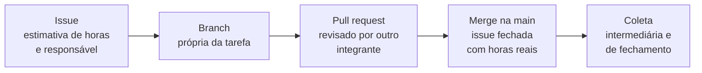
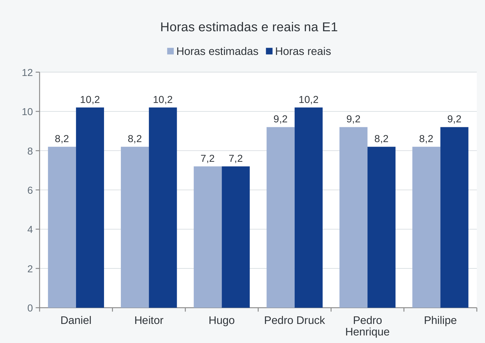
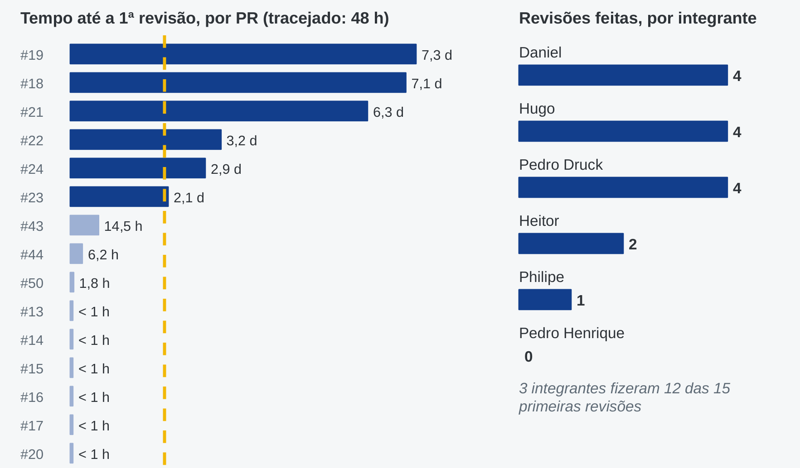

# Gestão do projeto (PSM/CID)

A execução do projeto é acompanhada com métricas baseadas no PSM/CID, em três categorias:

- **Desempenho dos processos** — por exemplo, retrabalho e revisões aprovadas de primeira;
- **Calendário e progresso** — por exemplo, issues fechadas em relação às planejadas;
- **Recursos e custos** — por exemplo, horas dedicadas por integrante.

Cada tarefa é registrada como uma issue, desenvolvida em uma branch própria e integrada por
pull request revisado por outro integrante. Esses registros são a fonte das medições.

- [Plano de métricas PSM/CID](https://github.com/FCTE-Qualidade-de-Software-1/2026-2_T02_KATHERINE_JOHNSON/blob/main/gestao/plano-psm.md)
- [Issues do projeto](https://github.com/FCTE-Qualidade-de-Software-1/2026-2_T02_KATHERINE_JOHNSON/issues)
- [Pull requests](https://github.com/FCTE-Qualidade-de-Software-1/2026-2_T02_KATHERINE_JOHNSON/pulls)
- [Milestones](https://github.com/FCTE-Qualidade-de-Software-1/2026-2_T02_KATHERINE_JOHNSON/milestones)
- [Quadro do backlog (GitHub Project)](https://github.com/orgs/FCTE-Qualidade-de-Software-1/projects/38), com acesso restrito aos membros da organização

O tempo gasto em cada issue é registrado pelos próprios integrantes em
[Registro de horas por issue](gestao-horas.md).

## Como a medição sai do fluxo de trabalho

Cada etapa do fluxo no GitHub deixa um registro, e as métricas são calculadas a partir desses
registros em datas fixas de coleta (Figura 1).

*Figura 1 — Origem dos dados de gestão no repositório. Fonte: `gestao/plano-psm.md`.*

Cada categoria do PSM/CID responde a uma pergunta de gestão (Tabela 1).

| Categoria | Pergunta de gestão | Métricas |
|---|---|---|
| Desempenho dos processos | O trabalho passa na revisão sem voltar para ajuste? | M-DP1 |
| Calendário e progresso | Estamos concluindo o que planejamos até cada data? | M-CP1 |
| Recursos e custos | Quanto esforço gastamos e como ele se divide na equipe? | M-RC1 e M-RC2 |

*Tabela 1 — Categorias, perguntas e métricas. Fonte: `gestao/plano-psm.md`; PSM (McGarry et al., 2002) e ISO/IEC/IEEE 15939:2017.*

## As quatro métricas e a decisão de cada uma

A Tabela 2 resume o cálculo, a faixa considerada adequada e a decisão que o plano prevê quando
o valor sai dessa faixa. As fichas completas estão no
[plano PSM/CID](https://github.com/FCTE-Qualidade-de-Software-1/2026-2_T02_KATHERINE_JOHNSON/blob/main/gestao/plano-psm.md).

| Métrica | Como se calcula | Faixa verde | Amarelo | Vermelho | Decisão se sair da faixa |
|---|---|---|---|---|---|
| M-DP1 — Retrabalho em revisão | PRs com pedido de ajuste ÷ PRs avaliados | até 30% | de 30% a 50% | acima de 50% | Alerta: reforçar o checklist nas issues. Crítico: reunião de 15 min e autoavaliação contra a rubrica no PR |
| M-CP1 — Cumprimento de marcos | Issues concluídas ÷ issues planejadas até a data | 85% ou mais | de 70% a 85% | abaixo de 70% | Moderado: renegociar o prazo em até 12 h. Crítico: reatribuir a subtarefa bloqueada |
| M-RC1 — Variação de esforço | (horas reais − estimadas) ÷ estimadas | de −20% a +20% | de +20% a +40% ou de −40% a −20% | acima de +40% | Acima de +40%: transferir a tarefa secundária. Na entrega seguinte: recalibrar as estimativas |
| M-RC2 — Contribuição individual | Horas do integrante ÷ horas da equipe | de 14% a 20% | de 11% a 14% ou de 20% a 23% | abaixo de 11% ou acima de 23% | Abaixo de 14%: tarefas extras de apoio. No fechamento: tabela de contribuição do artigo |

*Tabela 2 — Métricas de gestão, faixas de interpretação e decisões. Fonte: `gestao/plano-psm.md`, versão 1.2 (10/11/2026). Na versão 1.1, a faixa verde da M-DP1 passou de até 25% para até 30%, por decisão da equipe.*

## Antes do plano: o ponto de partida

O plano PSM/CID foi publicado na noite de 18/10/2026 (commit `83bf969`), junto com as 12
issues da Entrega 1. A divisão de tarefas e as estimativas já tinham sido combinadas na
[ata 01](https://github.com/FCTE-Qualidade-de-Software-1/2026-2_T02_KATHERINE_JOHNSON/blob/main/atas/ata-01-2026-10-16.md)
(16/10), mas ainda não existiam no GitHub. A Tabela 3 compara o repositório antes do plano, na
coleta intermediária e no fechamento da E1.

| Indicador | Antes do plano (até 18/10) | Coleta intermediária (21/10) | Fechamento da E1 (26/10) |
|---|---|---|---|
| Tarefas registradas como issue | Nenhuma; a divisão estava só na ata 01 | 12 issues, 46 h estimadas | 15 issues, 50 h estimadas |
| PRs revisados e mesclados na `main` | 0 | 5 (#13, #14, #15, #17 e #20) | 14 |
| Commits feitos direto na `main`, sem PR | 6, contando o do próprio plano | nenhum novo | 5 novos, todos em 26/10 |
| Issues com horas reais registradas | — | 0 de 12 | 15 de 15 (55 h) |
| M-DP1 — Retrabalho em revisão | Sem dado: nenhum PR | 0% (0 de 5) | 0% (0 de 14), Verde |
| M-CP1 — Cumprimento de marcos | Sem dado: nenhuma issue | 30% (3 de 10)\*, Vermelho | 100% (15 de 15), Verde |
| M-RC1 — Variação de esforço | Sem dado | Sem dado: horas reais em branco | +10%, Verde |
| M-RC2 — Contribuição individual | Sem dado | Sem dado: horas reais em branco | de 13,0% a 18,5%, Amarelo |

*Tabela 3 — Situação do repositório antes e depois da adoção do plano. Fonte: histórico de commits da `main`, issues e PRs no GitHub (levantados em 04/11/2026), ata 01 e ata 02.*

\* Valor recalculado em 04/11/2026 com os prazos internos da ata 01: até 21/10 venciam 10
issues (todas menos a #2 e a #8), e 3 estavam fechadas (#6, #9 e #10). Na reunião de 21/10, a
equipe registrou "3 de 12 issues fechadas" sem classificar o valor; pela faixa do plano
(abaixo de 70%), ele seria Vermelho. A decisão tomada foi priorizar a revisão dos PRs abertos,
porque o trabalho já estava produzido e o fechamento dependia da revisão (ver
[ata 02](https://github.com/FCTE-Qualidade-de-Software-1/2026-2_T02_KATHERINE_JOHNSON/blob/main/atas/ata-02-2026-10-21.md)).

O que mudou com o plano:

- **Antes**, o trabalho entrava na `main` sem revisão (6 commits diretos em 18/10) e não havia
  como calcular nenhuma das quatro métricas: sem issues, sem datas no GitHub e sem horas.
- **Na coleta intermediária**, o fluxo de PR revisado já estava em uso, mas só a M-DP1 e a
  M-CP1 podiam ser calculadas. O registro de horas só começou depois da ata 02, o que a
  retrospectiva também apontou.
- **No fechamento**, as quatro métricas foram calculadas. Os 5 commits diretos de 26/10
  (ajustes finais, README e evidências) mostram que o fluxo ainda não cobria tudo; por isso a
  retrospectiva manteve "sem commit direto na `main`" como ação para a E2.

## Ciclo de medição da Entrega 1

| Data | Etapa | O que foi medido | Decisão |
|---|---|---|---|
| 16/10 | Ata 01 | Divisão em 12 tarefas e 46 h estimadas, ainda fora do GitHub | Adotar issue, branch e PR revisado |
| 18 e 19/10 | Plano publicado | Plano v1.0 e 12 issues abertas, com 46 h estimadas | — |
| 21/10 | Coleta intermediária | 3 de 12 issues fechadas; horas reais em branco; M-RC1 e M-RC2 não calculáveis | Priorizar a revisão dos PRs #18, #19 e #21; todos registram as horas reais (ata 02) |
| 25 e 26/10 | Coleta de fechamento | As quatro métricas calculadas; plano revisto para a versão 1.1 | Backlog da E2 em issues por artefato, com sub-issues para retrabalho |
| 28/10 | Retrospectiva | Problemas votados pela equipe | Ações para a E2, cada uma com responsável e métrica |

*Tabela 4 — Linha do tempo das coletas da E1. Fonte: atas 01 e 02, `atas/registro-decisoes-2026-10-27.md` e `gestao/retrospectiva-e1.pdf`.*

## Medições da Entrega 1

As métricas seguem as definições do [plano PSM/CID](https://github.com/FCTE-Qualidade-de-Software-1/2026-2_T02_KATHERINE_JOHNSON/blob/main/gestao/plano-psm.md). Os
valores abaixo foram obtidos do histórico de issues e pull requests do repositório. O consolidado da
E1 está no [relatório de métricas da Release E1](https://github.com/FCTE-Qualidade-de-Software-1/2026-2_T02_KATHERINE_JOHNSON/blob/main/gestao/relatorio-metricas-e1.md).

| Data da coleta | Métrica | Valor medido | Situação | Interpretação | Decisão de gestão |
|---|---|---|---|---|---|
| 21/10/2026 | M-CP1 (cumprimento de marcos) | 3 de 12 issues fechadas | — | Produção adiantada, mas o fechamento formal dependia das revisões dos PRs abertos ([ata 02](https://github.com/FCTE-Qualidade-de-Software-1/2026-2_T02_KATHERINE_JOHNSON/blob/main/atas/ata-02-2026-10-21.md)) | Priorizar a revisão e o merge dos PRs #18, #19 e #21 |
| 21/10/2026 | M-RC1 e M-RC2 (esforço) | Não calculável | — | Campo de horas reais em branco em todas as issues | Todos preenchem as horas reais nas suas issues |
| 26/10/2026 (fechamento) | M-DP1 (retrabalho em revisão) | 0 de 14 PRs (0%) | Verde (≤ 30%) | Nenhum PR integrado à `main` na E1 recebeu pedido de ajustes ou commits após a revisão. A métrica não capta a espera pela revisão: os PRs #18, #19, #21, #23 e #24 aguardaram de 2 a 7 dias pela aprovação | Manter a revisão por pares e acompanhar o tempo de revisão na Entrega 2 |
| 26/10/2026 (fechamento) | M-CP1 (cumprimento de marcos) | 15 de 15 issues da E1 concluídas (100%) | Verde | A #27 foi fechada como duplicada da #2 e não entra na conta. Parte das issues foi fechada em 25/10 por decisão do grupo (registro abaixo) | Consolidar o backlog da E2 em issues por artefato, com sub-issues para retrabalho |
| 26/10/2026 (fechamento) | M-RC1 (variação de esforço) | 55 h reais / 50 h estimadas (+10%) | Verde | Desvios individuais: Daniel e Heitor +24,5% (Amarelo), concentrados na configuração do repositório e na seção de propósito e GitPage | Aplicar o fator de correção observado nas estimativas da Entrega 2 |
| 26/10/2026 (fechamento) | M-RC2 (contribuição individual) | Pelas horas: mín. 13,0% (Hugo) / máx. 18,5% (Daniel, Heitor e Pedro Druck) | Amarelo | As horas não captam a revisão do trabalho dos colegas, o retorno dado a cada entrega e a organização da equipe | Contribuição final de 16,67% para cada integrante, por decisão da equipe, publicada no apêndice do artigo |

### Por que o retrabalho ficou em 0%

Houve correções na E1, como o limite de 15 páginas e a hipótese H1.1, mas elas viraram
sub-issues próprias (#25, #26 e #45) em vez de ajustes dentro do PR. Por isso aparecem no
calendário (M-CP1), e não na M-DP1.

### Esforço por integrante

*Figura 2 — Horas estimadas e reais por integrante na E1. Fonte: [registro de horas](gestao-horas.md) e `gestao/relatorio-metricas-e1.md`; a 1 h da #25, feita pela equipe, foi dividida igualmente.*

A Figura 2 mostra que Daniel e Heitor ficaram em +24,5% (Amarelo), por causa da configuração
do repositório, da seção de propósito e da GitPage. Pelas horas, a contribuição vai de 13,0% a
18,5%, e Hugo, com 13,0%, ficaria no Amarelo. A equipe decidiu publicar 16,67% para cada
integrante, porque as horas não registram a revisão do trabalho dos colegas, o retorno dado a
cada entrega e a organização da equipe.

## O que as métricas não mostraram: a espera pela revisão

A M-DP1 mede se o PR volta para ajuste, mas não quanto tempo ele espera pela revisão. Esse
problema apareceu na retrospectiva (tópicos C1 e C5) e foi levantado no histórico dos 15 PRs
da E1 (Figura 3).

*Figura 3 — Tempo da abertura até a 1ª revisão de cada PR (linha tracejada: 48 h) e revisões feitas por integrante. Fonte: histórico dos 15 PRs da E1 no GitHub, levantado em 04/11/2026.*

| Indicador | Valor |
|---|---|
| Mediana do tempo até a 1ª revisão | 6,2 h |
| PRs que esperaram mais de 48 h | 6 de 15 (#18, #19, #21, #22, #23 e #24) |
| Maior espera | 7,3 dias (PR #19) |
| Revisões por integrante | Daniel 4, Hugo 4, Pedro Druck 4, Heitor 2, Philipe 1, Pedro Henrique 0 |
| Concentração | 3 integrantes fizeram 12 das 15 primeiras revisões |

*Tabela 5 — Resumo da espera pela revisão na E1. Fonte: a mesma da Figura 3.*

## Ações para a Entrega 2

Os tópicos com 5 ou 6 votos de 6 na retrospectiva viraram ações, cada uma com responsável e
métrica de acompanhamento (Tabela 6).

| Tópico | Ação | Quem acompanha | Métrica |
|---|---|---|---|
| C1 Demora na revisão | Revisar todo PR em até 48 h; passou disso, é cobrado no grupo e vai para a pauta | Daniel | Tempo até a 1ª revisão (até 48 h) e M-DP1 |
| C3 Problemas só no fim | Listar na issue #46 o que pode travar a avaliação (iPhone, veículo real, termos), com responsável e data | Hugo | M-CP1 (85% ou mais) |
| C3 Problemas só no fim | Repassar a lista de pendências em toda reunião e decidir na hora o item atrasado | Pedro Henrique | M-CP1 (85% ou mais) |
| C5 Revisão concentrada | Definir o revisor de cada issue já na criação, em rodízio entre os seis | Philipe | M-RC2 aplicada às revisões (14% a 20%) |
| C6 Manter | Fluxo issue, branch e PR revisado em tudo, sem commit direto na `main` | Pedro Druck | M-DP1 (até 30%) |
| C7 Manter | Uma reunião por semana com ata; decisões fora de reunião registradas em até 24 h | Heitor | Atas ÷ reuniões (100%) |

*Tabela 6 — Ações da retrospectiva para a E2. Fonte: `gestao/retrospectiva-e1.pdf` (28/10/2026), atividade Quê, Quem, Quando.*

## Coleta intermediária da Entrega 2 (10/11/2026)

A primeira coleta da E2 mediu as quatro métricas do plano e as ações da retrospectiva
([ata 03](https://github.com/FCTE-Qualidade-de-Software-1/2026-2_T02_KATHERINE_JOHNSON/blob/main/atas/ata-03-2026-10-28.md)). O resultado é claro: a E2 ainda não tem
planejamento suficiente para medir calendário e esforço (Tabela 7). A equipe confirmou a coleta e
o planejamento das issues na reunião de 10/11
([ata 04](https://github.com/FCTE-Qualidade-de-Software-1/2026-2_T02_KATHERINE_JOHNSON/blob/main/atas/ata-04-2026-11-10.md)). O registro completo está em
[`gestao/coleta-intermediaria-e2.md`](https://github.com/FCTE-Qualidade-de-Software-1/2026-2_T02_KATHERINE_JOHNSON/blob/main/gestao/coleta-intermediaria-e2.md).

| Métrica ou ação | Valor em 10/11 | Situação |
|---|---|---|
| M-CP1 — Cumprimento de marcos | 0 de 6 issues da E2 fechadas; 0 com data planejada | Não calculável (bloqueio na cadeia crítica) |
| M-RC1 e M-RC2 — Esforço | 0 de 6 issues com estimativa ou responsável | Não calculável |
| M-DP1 — Retrabalho em revisão | 0 de 1 PR (#52) | Verde, amostra de um PR |
| C1 — Tempo até a 1ª revisão | #52 revisado em 5 min | Verde |
| C3 — Bloqueios da #46 com responsável e data | Lista sem responsável e sem data | Não cumprida |
| C3 — Pendências repassadas em reunião | Nenhuma reunião de 29/10 a 09/11; a de 10/11 repassou as pendências | Retomada em 10/11 |
| C5 — Revisor em rodízio definido na criação | 0 de 6 issues com revisor antes da reunião; aplicado a todas em 10/11 | Cumprida em 10/11 |
| C6 — Sem commit direto na `main` | 2 commits diretos em 28/10 (o `2186819`, de 26/10, já entra na Tabela 3); nenhum depois | Amarelo |
| C7 — Atas ÷ reuniões | 2 de 2 (28/10 e 10/11); a ata da retrospectiva foi escrita fora do prazo de 24 h | Amarelo |
| C7 — Semanas com reunião | 2 de 3 semanas (nenhuma reunião na semana de 02/11) | Vermelho |

*Tabela 7 — Coleta intermediária da E2. Fonte: issues #28, #36, #46 a #49 e #51, PRs depois de 26/10 e histórico da `main` no GitHub, consultados em 10/11/2026; pasta `atas/`.*

As decisões tomadas a partir da coleta estão na Tabela 8.

| Gatilho | Decisão | Responsável |
|---|---|---|
| M-CP1, M-RC1 e M-RC2 não calculáveis; C5 não cumprida | Dar responsável, revisor em rodízio, prazo e estimativa às issues da E2 (estimativa com o fator +10% da E1 e margem de +20%; prazos até a Entrega 2, em 22/11). Aplicado em 10/11 | Heitor; equipe confirmou |
| Bloqueio na cadeia crítica | Priorizar a Fase 3 (#46), que trava a coleta (#47) e a análise (#48) | Hugo e Philipe |
| Semana de 02/11 sem reunião; C3 sem reunião de abertura | A reunião de 10/11 vale como abertura da E2; ata registrada e uma reunião por semana até 22/11 | Heitor e Pedro Henrique |
| C3 não cumprida | Completar a lista de bloqueios da #46 com responsável e data | Hugo |
| C6 em Amarelo | Manter a regra e conferir de novo na próxima coleta | Pedro Druck |

*Tabela 8 — Decisões da coleta intermediária da E2. Fonte: `gestao/coleta-intermediaria-e2.md`.*

O plano passou para a versão 1.2: as medidas da retrospectiva entraram como métricas
complementares e a E2 ganhou um calendário de coletas (intermediária em 10/11, acompanhamento na
17/11 e fechamento em 21/11, antes da Release E2 de 22/11).

### Situação em 11/11/2026

Com o planejamento aplicado, as métricas voltaram a ser calculáveis (Tabela 9). Duas issues da E2
estavam fechadas: a [#53](https://github.com/FCTE-Qualidade-de-Software-1/2026-2_T02_KATHERINE_JOHNSON/issues/53), da coleta e dos slides, e a
[#55](https://github.com/FCTE-Qualidade-de-Software-1/2026-2_T02_KATHERINE_JOHNSON/issues/55), que corrigiu inconsistências dos registros de gestão.

| Métrica ou ação | Valor em 11/11 | Situação |
|---|---|---|
| M-CP1 — Cumprimento de marcos | 8 de 8 issues com prazo; até 11/11 venciam a #53 e a #55, as duas fechadas no prazo (2 de 2) | Verde, amostra de 2 |
| M-RC1 — Variação de esforço | #53: 3 h para 4 h (−25%); #55: 1 h para 1 h (0%); total 4 h para 5 h (−20%) | Verde, no limite da faixa |
| M-RC2 — Contribuição individual | 8 de 8 issues com responsável; 4 h reais na E2 | Cálculo no fechamento (21/11) |
| M-DP1 — Retrabalho em revisão | 0 de 3 PRs com pedido de ajuste (#52, #54 e #56) | Verde |
| C1 — Tempo até a 1ª revisão | #52 em 5 min, #54 em 11,4 h e #56 dentro de 48 h | Verde |
| C5 — Revisor em rodízio | 8 de 8 issues com revisor; revisões da E2 por Pedro Henrique (2) e Philipe (1) | Cumprida |

*Tabela 9 — Situação das métricas da E2 em 11/11/2026. Fonte: issues #53 e #55 e PRs #52, #54 e #56 no GitHub; [registro de horas](gestao-horas.md).*

Os slides da apresentação de gestão estão em
[`slides/apresentacao-psm-cid-2026-11-11.pdf`](https://github.com/FCTE-Qualidade-de-Software-1/2026-2_T02_KATHERINE_JOHNSON/blob/main/slides/apresentacao-psm-cid-2026-11-11.pdf)
(versão de 04/11 com os slides da coleta da E2, atualizados em 11/11 com a situação das métricas, a reunião de 10/11 e as issues #53 e #55).

## Registro de fechamento de issues da Entrega 1

Em 25/10/2026, as issues abaixo foram fechadas por Pedro Druck, por decisão do grupo. Os
responsáveis (Heitor, Hugo e Philipe) entregaram o trabalho previsto nas suas issues, conforme as
evidências da tabela, mas não conseguiram fechá-las por estarem fora do país, em viagem
internacional. As issues do próprio Pedro Druck também foram fechadas nesta data. As horas reais
de cada issue continuam sendo registradas pelos respectivos responsáveis.

| Issue | Responsável | Evidência da entrega | Pendência remanescente |
|---|---|---|---|
| [#3](https://github.com/FCTE-Qualidade-de-Software-1/2026-2_T02_KATHERINE_JOHNSON/issues/3) Propósito, stakeholders, escopo e introdução | Heitor Macedo Ricardo | [PR #16](https://github.com/FCTE-Qualidade-de-Software-1/2026-2_T02_KATHERINE_JOHNSON/pull/16) e [PR #24](https://github.com/FCTE-Qualidade-de-Software-1/2026-2_T02_KATHERINE_JOHNSON/pull/24) (resgate para a `main`) | Introdução do artigo, tratada nos ajustes pedidos pela professora |
| [#4](https://github.com/FCTE-Qualidade-de-Software-1/2026-2_T02_KATHERINE_JOHNSON/issues/4) Configuração e alimentação da GitPage | Heitor Macedo Ricardo | [PR #15](https://github.com/FCTE-Qualidade-de-Software-1/2026-2_T02_KATHERINE_JOHNSON/pull/15) | Seções das Fases 3 e 4 seguem em [#37](https://github.com/FCTE-Qualidade-de-Software-1/2026-2_T02_KATHERINE_JOHNSON/issues/37) |
| [#5](https://github.com/FCTE-Qualidade-de-Software-1/2026-2_T02_KATHERINE_JOHNSON/issues/5) Levantamento e descrição dos canais | Hugo Freitas Silva | [PR #13](https://github.com/FCTE-Qualidade-de-Software-1/2026-2_T02_KATHERINE_JOHNSON/pull/13), [PR #14](https://github.com/FCTE-Qualidade-de-Software-1/2026-2_T02_KATHERINE_JOHNSON/pull/14) e [PR #20](https://github.com/FCTE-Qualidade-de-Software-1/2026-2_T02_KATHERINE_JOHNSON/pull/20) | Sessão com login de proprietário real, prevista em [#30](https://github.com/FCTE-Qualidade-de-Software-1/2026-2_T02_KATHERINE_JOHNSON/issues/30) e [#32](https://github.com/FCTE-Qualidade-de-Software-1/2026-2_T02_KATHERINE_JOHNSON/issues/32) |
| [#7](https://github.com/FCTE-Qualidade-de-Software-1/2026-2_T02_KATHERINE_JOHNSON/issues/7) Priorização, ODS e referencial SQuaRE | Pedro Druck | [PR #18](https://github.com/FCTE-Qualidade-de-Software-1/2026-2_T02_KATHERINE_JOHNSON/pull/18) | — |
| [#8](https://github.com/FCTE-Qualidade-de-Software-1/2026-2_T02_KATHERINE_JOHNSON/issues/8) Revisão de português e padronização | Pedro Druck | [PR #19](https://github.com/FCTE-Qualidade-de-Software-1/2026-2_T02_KATHERINE_JOHNSON/pull/19) | — |
| [#11](https://github.com/FCTE-Qualidade-de-Software-1/2026-2_T02_KATHERINE_JOHNSON/issues/11) Fichas de métricas e níveis de pontuação | Philipe Amâncio Reis Caetano | [PR #14](https://github.com/FCTE-Qualidade-de-Software-1/2026-2_T02_KATHERINE_JOHNSON/pull/14) e [PR #21](https://github.com/FCTE-Qualidade-de-Software-1/2026-2_T02_KATHERINE_JOHNSON/pull/21) | — |
| [#12](https://github.com/FCTE-Qualidade-de-Software-1/2026-2_T02_KATHERINE_JOHNSON/issues/12) Critérios de julgamento e diagrama GQM | Philipe Amâncio Reis Caetano | [PR #14](https://github.com/FCTE-Qualidade-de-Software-1/2026-2_T02_KATHERINE_JOHNSON/pull/14) e [PR #21](https://github.com/FCTE-Qualidade-de-Software-1/2026-2_T02_KATHERINE_JOHNSON/pull/21) | Regenerar o diagrama GQM em maior legibilidade (ata 02) |

Permanecem abertas as issues de Daniel ([#2](https://github.com/FCTE-Qualidade-de-Software-1/2026-2_T02_KATHERINE_JOHNSON/issues/2) e [#27](https://github.com/FCTE-Qualidade-de-Software-1/2026-2_T02_KATHERINE_JOHNSON/issues/27), esta compartilhada com Pedro Druck) e as
que ainda não têm entrega registrada: [#25](https://github.com/FCTE-Qualidade-de-Software-1/2026-2_T02_KATHERINE_JOHNSON/issues/25) (linhas individuais da declaração de uso de IA) e
[#26](https://github.com/FCTE-Qualidade-de-Software-1/2026-2_T02_KATHERINE_JOHNSON/issues/26) (revisão da hipótese H1.1 e das Tabelas 3 e 5).

*Atualização de 26/10/2026:* a #2 foi concluída com o [PR #50](https://github.com/FCTE-Qualidade-de-Software-1/2026-2_T02_KATHERINE_JOHNSON/pull/50), que também entregou
as sub-issues #25, #26 e #45; a #27 foi fechada como duplicada da #2. Todas as issues da Entrega 1
estão fechadas.