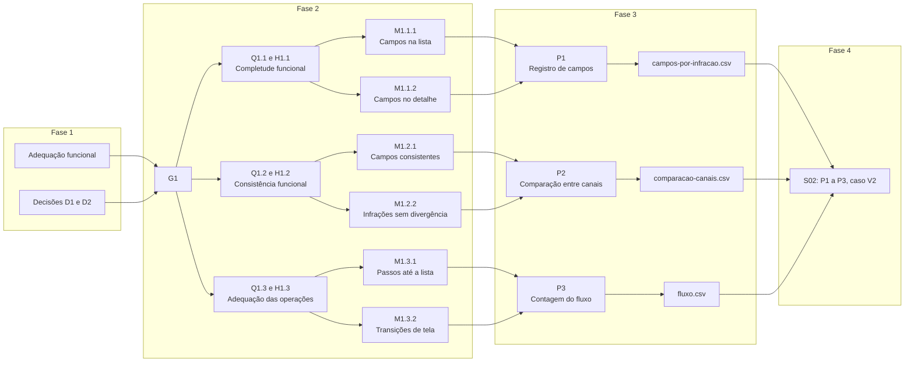
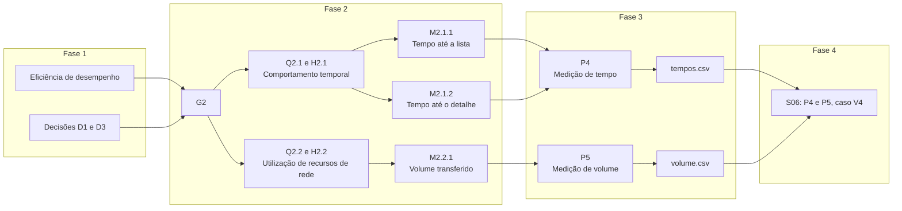
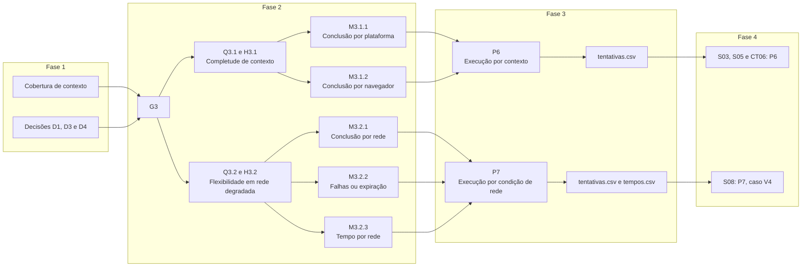

# Avaliação Comparativa de Qualidade em Serviços Digitais de Governo: Portal de Serviços × Aplicativo na Consulta de Infrações do Detran-DF

Este site apresenta o Projeto Final da disciplina FGA0315 Qualidade de Software 1
(Engenharia de Software, UnB/FGA, semestre 2026/2), desenvolvido pela equipe Katherine Johnson.

## O que está sendo avaliado

O projeto avalia a qualidade da **consulta de infrações de trânsito** oferecida pelo Detran-DF
em dois canais: o **Portal de Serviços**, acessado pelo navegador, e o **aplicativo** oficial
para Android e iOS. O objetivo é comparar os dois canais quanto às mesmas características de
qualidade, usando apenas medições externas, observáveis por quem usa o serviço (avaliação
caixa-preta).

As características avaliadas são:

| Característica | Modelo de referência |
|---|---|
| Adequação funcional | ISO/IEC 25010:2023 (qualidade do produto) |
| Eficiência de desempenho | ISO/IEC 25010:2023 (qualidade do produto) |
| Cobertura de contexto | ISO/IEC 25010:2011 (qualidade em uso) e ISO/IEC 25022:2016 |

## Como o trabalho está organizado

A avaliação segue o processo de avaliação de produto da ISO/IEC 25040, dividido em quatro fases.
A [Metodologia](metodologia.md) descreve o método em visão geral e o passo a passo de cada fase.

1. **[Fase 1](fase1.md)** — estabelecer os requisitos da avaliação: propósito, partes
   interessadas, descrição do produto, modelo de qualidade, priorização e escopo.
2. **[Fase 2](fase2.md)** — especificar a avaliação com o método GQM: objetivos, questões,
   hipóteses, métricas, níveis de pontuação e critérios de julgamento.
3. **[Fase 3](fase3.md)** — plano de avaliação: método, ambiente, massa de dados e cronograma
   (plano executado em seis sessões de coleta, em 21 e 22/11/2026).
4. **[Fase 4](fase4.md)** — executar a avaliação e julgar os resultados, com a
   [ação de melhoria](fase4-melhoria.md) (Entrega 2; valores de primeira leitura, com segunda
   leitura independente concluída só para P1 a P3 da S02 e, por isso, sem níveis de pontuação).

A execução do projeto é acompanhada com métricas PSM/CID, descritas em
[Gestão](gestao.md), e as decisões da equipe ficam registradas nas [Atas](atas.md).

## Cadeia da avaliação, da Fase 1 à Fase 4 {#cadeia}

Os três diagramas abaixo mostram, para cada objetivo, como a característica escolhida na Fase 1
leva às questões e hipóteses, às métricas, aos procedimentos de coleta e às observações da
Fase 4. Cada nó é um link para a seção correspondente: clique nele ou percorra os nós com a
tecla Tab e abra com Enter. Os diagramas podem ser rolados na horizontal em telas estreitas.
**Alternativa em texto:** a mesma cadeia está em tabelas na página de
[rastreabilidade](rastreabilidade.md), com uma linha por métrica.

### G1 — Adequação funcional {#cadeia-g1}

*Figura 1 — Cadeia do objetivo G1, da Fase 1 à Fase 4. Alternativa em texto: [linhas de G1 na rastreabilidade](rastreabilidade.md#rt-g1). Fonte: elaborada pela equipe a partir das Fases 1 a 4.*

### G2 — Eficiência de desempenho {#cadeia-g2}

*Figura 2 — Cadeia do objetivo G2, da Fase 1 à Fase 4. Alternativa em texto: [linhas de G2 na rastreabilidade](rastreabilidade.md#rt-g2). Fonte: elaborada pela equipe a partir das Fases 1 a 4.*

### G3 — Cobertura de contexto {#cadeia-g3}

*Figura 3 — Cadeia do objetivo G3, da Fase 1 à Fase 4. Alternativa em texto: [linhas de G3 na rastreabilidade](rastreabilidade.md#rt-g3). Fonte: elaborada pela equipe a partir das Fases 1 a 4.*

## Situação atual

A **Entrega 1** (Fases 1 e 2) foi concluída em 26/10/2026; a versão entregue, com o PDF do artigo,
está em [Releases](https://github.com/FCTE-Qualidade-de-Software-1/2026-2_T02_KATHERINE_JOHNSON/releases). As Fases 3 e 4 fazem parte da Entrega 2: o plano da Fase 3 foi executado em seis sessões de coleta (S01, S02, S03, S05, S06 e S08, em 21 e 22/11/2026) e a Fase 4 traz os valores observados, a análise e a ação de melhoria entregue. Os valores são de primeira leitura, a conferência independente está concluída apenas para P1 a P3 da S02 (uma rolagem do P3 segue pendente) e os objetivos de medição permanecem inconclusivos; as lacunas (aplicativo na rede degradada e contexto CT04) estão declaradas. O andamento das tarefas pode ser acompanhado no
[quadro do backlog](https://github.com/orgs/FCTE-Qualidade-de-Software-1/projects/38) (acesso restrito aos membros da organização; as
[issues](https://github.com/FCTE-Qualidade-de-Software-1/2026-2_T02_KATHERINE_JOHNSON/issues) e os [milestones](https://github.com/FCTE-Qualidade-de-Software-1/2026-2_T02_KATHERINE_JOHNSON/milestones) são públicos).

## Onde estão as evidências

- [Repositório do projeto](https://github.com/FCTE-Qualidade-de-Software-1/2026-2_T02_KATHERINE_JOHNSON)
- [Releases](https://github.com/FCTE-Qualidade-de-Software-1/2026-2_T02_KATHERINE_JOHNSON/releases) — versões entregues, com o PDF do artigo
- [Artigo em LaTeX](https://github.com/FCTE-Qualidade-de-Software-1/2026-2_T02_KATHERINE_JOHNSON/tree/main/artigo)
- [Plano de gestão PSM/CID](https://github.com/FCTE-Qualidade-de-Software-1/2026-2_T02_KATHERINE_JOHNSON/tree/main/gestao)
- [Atas de reunião](atas.md)
- [Slides do Ponto de Controle 1 (PDF, 19/10/2026)](https://github.com/FCTE-Qualidade-de-Software-1/2026-2_T02_KATHERINE_JOHNSON/blob/main/slides/ponto-de-controle-1-2026-10-19.pdf)
- [Evidências do levantamento da Fase 1](https://github.com/FCTE-Qualidade-de-Software-1/2026-2_T02_KATHERINE_JOHNSON/tree/main/evidencias/fase1)
- [Evidências e registro de sessão da Fase 4](https://github.com/FCTE-Qualidade-de-Software-1/2026-2_T02_KATHERINE_JOHNSON/tree/main/evidencias/fase4)
- [Dados da avaliação e termo de consentimento](https://github.com/FCTE-Qualidade-de-Software-1/2026-2_T02_KATHERINE_JOHNSON/tree/main/dados)
- [Registro de horas por issue](gestao-horas.md)

Dados pessoais de condutores e veículos usados na avaliação não são publicados. Prints e
registros aparecem anonimizados, com códigos como "Veículo V1".
