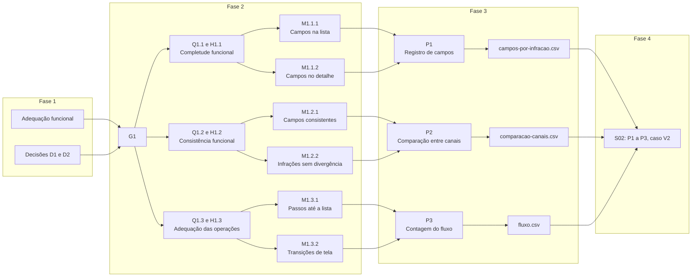
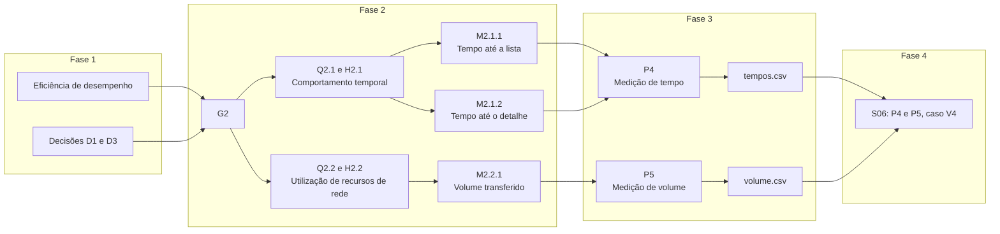
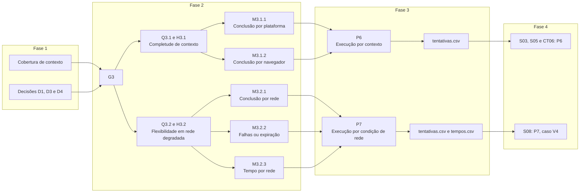

# Avaliação Comparativa de Qualidade em Serviços Digitais de Governo: Portal de Serviços × Aplicativo na Consulta de Infrações do Detran-DF

Este site apresenta o Projeto Final da disciplina FGA0315 Qualidade de Software 1
(Engenharia de Software, UnB/FGA, semestre 2026/2), desenvolvido pela equipe Katherine Johnson.

<a class="kj-destaque" href="#cadeia">
Explore a avaliação
Cadeia da avaliação, da Fase 1 à Fase 4
Diagramas clicáveis ligam cada uma das 14 métricas à característica, à questão, à hipótese, ao procedimento de coleta e à observação registrada.
Ver os diagramas
</a>
<a class="kj-destaque" href="#evidencias">
Dados e provas
Evidências das coletas
Registros das seis sessões de 21 e 22/11/2026, capturas anonimizadas, dados brutos em CSV e desvios, organizados por sessão.
Ver as evidências
</a>

## O que está sendo avaliado

O projeto avalia a qualidade da **consulta de infrações de trânsito** oferecida pelo Detran-DF
em dois canais: o **Portal de Serviços**, acessado pelo navegador, e o **aplicativo** oficial
para Android e iOS. O objetivo é comparar os dois canais quanto às mesmas características de
qualidade, usando apenas medições externas, observáveis por quem usa o serviço (avaliação
caixa-preta).

As características avaliadas são:

| Característica | Modelo de referência |
|---|---|
| Adequação funcional | ISO/IEC 25010:2023 (qualidade do produto) |
| Eficiência de desempenho | ISO/IEC 25010:2023 (qualidade do produto) |
| Cobertura de contexto | ISO/IEC 25010:2011 (qualidade em uso) e ISO/IEC 25022:2016 |

## Cadeia da avaliação, da Fase 1 à Fase 4 {#cadeia}

Cada diagrama mostra, para um objetivo, como a característica escolhida na Fase 1 leva às
questões e hipóteses, às métricas, aos procedimentos de coleta e às observações da Fase 4. As
cores identificam a fase de cada elemento. Cada nó é um link para a seção correspondente:
clique nele ou percorra os nós com a tecla Tab e abra com Enter. Em telas estreitas, os
diagramas rolam na horizontal.

**Alternativa em texto:** a mesma cadeia está em tabelas na página de
[rastreabilidade](rastreabilidade.md), com uma linha por métrica.

<ul class="kj-legenda" aria-label="Cores por fase">
<li>Fase 1: característica e decisões</li>
<li>Fase 2: objetivo, questões e métricas</li>
<li>Fase 3: procedimentos e arquivos de dados</li>
<li>Fase 4: sessões e observações</li>
</ul>

### G1 — Adequação funcional {#cadeia-g1}

*Figura 1 — Cadeia do objetivo G1, da Fase 1 à Fase 4. Alternativa em texto: [linhas de G1 na rastreabilidade](rastreabilidade.md#rt-g1). Fonte: elaborada pela equipe a partir das Fases 1 a 4.*

### G2 — Eficiência de desempenho {#cadeia-g2}

*Figura 2 — Cadeia do objetivo G2, da Fase 1 à Fase 4. Alternativa em texto: [linhas de G2 na rastreabilidade](rastreabilidade.md#rt-g2). Fonte: elaborada pela equipe a partir das Fases 1 a 4.*

### G3 — Cobertura de contexto {#cadeia-g3}

*Figura 3 — Cadeia do objetivo G3, da Fase 1 à Fase 4. Alternativa em texto: [linhas de G3 na rastreabilidade](rastreabilidade.md#rt-g3). Fonte: elaborada pela equipe a partir das Fases 1 a 4.*

## Como o trabalho está organizado

A avaliação segue o processo de avaliação de produto da ISO/IEC 25040, dividido em quatro fases.
A [Metodologia](metodologia.md) descreve o método em visão geral e o passo a passo de cada fase.

1. **[Fase 1](fase1.md)** — estabelecer os requisitos da avaliação: propósito, partes
   interessadas, descrição do produto, modelo de qualidade, priorização e escopo.
2. **[Fase 2](fase2.md)** — especificar a avaliação com o método GQM: objetivos, questões,
   hipóteses, métricas, níveis de pontuação e critérios de julgamento.
3. **[Fase 3](fase3.md)** — plano de avaliação: método, ambiente, massa de dados e cronograma
   (plano executado em seis sessões de coleta, em 21 e 22/11/2026).
4. **[Fase 4](fase4.md)** — executar a avaliação e julgar os resultados, com a
   [ação de melhoria](fase4-melhoria.md) (Entrega 2; resultados elegíveis conferidos, calculados
   e julgados por questão, objetivo e canal; lacunas de contexto permanecem explícitas).

A execução do projeto é acompanhada com métricas PSM/CID, descritas em
[Gestão](gestao.md), e as decisões da equipe ficam registradas nas [Atas](atas.md).

## Situação atual

A **Entrega 1** (Fases 1 e 2) foi concluída em 26/10/2026; a versão entregue, com o PDF do artigo,
está em [Releases](https://github.com/FCTE-Qualidade-de-Software-1/2026-2_T02_KATHERINE_JOHNSON/releases). As Fases 3 e 4 fazem parte da Entrega 2: o plano da Fase 3 foi executado em seis sessões de coleta (S01, S02, S03, S05, S06 e S08, em 21 e 22/11/2026). As segundas leituras elegíveis foram concluídas, os níveis calculados e as respostas GQM registradas. A adequação funcional não foi atendida; a eficiência de desempenho permanece inconclusiva pela não equivalência dos instrumentos de volume; a cobertura foi atendida no portal nos contextos medidos e não atendida no escopo observado para o aplicativo. Permanecem as lacunas do aplicativo na rede degradada e do contexto CT04. O andamento das tarefas pode ser acompanhado no
[quadro do backlog](https://github.com/orgs/FCTE-Qualidade-de-Software-1/projects/38) (acesso restrito aos membros da organização; as
[issues](https://github.com/FCTE-Qualidade-de-Software-1/2026-2_T02_KATHERINE_JOHNSON/issues) e os [milestones](https://github.com/FCTE-Qualidade-de-Software-1/2026-2_T02_KATHERINE_JOHNSON/milestones) são públicos).

## Onde estão as evidências {#evidencias}

As evidências das coletas ficam no repositório, em [`evidencias/fase4/`](https://github.com/FCTE-Qualidade-de-Software-1/2026-2_T02_KATHERINE_JOHNSON/tree/main/evidencias/fase4)
(registros de sessão e capturas anonimizadas) e em [`dados/brutos/`](https://github.com/FCTE-Qualidade-de-Software-1/2026-2_T02_KATHERINE_JOHNSON/tree/main/dados/brutos) (valores
registrados em CSV). A Tabela 1 indica onde está o material de cada sessão.

| Sessão e data | Procedimentos e caso | Registro da sessão | Capturas anonimizadas | Dados brutos |
|---|---|---|---|---|
| S01, 22/11 (piloto) | Telas e instrumentos; V2, com telas de V1 e V5 | [Registro da S01](https://github.com/FCTE-Qualidade-de-Software-1/2026-2_T02_KATHERINE_JOHNSON/blob/main/evidencias/fase4/S01-registro-2026-11-22.md) | 11 telas do portal, do Android e do iOS: [capturas da S01](https://github.com/FCTE-Qualidade-de-Software-1/2026-2_T02_KATHERINE_JOHNSON/tree/main/evidencias/fase4/capturas/S01) | Não entra no cálculo |
| S02, 22/11 | P1 a P3; V2 | [Registro da S02](https://github.com/FCTE-Qualidade-de-Software-1/2026-2_T02_KATHERINE_JOHNSON/blob/main/evidencias/fase4/S02-registro-2026-11-22.md); [segunda leitura](https://github.com/FCTE-Qualidade-de-Software-1/2026-2_T02_KATHERINE_JOHNSON/blob/main/evidencias/fase4/S02-segunda-leitura-2026-11-23.md) | Lista e detalhe nos dois canais: [capturas da S02](https://github.com/FCTE-Qualidade-de-Software-1/2026-2_T02_KATHERINE_JOHNSON/tree/main/evidencias/fase4/capturas/S02) | [`campos-por-infracao.csv`](https://github.com/FCTE-Qualidade-de-Software-1/2026-2_T02_KATHERINE_JOHNSON/blob/main/dados/brutos/campos-por-infracao.csv), [`comparacao-canais.csv`](https://github.com/FCTE-Qualidade-de-Software-1/2026-2_T02_KATHERINE_JOHNSON/blob/main/dados/brutos/comparacao-canais.csv), [`fluxo.csv`](https://github.com/FCTE-Qualidade-de-Software-1/2026-2_T02_KATHERINE_JOHNSON/blob/main/dados/brutos/fluxo.csv) |
| S03, 21/11 | P6 (CT01, CT03 e CT05); V1 | [Registro da S03](https://github.com/FCTE-Qualidade-de-Software-1/2026-2_T02_KATHERINE_JOHNSON/blob/main/evidencias/fase4/S03-registro-2026-11-21.md) | 9 tentativas: [capturas da S03](https://github.com/FCTE-Qualidade-de-Software-1/2026-2_T02_KATHERINE_JOHNSON/tree/main/evidencias/fase4/capturas/S03) (blocos B01 a B03) | [`tentativas.csv`](https://github.com/FCTE-Qualidade-de-Software-1/2026-2_T02_KATHERINE_JOHNSON/blob/main/dados/brutos/tentativas.csv) |
| CT06, 22/11 | P6 no iOS; V5 | [Registro do CT06](https://github.com/FCTE-Qualidade-de-Software-1/2026-2_T02_KATHERINE_JOHNSON/blob/main/evidencias/fase4/S03-CT06-iphone-registro-2026-11-22.md) | 2 telas na pasta da S03 (bloco B04) | [`tentativas.csv`](https://github.com/FCTE-Qualidade-de-Software-1/2026-2_T02_KATHERINE_JOHNSON/blob/main/dados/brutos/tentativas.csv) |
| S05, 22/11 | P6 (CT05, CT02 e CT01); V2 | [Registro da S05](https://github.com/FCTE-Qualidade-de-Software-1/2026-2_T02_KATHERINE_JOHNSON/blob/main/evidencias/fase4/S05-registro-2026-11-22.md) | 9 tentativas: [capturas da S05](https://github.com/FCTE-Qualidade-de-Software-1/2026-2_T02_KATHERINE_JOHNSON/tree/main/evidencias/fase4/capturas/S05) | [`tentativas.csv`](https://github.com/FCTE-Qualidade-de-Software-1/2026-2_T02_KATHERINE_JOHNSON/blob/main/dados/brutos/tentativas.csv) |
| S06, 22/11 | P4 e P5; V4 | [Registro da S06](https://github.com/FCTE-Qualidade-de-Software-1/2026-2_T02_KATHERINE_JOHNSON/blob/main/evidencias/fase4/S06-registro-2026-11-22.md) | Gravações e leituras em armazenamento privado, sem captura pública | [`tempos.csv`](https://github.com/FCTE-Qualidade-de-Software-1/2026-2_T02_KATHERINE_JOHNSON/blob/main/dados/brutos/tempos.csv), [`volume.csv`](https://github.com/FCTE-Qualidade-de-Software-1/2026-2_T02_KATHERINE_JOHNSON/blob/main/dados/brutos/volume.csv) |
| S08, 22/11 | P7; V4 | [Registro da S08](https://github.com/FCTE-Qualidade-de-Software-1/2026-2_T02_KATHERINE_JOHNSON/blob/main/evidencias/fase4/S08-registro-2026-11-22.md) | Gravações em armazenamento privado, sem captura pública | [`tentativas.csv`](https://github.com/FCTE-Qualidade-de-Software-1/2026-2_T02_KATHERINE_JOHNSON/blob/main/dados/brutos/tentativas.csv), [`tempos.csv`](https://github.com/FCTE-Qualidade-de-Software-1/2026-2_T02_KATHERINE_JOHNSON/blob/main/dados/brutos/tempos.csv) |

*Tabela 1 — Evidências das coletas por sessão. Fonte: `evidencias/fase4/` e `dados/brutos/`.*

Mudanças em relação ao plano estão em [`desvios.csv`](https://github.com/FCTE-Qualidade-de-Software-1/2026-2_T02_KATHERINE_JOHNSON/blob/main/dados/brutos/desvios.csv), e o ambiente
de cada sessão em [`ambientes.csv`](https://github.com/FCTE-Qualidade-de-Software-1/2026-2_T02_KATHERINE_JOHNSON/blob/main/dados/brutos/ambientes.csv). Originais, vídeos sem tarja e
termos assinados ficam em armazenamento privado, com acesso restrito aos avaliadores.

### Outros materiais

- [Repositório do projeto](https://github.com/FCTE-Qualidade-de-Software-1/2026-2_T02_KATHERINE_JOHNSON)
- [Releases](https://github.com/FCTE-Qualidade-de-Software-1/2026-2_T02_KATHERINE_JOHNSON/releases) — versões entregues, com o PDF do artigo
- [Artigo em LaTeX](https://github.com/FCTE-Qualidade-de-Software-1/2026-2_T02_KATHERINE_JOHNSON/tree/main/artigo)
- [Plano de gestão PSM/CID](https://github.com/FCTE-Qualidade-de-Software-1/2026-2_T02_KATHERINE_JOHNSON/tree/main/gestao)
- [Atas de reunião](atas.md)
- [Slides do Ponto de Controle 1 (PDF, 19/10/2026)](https://github.com/FCTE-Qualidade-de-Software-1/2026-2_T02_KATHERINE_JOHNSON/blob/main/slides/ponto-de-controle-1-2026-10-19.pdf)
- [Evidências do levantamento da Fase 1](https://github.com/FCTE-Qualidade-de-Software-1/2026-2_T02_KATHERINE_JOHNSON/tree/main/evidencias/fase1)
- [Dados da avaliação e termo de consentimento](https://github.com/FCTE-Qualidade-de-Software-1/2026-2_T02_KATHERINE_JOHNSON/tree/main/dados)
- [Registro de horas por issue](gestao-horas.md)

Dados pessoais de condutores e veículos usados na avaliação não são publicados. Prints e
registros aparecem anonimizados, com códigos como "Veículo V1".
