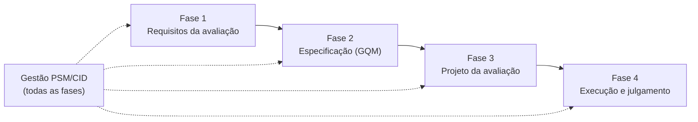

# Metodologia

Esta página descreve como a avaliação é conduzida. Primeiro apresenta a visão geral do método,
com o processo de avaliação, os modelos e as técnicas adotadas; depois detalha, passo a passo, o
que foi feito em cada uma das quatro fases. Nas Fases 1 e 2, a numeração dos passos é a mesma das
subseções da Metodologia no artigo. A ligação de cada métrica com os elementos de todas as fases
está na página de [rastreabilidade](rastreabilidade.md).

## Visão geral

A avaliação compara a **consulta de infrações** do Detran-DF em dois canais, o Portal de
Serviços e o aplicativo, sob o ponto de vista de quem usa o serviço. Todas as medições são
externas (caixa-preta): a equipe não tem acesso ao código-fonte nem à infraestrutura do Detran-DF,
e cada métrica precisa ser aplicável igualmente aos dois canais.

O trabalho combina quatro referenciais (Tabela 1):

| Referencial | Papel no projeto |
|---|---|
| Processo de avaliação de produto da família SQuaRE (ISO/IEC 25040) | Organiza a avaliação em quatro fases, da definição dos requisitos ao julgamento dos resultados |
| Modelos de qualidade da família SQuaRE (ISO/IEC 25010 e ISO/IEC 25022) | Fornecem as características e subcaracterísticas avaliadas |
| Goal–Question–Metric (GQM) | Liga os objetivos de medição às questões e às métricas da Fase 2 |
| Practical Software Measurement (PSM/CID) e ISO/IEC/IEEE 15939 | Acompanham a execução do próprio projeto com métricas de gestão |

*Tabela 1 — Referenciais adotados. Fonte: elaborada pela equipe.*

A Figura 1 mostra a sequência das fases e o acompanhamento de gestão.

*Figura 1 — Fases da avaliação segundo a ISO/IEC 25040 e o acompanhamento de gestão. Fonte: elaborada pela equipe.*

Cada fase produz artefatos que alimentam a seguinte: as características priorizadas na Fase 1
viram objetivos de medição na Fase 2; as métricas da Fase 2 definem o que o plano da Fase 3 deve
coletar; e os níveis de pontuação e critérios de julgamento da Fase 2 são aplicados aos dados
na Fase 4.

### Organização do trabalho da equipe

- Cada tarefa é uma *issue* com responsável, critérios de aceitação e estimativa de horas,
  agrupada no *milestone* da entrega correspondente.
- O trabalho é feito em uma *branch* própria e integrado à `main` por *pull request* revisado
  por outro integrante.
- O andamento é acompanhado no [quadro do backlog](https://github.com/orgs/FCTE-Qualidade-de-Software-1/projects/38) (acesso restrito aos membros da organização),
  e o tempo gasto em cada issue é registrado em [Registro de horas](gestao-horas.md).
- As decisões de equipe ficam nas [Atas](atas.md), e as medições de gestão em
  [Gestão (PSM/CID)](gestao.md).

## Fase 1 — Requisitos da avaliação

**Objetivo:** definir por que a avaliação existe, o que será avaliado e com quais
características de qualidade.

| Passo | O que foi feito | Resultado |
|---|---|---|
| 1.1 Propósito, requisitante e partes interessadas | Definição do propósito, de quem solicita a avaliação, das decisões que ela apoia e dos interessados, com papel, critérios de sucesso e influência | [Propósito, partes interessadas e escopo](fase1-proposito.md) |
| 1.2 Escopo, profundidade e limites de validade | Delimitação dos objetos avaliados, dos contextos de uso, do que fica fora e dos limites de validade dos resultados | [Propósito, partes interessadas e escopo](fase1-proposito.md) |
| 1.3 Descrição do produto e arquitetura de contexto | Levantamento público dos dois canais (telas, passos da consulta, campos exibidos) e diagrama de contexto | [Produto e modelo de qualidade](fase1-produto.md) |
| 1.4 Modelo de qualidade adaptado | Adaptação do modelo SQuaRE ao produto, com a seleção das subcaracterísticas | [Produto e modelo de qualidade](fase1-produto.md) |
| 1.5 Priorização das características e cobertura de contexto | Matriz de priorização ponderada, análise de sensibilidade e trade-offs, resultando em adequação funcional, eficiência de desempenho e cobertura de contexto, e a distinção entre cobertura de contexto e usabilidade | [Priorização, cobertura de contexto e ODS](fase1-priorizacao.md) |
| 1.6 Alinhamento aos ODS | Vínculo da avaliação com metas e indicadores dos Objetivos de Desenvolvimento Sustentável | [Priorização, cobertura de contexto e ODS](fase1-priorizacao.md) |

## Fase 2 — Especificação da avaliação

**Objetivo:** transformar as características priorizadas em uma estrutura de medição
verificável, usando o método GQM.

| Passo | O que foi feito | Resultado |
|---|---|---|
| 2.1 Rastreabilidade e objetivos de medição | Cada característica priorizada e cada parte interessada originam um objetivo; três objetivos (G1 a G3) no modelo estruturado do GQM | [Objetivos, questões e hipóteses](fase2-gqm.md) |
| 2.2 Questões de medição e hipóteses | Sete questões, cada uma com hipótese explícita | [Objetivos, questões e hipóteses](fase2-gqm.md) |
| 2.3 Especificação das métricas | Quatorze métricas caixa-preta, cada uma com definição, cálculo, fonte, coleta e interpretação | [Métricas, níveis e critérios de julgamento](fase2-metricas.md) |
| 2.4 Níveis de pontuação, critérios de julgamento e diagrama GQM | Faixas de aceitação para todas as métricas, regras para passar dos resultados às respostas das questões e dos objetivos, e a hierarquia objetivos → questões → métricas | [Métricas, níveis e critérios de julgamento](fase2-metricas.md) |

## Fase 3 — Projeto da avaliação (Entrega 2)

**Objetivo:** planejar como as medições seriam obtidas, de forma repetível.

| Passo | O que foi feito | Resultado |
|---|---|---|
| 3.1 Método e instruções para o avaliador | Método caixa-preta roteirizado, parâmetros comuns (repetições, cache, tempo limite, condições de rede) e sete procedimentos que cobrem as quatorze métricas, com a rastreabilidade de cada métrica até o arquivo de dados | [Método e instruções para o avaliador](fase3-metodo.md) |
| 3.2 Recursos e ambiente | Contextos CT01 a CT06, dispositivos, preparação da rede e piloto | [Recursos e ambiente](fase3-ambiente.md) |
| 3.3 Massa e instrumentos de coleta | Veículos consentidos, termo de consentimento e oito arquivos CSV | [Massa e instrumentos de coleta](fase3-dados.md) |
| 3.4 Cronograma e bloqueios | Sessões, responsáveis, bloqueios e critérios de resolução | [Cronograma e bloqueios](fase3-cronograma.md) |

## Fase 4 — Execução e julgamento (Entrega 2)

**Objetivo:** obter as medidas, calcular as métricas, responder às questões do GQM e julgar a
qualidade dos dois canais.

| Passo | O que foi feito | Resultado |
|---|---|---|
| 4.1 Execução das medições | Seis sessões em 21 e 22/11/2026 (S01, S02, S03, S05, S06 e S08), com registros, evidências anonimizadas e desvios | [Coleta, pendências e cálculo](fase4-coleta.md) |
| 4.2 Cálculo e comparação com os níveis | Valores de primeira leitura; níveis aguardam a segunda leitura independente | [Análise e julgamento GQM](fase4-analise.md) |
| 4.3 Julgamento e conclusões | Questões e objetivos inconclusivos até a conferência, com lacunas declaradas | [Análise e julgamento GQM](fase4-analise.md#julgamento) |
| 4.4 Ação de melhoria | Proposta de processo com templates técnicos, motivada pela falha de P6 no aplicativo 2.6.3 | [Ação de melhoria](fase4-melhoria.md) |

O andamento da fase, as responsabilidades e as limitações já conhecidas estão em
[Fase 4](fase4.md); a ação de melhoria tem página própria em [Ação de melhoria](fase4-melhoria.md).
