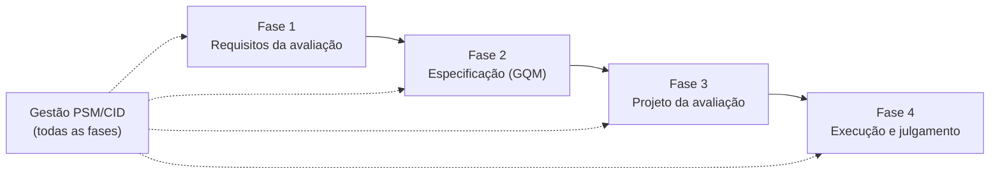

# Metodologia

Esta página descreve como a avaliação é conduzida. Primeiro apresenta a visão geral do método,
com o processo de avaliação, os modelos e as técnicas adotadas; depois detalha, passo a passo, o
que foi feito em cada fase já concluída e o que está previsto para as próximas.

## Visão geral

A avaliação compara a **consulta de infrações** do Detran-DF em dois canais, o Portal de
Serviços e o aplicativo, sob o ponto de vista de quem usa o serviço. Todas as medições são
externas (caixa-preta): a equipe não tem acesso ao código-fonte nem à infraestrutura do Detran-DF,
e cada métrica precisa ser aplicável igualmente aos dois canais.

O trabalho combina três referenciais:

| Referencial | Papel no projeto |
|---|---|
| Processo de avaliação de produto da família SQuaRE (ISO/IEC 25040) | Organiza a avaliação em quatro fases, da definição dos requisitos ao julgamento dos resultados |
| Modelos de qualidade da família SQuaRE (ISO/IEC 25010 e ISO/IEC 25022) | Fornecem as características e subcaracterísticas avaliadas |
| Goal–Question–Metric (GQM) | Liga os objetivos de medição às questões e às métricas da Fase 2 |
| Practical Software Measurement (PSM/CID) e ISO/IEC/IEEE 15939 | Acompanham a execução do próprio projeto com métricas de gestão |

Cada fase produz artefatos que alimentam a seguinte: as características priorizadas na Fase 1
viram objetivos de medição na Fase 2; as métricas da Fase 2 definem o que o plano da Fase 3 deve
coletar; e os níveis de pontuação e critérios de julgamento da Fase 2 são aplicados aos dados
na Fase 4.

### Organização do trabalho da equipe

- Cada tarefa é uma *issue* com responsável, critérios de aceitação e estimativa de horas,
  agrupada no *milestone* da entrega correspondente.
- O trabalho é feito em uma *branch* própria e integrado à `main` por *pull request* revisado
  por outro integrante.
- O andamento é acompanhado no [quadro do backlog](https://github.com/users/pedruck/projects/1),
  e o tempo gasto em cada issue é registrado em [Registro de horas](gestao-horas.md).
- As decisões de equipe ficam nas [Atas](atas.md), e as medições de gestão em
  [Gestão (PSM/CID)](gestao.md).

## Fase 1 — Requisitos da avaliação

**Objetivo:** definir por que a avaliação existe, o que será avaliado e com quais
características de qualidade.

| Passo | O que foi feito | Resultado |
|---|---|---|
| 1. Propósito e requisitante | Definição do propósito, de quem solicita a avaliação e das decisões que ela apoia | [Propósito, partes interessadas e escopo](fase1-proposito.md) |
| 2. Partes interessadas | Identificação dos interessados, com papel, critérios de sucesso e influência | [Propósito, partes interessadas e escopo](fase1-proposito.md) |
| 3. Escopo e profundidade | Delimitação dos objetos avaliados, dos contextos de uso, do que fica fora e dos limites de validade dos resultados | [Propósito, partes interessadas e escopo](fase1-proposito.md) |
| 4. Descrição do produto | Levantamento público dos dois canais (telas, passos da consulta, campos exibidos) e diagrama de contexto | [Produto e modelo de qualidade](fase1-produto.md) |
| 5. Modelo de qualidade | Adaptação do modelo SQuaRE ao produto, com a seleção das subcaracterísticas | [Produto e modelo de qualidade](fase1-produto.md) |
| 6. Priorização | Matriz de priorização ponderada, análise de sensibilidade e discussão de trade-offs, resultando em adequação funcional, eficiência de desempenho e cobertura de contexto | [Priorização, cobertura de contexto e ODS](fase1-priorizacao.md) |
| 7. Relação com os ODS | Vínculo da avaliação com metas e indicadores dos Objetivos de Desenvolvimento Sustentável | [Priorização, cobertura de contexto e ODS](fase1-priorizacao.md) |

## Fase 2 — Especificação da avaliação

**Objetivo:** transformar as características priorizadas em uma estrutura de medição
verificável, usando o método GQM.

| Passo | O que foi feito | Resultado |
|---|---|---|
| 1. Rastreabilidade com a Fase 1 | Cada característica priorizada e cada parte interessada originam um objetivo de medição | [Objetivos, questões e hipóteses](fase2-gqm.md) |
| 2. Objetivos de medição | Três objetivos (G1 a G3) escritos no modelo estruturado do GQM | [Objetivos, questões e hipóteses](fase2-gqm.md) |
| 3. Questões e hipóteses | Sete questões, cada uma com hipótese explícita | [Objetivos, questões e hipóteses](fase2-gqm.md) |
| 4. Métricas | Quatorze métricas caixa-preta, cada uma com definição, cálculo, fonte, coleta e interpretação | [Métricas, níveis e critérios de julgamento](fase2-metricas.md) |
| 5. Níveis de pontuação | Faixas de aceitação definidas para todas as métricas | [Métricas, níveis e critérios de julgamento](fase2-metricas.md) |
| 6. Critérios de julgamento | Regras para passar dos resultados das métricas às respostas das questões e dos objetivos | [Métricas, níveis e critérios de julgamento](fase2-metricas.md) |
| 7. Diagrama GQM | Hierarquia completa objetivos → questões → métricas | [Métricas, níveis e critérios de julgamento](fase2-metricas.md) |

## Fase 3 — Projeto da avaliação (Entrega 2)

**Objetivo:** planejar como as medições serão obtidas, de forma repetível.

Passos previstos: definição do método e das instruções para o avaliador; especificação dos
recursos, do ambiente e da massa de dados; e cronograma das sessões de coleta.

## Fase 4 — Execução e julgamento (Entrega 2)

**Objetivo:** obter as medidas, calcular as métricas, responder às questões do GQM e julgar a
qualidade dos dois canais.

Passos previstos: execução das medições com registro de evidências; organização dos dados
brutos; cálculo das métricas e comparação com os níveis de pontuação; julgamento e conclusões
em relação ao propósito da Fase 1; e execução de uma ação de melhoria justificada pelos
resultados.
