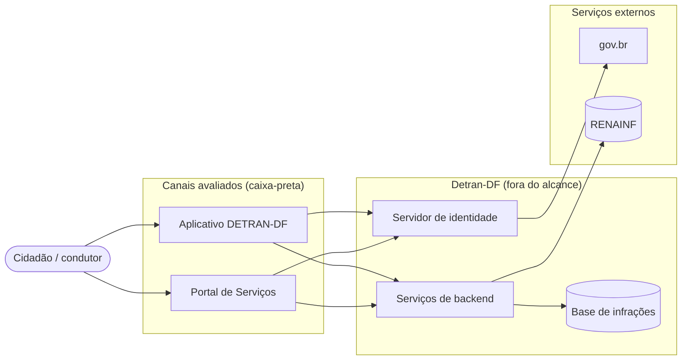
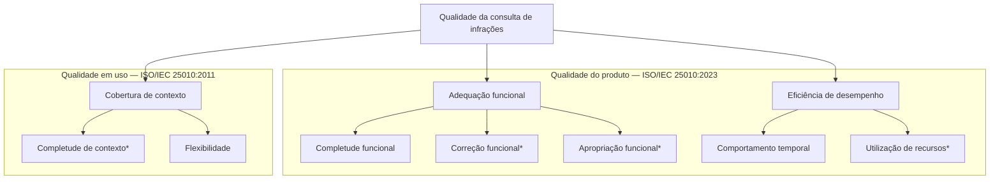

# Deck do Ponto de Controle 1 — conteúdo geral e direção visual

> **Nota de 27/10/2026.** Estes arquivos registram o conteúdo preparado para o Ponto de Controle 1, em
> 19/10. Eles não refletem a versão final da Entrega 1 (por exemplo, a hipótese H1.1 foi revista e o
> artigo foi integrado); a versão final está em `artigo/main.pdf` e na GitPage. Os slides apresentados
> estão em [`ponto-de-controle-1-2026-10-19.pdf`](ponto-de-controle-1-2026-10-19.pdf).

Documento-base para gerar os slides da apresentação do Ponto de Controle 1 (19/10/2026). Ele
reúne, em ordem, o conteúdo de todos os integrantes e define o estilo visual. Os arquivos
`slides/conteudo-<nome>.md` têm o mesmo conteúdo com mais detalhe e a fala de cada um.

O deck mostra **o que as Fases 1 e 2 terão até 19/10 às 12h** e o que falta até a Entrega 1
(26/10). Não é a entrega final: é o ponto em que a professora indica correções.

---

## Parte 1 — Direção visual

### Conceito

O assunto é a consulta de multas de trânsito, e o documento mais característico desse mundo é o
**auto de infração**: um formulário oficial com campos rotulados, preenchidos com dados objetivos.
O deck usa essa linguagem de formulário e a sinalização viária brasileira, sem imitar nenhum
documento real nem usar a marca do Detran-DF.

**O elemento memorável é um só:** a faixa amarela tracejada, como a marcação que divide as
faixas de uma via. Ela separa Portal de Serviços e aplicativo em todo slide de comparação, e
aparece uma vez na capa. Todo o resto fica quieto e disciplinado.

### Cores

| Nome | Hex | Uso |
|---|---|---|
| Asfalto | `#2E3338` | Texto principal; fundo da capa e do encerramento |
| Papel | `#F5F7F8` | Fundo dos slides de conteúdo (branco frio, não creme) |
| Azul placa | `#123E8C` | Títulos, identificadores (G1, Q1.2, M2.1.1) e destaque de dados |
| Faixa amarela | `#F2B807` | Só o divisor tracejado e marcas de destaque sobre fundo escuro; nunca texto sobre o fundo claro |
| Linha de formulário | `#C9D0D6` | Bordas dos campos, linhas de tabela |
| Cinza de rótulo | `#5F6B76` | Rótulos de campo, fontes e notas |

Escala ordinal dos níveis de pontuação (um só matiz, do mais claro ao mais escuro):
Inaceitável `#DCE3EE`, Mínimo aceitável `#9DB0D3`, Alvo `#5274B8`, Excelente `#123E8C`.
Não usar semáforo verde/amarelo/vermelho.

Situação das partes no slide de status: concluído (preenchimento Azul placa), em revisão
(contorno Azul placa), pendente (contorno tracejado Cinza de rótulo). A diferença não pode
depender só de cor: escrever a situação por extenso.

### Tipografia

- **Barlow Condensed**, peso 600: títulos e números grandes. É inspirada na sinalização de
  rodovias, o que conversa com o assunto.
- **Barlow**, pesos 400 e 500: corpo, tabelas e rótulos. Algarismos tabulares em tabelas e
  identificadores.
- Escala para 1920 × 1080: título 64 px; subtítulo 36 px; corpo 28 px; tabela 22 px; rótulo de
  campo e rodapé 18 px. Tudo em caixa normal de frase; nada em caixa alta.

### Layout

- 16:9, margens laterais de 96 px, grade de 12 colunas, tudo alinhado à esquerda.
- **Campo de formulário:** bloco com borda de 1,5 px Linha de formulário e um rótulo pequeno
  em Cinza de rótulo no canto superior esquerdo, como um campo do auto de infração. Usar só
  onde o conteúdo é de fato rótulo e valor (template GQM, decisão e responsável, dentro e fora
  do escopo). Raio de 2 px.
- **Slide de comparação:** duas colunas, Portal à esquerda e aplicativo à direita, separadas
  pela faixa amarela tracejada vertical (traço de 24 px, espaço de 16 px, 6 px de largura).
- Rodapé discreto: à esquerda "Ponto de controle 1, FGA0315"; à direita o número do slide.

```
Comparação                                Campo de formulário
+--------------------------------------+  +------------------------------+
| Título                               |  | Rótulo                       |
|                                      |  | Valor em corpo 28 px         |
|  Portal de Serviços  ¦  Aplicativo   |  +------------------------------+
|  ...                 ¦  ...          |
|                      ¦               |
| rodapé                          7/16 |
+--------------------------------------+
```

### Regras

- Nenhum emoji, ícone decorativo, figurinha ou ilustração genérica (exigência da disciplina).
- Prints só os anonimizados de `evidencias/fase1/`; nenhum dado pessoal (placa, CPF, RENAVAM,
  nome, número de auto).
- Toda figura e tabela com fonte em Cinza de rótulo, 18 px.
- Numeração (1, 2, 3) só onde o conteúdo é uma sequência real: fases do processo, agenda,
  próximos passos. Os identificadores G, Q, M, D e R são do próprio trabalho e devem aparecer.
- Uma ideia por slide; tabelas longas viram duas colunas ou são resumidas, nunca em fonte menor
  que 20 px.

---

## Parte 2 — Situação do Ponto de Controle 1 (19/10, 12h)

| Parte | Responsável | Situação | Onde |
|---|---|---|---|
| Propósito, partes interessadas e escopo | Heitor | Em revisão | PR #16 |
| Produto e modelo de qualidade | Hugo | Concluído | `main` |
| Priorização e ODS | Pedro Druck | Rascunho | slides; artigo pendente |
| Objetivos, questões e hipóteses GQM | Pedro Henrique | Concluído | `main` |
| Métricas, níveis, critérios e diagrama GQM | Philipe | Concluído | `main` |
| Metodologia | Daniel | Pendente | artigo pendente |
| Plano de gestão PSM/CID | Daniel | Concluído | `main` |
| GitPage | Heitor | Em revisão | PR #15 |
| Artigo integrado | Daniel | Pendente | prazo 24/10 |

Atualizar esta tabela de manhã, conforme os PRs forem mesclados.

---

## Parte 3 — Slides

Tempo estimado: cerca de 1 minuto por slide de conteúdo [VERIFICAR o tempo dado pela
professora].

### 1. Capa — Pedro Henrique

Fundo Asfalto, faixa amarela tracejada vertical no terço direito.

- **Avaliação da consulta de infrações do Detran-DF: Portal de Serviços e aplicativo**
- Ponto de controle 1 — Fases 1 e 2
- Equipe Katherine Johnson: Daniel, Heitor, Hugo, Pedro Druck, Pedro Henrique e Philipe
- FGA0315 Qualidade de Software 1, UnB/FGA, 2026/2. Profa. Cristiane Soares Ramos

### 2. Agenda e situação — Pedro Henrique

Esquerda, agenda: 1. Problema, propósito, partes interessadas e escopo; 2. Produto e modelo de
qualidade; 3. Priorização e ODS; 4. Objetivos, questões e hipóteses GQM; 5. Métricas, níveis e
critérios; 6. Metodologia e gestão; 7. Próximos passos.

Direita: a tabela da Parte 2, compacta (parte e situação).

### 3. Problema e propósito — Heitor

**Por que comparar o Portal de Serviços e o aplicativo**

- Problema: o mesmo serviço é oferecido em dois canais que usam o mesmo login, mas serviços de
  backend distintos para buscar as infrações. Um mesmo veículo pode aparecer com dados, tempos
  ou possibilidade de conclusão diferentes conforme o canal.
- Propósito: verificar se os dois canais entregam a consulta com qualidade equivalente e, quando
  não entregam, onde está a diferença.
- Requisitante (hipotético): Área de Governança Digital do Detran-DF.

Campos de formulário, decisão e quem decide:

| Decisão | Quem decide |
|---|---|
| D1 Em qual canal e característica investir primeiro | Requisitante |
| D2 Quais divergências de dados corrigir | Equipe técnica de TI |
| D3 Qual canal recomendar em cada contexto de uso | Requisitante e atendimento |
| D4 Quais contextos devem ter suporte garantido | Equipe técnica de TI |

Uso pretendido: comparativo; linha de base, não certificação.

### 4. Partes interessadas e escopo — Heitor

**Para quem avaliamos e até onde vamos**

| Parte interessada | Critério de sucesso | Influência |
|---|---|---|
| Requisitante (hipotético) | Julgamento por canal que ordene as melhorias | Propósito comparativo |
| Cidadão/condutor | Consulta completa, correta e concluída em qualquer contexto | Adequação funcional e cobertura de contexto (G1, G3) |
| Equipe técnica de TI | Medições reproduzíveis por canal e rede | Eficiência de desempenho (G2) |

Também mapeados: atendimento ao cidadão, órgãos de controle, equipe avaliadora.

Dois campos lado a lado:
- Dentro: histórico de infrações por veículo, já autenticado, até os detalhes de uma infração.
  Portal: Chrome e Firefox no computador, Chrome no Android. Aplicativo 2.6.9: Android de entrada
  e intermediário, iPhone. Redes: Wi-Fi, 4G e rede degradada simulada. Caixa-preta.
- Fora: login, consulta pública de débitos, histórico por condutor, pagamento, recurso, indicação
  de condutor, veículo de outra UF, usabilidade.

### 5. O produto — Hugo

**A consulta de infrações em dois canais** (slide de comparação)

| | Portal de Serviços | Aplicativo DETRAN-DF |
|---|---|---|
| Acesso | portal.detran.df.gov.br, navegador | Google Play e App Store, versão 2.6.9 |
| Tecnologia | Aplicação web de página única (Angular) | React Native, Android 8.0+ e iOS 15.1+ |
| Login | CPF/CNPJ e senha com reCAPTCHA, ou gov.br | Mesma conta: CPF/CNPJ e senha, gov.br ou biometria |
| Abrangência | Só veículos do CPF autenticado | Igual |

Figura: diagrama de contexto (redesenhar a partir deste código):



Mensagem: avaliamos só o que chega ao cidadão (campos, passos, tempo, dados transferidos,
conclusão); servidor, capacidade e correção absoluta dos dados ficam fora.

### 6. Modelo de qualidade adaptado — Hugo

**Três características, sete subcaracterísticas**



Asterisco: subcaracterística adaptada. Principais adaptações:
- Cobertura de contexto vem da norma de 2011, porque a ISO/IEC 25019:2023 a removeu; as medidas
  seguem na ISO/IEC 25022:2016.
- Completude de contexto sem satisfação: só conclusão da consulta e tempo.
- Correção funcional como consistência entre os canais.
- Apropriação funcional como contagem de passos.
- Utilização de recursos só pela rede.

### 7. Priorização — Pedro Druck

**Como chegamos às três características**

Matriz de pontuação ponderada (notas de 1 a 5; máximo 45) e classificação MoSCoW. Usabilidade
excluída antes da pontuação, por exigência da disciplina.

Pesos: impacto para o cidadão 3; relação com o propósito 3; viabilidade em caixa-preta 2;
esforço de coleta 1.

| Característica | Total | MoSCoW |
|---|---:|---|
| Adequação funcional | 44 | Must |
| Cobertura de contexto | 37 | Must |
| Eficiência de desempenho | 35 | Must |
| Confiabilidade | 21 | Could |
| Segurança | 21 | Won't |
| Compatibilidade | 17 | Won't |

Trade-off principal: segurança tem impacto alto, mas exigiria autorização do Detran-DF; a
avaliação não cobre a proteção dos dados pessoais exibidos.

### 8. ODS — Pedro Druck

**Onde a consulta de infrações toca os ODS**

| ODS e meta | Indicador | Pertinência |
|---|---|---|
| ODS 16, meta 16.6: instituições eficazes, responsáveis e transparentes | 16.6.2: satisfação com a última experiência com serviços públicos | A consulta é o serviço público; a avaliação aponta causas objetivas que afetam essa experiência |
| ODS 9, meta 9.c: acesso às tecnologias de informação e comunicação | 9.c.1: população coberta por rede móvel | Ter rede móvel só vira acesso ao serviço se a consulta conclui nessa rede (G3) |

Considerado e descartado: ODS 3, meta 3.6; o vínculo seria com a fiscalização de trânsito, não
com o software. [VERIFICAR textos oficiais em odsbrasil.gov.br]

### 9. Objetivos de medição — Pedro Henrique

**Três objetivos, um por característica priorizada**

Os três analisam o serviço de consulta de infrações com o propósito de compará-lo e avaliá-lo
entre os canais. Três colunas de campos de formulário (com respeito a; do ponto de vista de; no
contexto de):

| | Com respeito à | Do ponto de vista de | No contexto de |
|---|---|---|---|
| G1 | Adequação funcional | Cidadão/condutor e requisitante | Veículos reais registrados no DF |
| G2 | Eficiência de desempenho | Equipe técnica de TI e requisitante | Conectividade controlada |
| G3 | Cobertura de contexto | Cidadão/condutor com restrição de aparelho ou rede | Plataformas e redes variadas |

Rastreabilidade: foco vem da priorização; ponto de vista vem das partes interessadas.

### 10. Questões e hipóteses — Pedro Henrique

**Sete questões, uma hipótese para cada**

| Questão | Hipótese |
|---|---|
| Q1.1 Os canais apresentam as informações necessárias da autuação? | O portal apresenta mais campos de referência |
| Q1.2 Os dados são consistentes entre os canais? | Não há divergência |
| Q1.3 Algum canal impõe passos desnecessários? | O aplicativo exige menos passos |
| Q2.1 Qual canal exibe a lista em menos tempo? | O aplicativo é mais rápido |
| Q2.2 Quanto tráfego cada canal gera? | O aplicativo transfere menos dados |
| Q3.1 A consulta conclui em todos os ambientes? | Os dois concluem em 100% |
| Q3.2 A consulta conclui em rede degradada? | A conclusão cai em ao menos um canal |

### 11. Métricas — Philipe

**Catorze métricas externas, iguais para os dois canais**

| Objetivo | Métricas |
|---|---|
| G1 | M1.1.1 e M1.1.2 campos da lista de referência exibidos (%); M1.2.1 e M1.2.2 consistência entre canais (%); M1.3.1 passos e M1.3.2 telas até a lista |
| G2 | M2.1.1 tempo até a lista (s); M2.1.2 tempo até os detalhes (s); M2.2.1 dados transferidos (MB) |
| G3 | M3.1.1 conclusão por plataforma (%); M3.1.2 por navegador (%); M3.2.1 por condição de rede (%); M3.2.2 falhas ou expiração (%); M3.2.3 tempo por condição de rede (s) |

Lista de referência: 15 campos (R01 a R15) baseados no art. 280 do CTB, externa aos dois
canais. Cada métrica tem ficha completa na GitPage.

### 12. Níveis, critérios e diagrama GQM — Philipe

**Como um número vira julgamento**

Escala de quatro níveis na cor ordinal da Parte 1:

| Tipo | Excelente | Alvo | Mínimo aceitável | Inaceitável |
|---|---|---|---|---|
| Percentuais | 95–100% | 80–94% | 60–79% | abaixo de 60% |
| Falhas (M3.2.2) | 0–5% | 6–20% | 21–40% | acima de 40% |
| Tempo até a lista (M2.1.1) | até 3 s | 3,01–5 s | 5,01–8 s | acima de 8 s |
| Dados (M2.2.1) | até 2 MB | 2,01–5 MB | 5,01–10 MB | acima de 10 MB |

Critérios: questão atendida se todas as métricas chegam ao Mínimo aceitável; objetivo atendido se
todas as questões são atendidas; entre canais, vence o nível maior, e mesmo nível é paridade.

Figura: diagrama GQM em árvore, G1–G3 no nível conceitual, Q1.1–Q3.2 no operacional e
M1.1.1–M3.2.3 no quantitativo (arquivo `artigo/figuras/fase2-gqm.svg`).

### 13. Metodologia — Daniel

**Processo de avaliação e onde estamos** (sequência real, numerar)

1. Estabelecer os requisitos da avaliação — Entrega 1, em andamento
2. Especificar a avaliação (GQM) — Entrega 1, em andamento
3. Projetar a avaliação (plano) — Entrega 2
4. Executar a avaliação e julgar — Entrega 2

Processo da ISO/IEC 25040. Uma issue por tarefa, branch e pull request revisado antes do
merge. Artigo em LaTeX; GitPage em MkDocs publicada automaticamente.

### 14. Gestão PSM/CID — Daniel

**O que medimos na gestão e a primeira decisão**

| Categoria | Métrica | Em 19/10 |
|---|---|---|
| Desempenho dos processos | M-DP1 retrabalho em revisão | 0% (2 PRs mesclados, nenhum pedido de ajuste) |
| Calendário e progresso | M-CP1 cumprimento de marcos | 3 de 12 issues da E1 fechadas; coleta oficial em 21/10 |
| Recursos e custos | M-RC1 variação de esforço; M-RC2 contribuição individual | 46 h estimadas; nenhuma hora real registrada |

Decisão tomada: todos registram as horas reais nas próprias issues até a coleta de 21/10.

### 15. Próximos passos e pontos para validar — Pedro Henrique

Até a Entrega 1 (sequência):
1. Até 21/10: priorização, ODS e referencial SQuaRE no artigo; primeira coleta de gestão
2. Até 24/10: Introdução, Metodologia, artigo integrado, GitPage com as Fases 1 e 2
3. 25/10: revisão cruzada, português e declaração de IA
4. 26/10: release E1 e submissão

Queremos a opinião da professora sobre:
- a inclusão da cobertura de contexto (qualidade em uso) num trabalho de qualidade do produto;
- as faixas provisórias dos níveis de pontuação, principalmente as de tempo;
- o requisitante hipotético.

### 16. Encerramento

Fundo Asfalto. "Obrigado." Links: repositório
<https://github.com/FCTE-Qualidade-de-Software-1/2026-2_T02_KATHERINE_JOHNSON> e GitPage
<https://fcte-qualidade-de-software-1.github.io/2026-2_T02_KATHERINE_JOHNSON/>.
